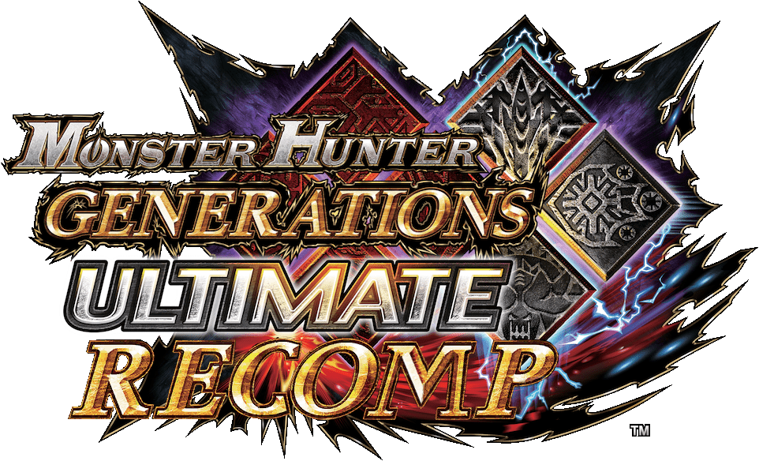

<p align="center"></p>

<p align="center"><a href="README.md">English</a> · <b>Español</b></p>

<p align="center">
  <a href="https://github.com/morerokk/MHGURecomp/releases/latest"></a>
  <a href="https://github.com/morerokk/MHGURecomp/releases"></a>
  <a href="#requisitos"></a>
  <a href="LICENSE"></a>
  <a href="https://github.com/morerokk/MHGURecomp/stargazers"></a>
</p>

<p align="center">
  <a href="https://discord.gg/mdNPWfKBXf"></a>
  <a href="https://github.com/Oddity-git/MHGURecomp-mods"></a>
</p>

<p align="center">
  <a href="https://github.com/morerokk/MHGURecomp/releases/latest"><b>Descargar</b></a> ·
  <a href="#instalación">Instalar</a> ·
  <a href="#android">Android</a> ·
  <a href="#controles">Controles</a> ·
  <a href="#ajustes">Ajustes</a> ·
  <a href="#mods">Mods</a> ·
  <a href="#compilar-desde-el-código-fuente">Compilar</a>
</p>

# MHGU Recomp

Un port nativo para PC de **Monster Hunter Generations Ultimate** (Nintendo Switch, versión 1.4.0), hecho
recompilando de forma estática el código ARM de 32 bits del juego a C y ejecutándolo sobre un runtime propio. Los
servicios del sistema de la Switch y la API gráfica NVN están reimplementados en Windows, Linux y Android, con Vulkan
para el renderizado. No es un emulador.

> **No se incluyen archivos del juego.** Necesitas tu propia copia del juego, volcada desde tu propia Switch. Este
> proyecto no explica cómo volcarlo y no proporciona archivos del juego, claves ni enlaces a ellos.

**Estado: totalmente jugable**, en solitario y en multijugador. Puede que aún haya errores: si encuentras uno,
[abre un issue](https://github.com/morerokk/MHGURecomp/issues/new/choose) con tu `log.txt`.

> Esta es una traducción del [README en inglés](README.md). Si algo no coincide, el inglés es el que vale.

## Qué añade respecto a la versión de Switch

| Área | Qué obtienes |
| --- | --- |
| **Gráficos** | Resolución, resolución de render (supermuestreo), MSAA, FXAA, escalado FSR 3.1, VSync, mayor distancia de dibujado |
| **Pantallas** | Cualquier relación de aspecto panorámica (16:10, 16:9 y más ancha), con el HUD centrado o extendido hasta los bordes |
| **Tasa de fotogramas** | Un límite entre 30 y 240 fps, con correcciones para los fallos de velocidad que tienen los emuladores a fps altos |
| **Controles** | Casi cualquier mando (a través de SDL), y teclado y ratón con teclas reasignables |
| **Multijugador** | Salas en línea a través de un servidor alojado, públicas o con una clave de emparejamiento para amigos (menú "Local Wireless"); también LAN e IP directa |
| **Opciones multijugador** | Monstruos pequeños sincronizados entre jugadores, vida de los monstruos según el número de jugadores, misiones de la Aldea en la Sala, misiones Urgentes completadas para todos |
| **Comodidades** | Avanzar rápido las escenas que no se pueden saltar con A, un menú de ajustes de PC dentro del juego (F1 o `Plus`+`Minus`), Discord Rich Presence |
| **Mods y trucos** | Carpeta `mods` en la que basta con soltarlos, con orden de carga y detección de conflictos, plugins de Forge incluidos ([Mods](#mods)); archivos de trucos de Ryujinx / Atmosphère ([Trucos](#trucos)) |

## Requisitos

- SO: Windows 10/11 de 64 bits, o Linux de 64 bits con glibc 2.39 o más reciente. Se sabe que estas distribuciones de Linux funcionan (se necesita Vulkan):
    - Ubuntu 24.04
    - Linux Mint 22
    - Debian 13
    - SteamOS 3.7
    - Arch
    - Fedora 40
- CPU: cualquier CPU de 2014 o posterior (necesita AVX2)
- GPU: cualquier GPU de 2016 o posterior (necesita Vulkan 1.2), con al menos 1 GB de VRAM
- RAM: 4 GB
- Android (experimental): un dispositivo ARM de 64 bits con Android 10 o más reciente, Vulkan 1.1 y un mando. Consulta [Android](#android).
- Los archivos del juego de Monster Hunter Generations Ultimate, versión 1.4.0. Puedes extraerlos de tu Switch o de Ryujinx con los parches ya aplicados.
    - (Title ID `0100770008DD8000`; el build ID del ejecutable `main` empieza por `FB08F1D20FD1204F`)

## Instalación

[Descarga la última versión compilada desde la página de Releases. Asegúrate de descargar el ZIP correcto para tu plataforma.](https://github.com/morerokk/MHGURecomp/releases)

Necesitas las carpetas `exefs` y `romfs` de Monster Hunter Generations Ultimate 1.4.0. Si vienes de Ryujinx, haz clic derecho en el juego (con la actualización 1.4.0 aplicada) y extrae los archivos del juego con los parches ya aplicados.

Puede que puedas extraerlos con otra herramienta; solo asegúrate de extraer tanto los archivos del juego base como la actualización 1.4.0. Los archivos `exefs` y `romfs` de la actualización se copian encima de los del juego base. Comprueba que la primera subcarpeta se llama `nativeNX` (no `NativeNX`) y que los nombres conservan sus mayúsculas.

1. Extrae el zip de la versión donde quieras, por ejemplo en `C:\Games\MHGURecomp\`.
2. Pon las carpetas `exefs` y `romfs` del juego en la subcarpeta `data`. Debería quedar así:

   ```
   MHGURecomp\
     mhgurecomp.exe
     mhgugame.dll
     (otros archivos .dll)
     data\
       exefs\
         main
         main.npdm
         rtld
         sdk
         subsdk0
       romfs\
         nativeNX\
         (el resto del romfs del juego)
   ```

   `exefs` tiene que venir de la actualización 1.4.0, y `romfs` tiene que ser el romfs del juego base con los archivos
   de la actualización combinados encima. Deberías tener unos 35 500 archivos, 12,3 GB.
3. Inicia `mhgurecomp.exe`.

### Mantenerlo actualizado

Las versiones nuevas pueden salir bastante a menudo. Para actualizar automáticamente, inicia `mhgurecomp-updater.exe` (`mhgurecomp-updater` en Linux). El actualizador funciona con mando, así que puedes usarlo como acceso directo principal o añadirlo como juego que no es de Steam.

- El actualizador siempre compara con la última versión publicada en GitHub. A veces hay versiones preliminares (pre-releases); el actualizador no las ofrece porque podrían estar rotas.
- Al actualizar solo se reemplazan los archivos del recomp; todas las demás carpetas (`data`, `mods` y demás) se conservan.
- Puedes cambiar el comportamiento del actualizador en los ajustes.
- Si tienes algún problema, `updater.log` tiene más información.

### Dónde está cada cosa

| Qué | Dónde |
| --- | --- |
| Ajustes | `mhgurecomp.ini` (puedes borrarlo sin problema si quieres restablecer los ajustes) |
| Partida guardada | `%APPDATA%\MHGURecomp\save\` (Linux: `~/.local/share/MHGURecomp/save/`), o la carpeta elegida como Carpeta de la partida en el menú de ajustes (pestaña Opciones del menú, `SaveLocation` en `mhgurecomp.ini`) |
| Registro | `log.txt`; adjúntalo cuando abras un issue |
| Capturas de pantalla | `shots\` (pulsa F12) |
| Mods | `mods\`, una carpeta por mod (ver más abajo) |
| Módulos del motor | `engine_modules\` (ver más abajo) |
| Trucos | `cheats\`, archivos `.txt` con códigos de trucos (ver más abajo) |
| Caché de shaders | `cache\` |

Para importar tus partidas de la Switch, pon los archivos `system` y `system_backup` en `%APPDATA%\MHGURecomp\save\save_0\` (Linux: `~/.local/share/MHGURecomp/save/save_0/`).

### Android

**¡La versión de Android es experimental!** Necesitas:

- Un teléfono, tablet o dispositivo Android TV con un procesador ARM de 64 bits, Android 10 o más reciente, y un
  driver de GPU con Vulkan 1.1 (FSR necesita Vulkan 1.2). Cuenta con un dispositivo reciente de gama media o alta
  (Snapdragon 865 o mejor) con 6 GB de RAM o más; una NVIDIA Shield TV Pro 2019 (3 GB) también lo mueve, a 41-45 fps en
  una cacería.
- Un mando (Bluetooth o USB). No hay controles táctiles.
- Unos 13 GB libres para los archivos del juego (26 GB mientras la app los copia desde otra carpeta).

1. Descarga `Android-MHGURecomp.<versión>.apk` desde la
   [página de Releases](https://github.com/morerokk/MHGURecomp/releases) y ábrelo en el dispositivo. La primera vez,
   Android te pide que permitas instalar apps desde tu navegador o tu gestor de archivos.
2. Pon las carpetas `exefs` y `romfs` del juego en cualquier lugar del dispositivo (por ejemplo en `Download`, o en una
   tarjeta SD), las dos en la misma carpeta. Inicia **MHGU Recomp**: dirá que no encontró los archivos del juego y te
   ofrecerá **Import game files** (importar archivos del juego). Elige la carpeta que contiene `exefs` y `romfs`, y la
   app los copia a su propia carpeta (unos minutos). Después puedes borrar tu copia.

   ¿No hay espacio suficiente, o los archivos están en una unidad USB o tarjeta SD? Elige **Use where they are**
   (usarlos donde están): no se copia nada y el juego los lee desde esa carpeta, así que la unidad tiene que seguir
   conectada mientras juegas. Android te pide que permitas el "Acceso a todos los archivos" para la app. Con una unidad
   USB grande, el primer inicio puede tardar un par de minutos.
3. O cópialos desde un PC: inicia la app una vez (crea su carpeta), conecta el dispositivo al PC por USB y elige
   **Transferencia de archivos** en el dispositivo. En el PC, abre el almacenamiento del dispositivo, ve a
   `Android\data\io.github.morerokk.mhgurecomp\files\` y copia las carpetas `exefs` y `romfs` del juego en la carpeta
   `data` de ahí:

   ```
   Android/data/io.github.morerokk.mhgurecomp/files/
     data/
       exefs/
         main
         (main.npdm, rtld, sdk, subsdk0)
       romfs/
         nativeNX/
         (el resto del romfs del juego)
   ```

   Si el PC no muestra la carpeta `files` o `data`, reinicia el dispositivo y vuelve a conectarlo (o crea `data` tú
   mismo). El gestor de archivos del propio dispositivo no puede abrir `Android/data` desde Android 11, así que usa un
   PC. Con [adb](https://developer.android.com/tools/adb) también puedes enviarlos desde una terminal:
   `adb push exefs romfs /sdcard/Android/data/io.github.morerokk.mhgurecomp/files/data/`
4. Conecta tu mando e inicia el juego.

Todo está en esa carpeta `files`. Su contenido es el mismo que la carpeta del juego de la versión de PC:

| Qué | Dónde (en `Android/data/io.github.morerokk.mhgurecomp/files/`) |
| --- | --- |
| Archivos del juego | `data/exefs/`, `data/romfs/` |
| Partida guardada | `save/save_0/` |
| Ajustes | `mhgurecomp.ini` (o el menú de ajustes del juego: `Plus`+`Minus`) |
| Registro | `log.txt` |
| Mods, trucos | `mods/`, `cheats/` |
| Caché de shaders | `cache/` |

El menú de ajustes tiene una pestaña **Android** (la última) para lo que los gestores de archivos del dispositivo no
pueden hacer en `Android/data`:

- **Importar partida guardada:** elige los archivos `system` y `system_backup` desde cualquier lugar del dispositivo.
  La app los copia, guarda tu partida actual en `save/save_0.before-import-<fecha>` y se cierra; vuelve a iniciarla
  para jugar. (Por USB también puedes poner tú mismo los dos archivos en `save/save_0/`.)
- **Exportar partida guardada:** copia los dos archivos de la partida a una carpeta que elijas, como copia de
  seguridad o para llevarla a otro sitio.
- **Carpeta de la partida:** guarda la partida en una carpeta que elijas (la que contiene `save_0`), para que un
  programa de sincronización la mantenga igual entre dispositivos: elige la misma carpeta en cada uno. Android te
  pide que permitas el "Acceso a todos los archivos", ya que la app lee y escribe esa carpeta ella misma. Pulsa
  Guardar y vuelve a iniciar la app. Tu partida actual no se mueve: usa antes **Exportar partida guardada** para
  ponerla en la carpeta. **Usar la carpeta de la aplicación** vuelve a la opción predeterminada.
- **Carpeta de archivos del juego:** usa los archivos del juego donde están (el **Use where they are** del primer
  inicio), por ejemplo en una unidad USB o una tarjeta SD. Android te pide que permitas el "Acceso a todos los
  archivos". Pulsa Guardar y vuelve a iniciar la app. **Usar la carpeta de la aplicación** vuelve a la opción
  predeterminada.
- **Importar archivos del juego:** la misma importación del primer inicio (ver arriba), para reemplazar los archivos
  del juego. También sustituyen a cualquier Carpeta de archivos del juego que hubiera.
- **Importar mod (zip)** e **Importar mod (carpeta):** elige el `.zip` o la carpeta de un mod desde cualquier lugar
  del dispositivo, y la app lo pone en `mods/`. Antes comprueba la estructura: el juego encuentra los archivos de un
  mod en una carpeta `romfs`, `exefs` o `nativeNX` como mucho tres carpetas por debajo de la carpeta del mod. Si los
  archivos están más hondo (un zip con carpetas de más alrededor del mod), o los archivos de parches (`.pchtxt`,
  `.ips`) no están en una carpeta `exefs`, te lo dice y ofrece arreglarlo al importar (los archivos solo se mueven,
  nunca se modifican). Un zip sin ninguna de esas carpetas se marca como que no parece un mod, y aun así puedes
  importarlo. Cierra y vuelve a abrir la app para cargar el mod.

El contador de FPS tiene un **Indicador de batería** al lado (Gráficos y audio): desactivado, dentro del recuadro del
contador de FPS o en un recuadro propio.

En Android no hay Reiniciar en el menú (la app no puede volver a iniciarse sola): usa Salir del juego y ábrela de
nuevo. Desde la versión de PC, copia el contenido de `%APPDATA%\MHGURecomp\save\save_0\` (Linux:
`~/.local/share/MHGURecomp/save/save_0/`). Desde una Switch, usa los mismos archivos que usarías en PC. De vez en
cuando, copia `save/save_0/` a tu PC como copia de seguridad.

Las salas públicas por internet en Android se comparten solo con otros jugadores de Android. Para jugar con amigos en
PC, poned todos la misma clave de emparejamiento (menú de ajustes, En línea).

Para actualizar, instala el APK nuevo encima del antiguo: tus archivos del juego, partidas y ajustes se conservan.
**No lo desinstales antes.** Desinstalar borra toda la carpeta `files`, incluidos los archivos del juego y las
partidas. Android puede ofrecerte conservar los datos de la app; di que sí si piensas reinstalarla.

## Controles

Debería funcionar casi cualquier mando que exista, siempre que SDL lo admita. Si hay más de uno conectado (una Steam
Deck con un mando enchufado, por ejemplo), pulsa un botón en el que quieras usar. Si de verdad quieres intercambiar
los botones frontales en mandos que no son de Nintendo, abre el .ini y pon `FaceButtons = Label`, aunque recomiendo
instalar un mod que adapte los iconos de los botones.

También hay soporte para teclado y ratón, y ahora mismo es sorprendentemente usable. Teclas predeterminadas:

| Tecla | Botón de Switch |
| --- | --- |
| W A S D | stick izquierdo (mantén Shift izquierdo para caminar) |
| Ratón | cámara |
| Clic izquierdo / clic derecho | X / A |
| Espacio / R o clic central | B / Y |
| Rueda del ratón | barra de objetos: arriba = el objeto de la izquierda, abajo = el de la derecha (en una cacería no hace falta mantener L) |
| Q / E | L / R |
| Tab / T | ZL / ZR |
| Enter / Retroceso | Plus / Minus |
| Flechas | cruceta |
| Ctrl / Alt | clic del stick izquierdo / derecho |

Puedes cambiarlas en el menú de ajustes (F1), Controles, Asignación de teclas. Puedes asignar hasta 2 teclas a una
misma acción.

Escape, Insert, F1 y de F7 a F12 no se pueden asignar, porque las reserva el recomp.

A veces el juego pide escribir con el teclado, por ejemplo para poner nombre a tu cazador o renombrar sets de
objetos. Usa el teclado para escribir, `ENTER` para confirmar o `ESC` para cancelar. En las salas multijugador puedes
usar la tecla `/` para chatear libremente.

Otras teclas útiles:

- F1: menú de ajustes
- Alt+Enter o F11: cambia entre ventana y pantalla completa
- F7: cambia el MSAA
- F12: captura de pantalla

## Ajustes

El menú de ajustes se abre con F1 en el teclado, o con `Plus`+`Minus` (`Start`+`Select`) en el mando. El menú
también está en español: Opciones del menú > Idioma.

Todos los ajustes están también en `mhgurecomp.ini`, con un comentario encima de cada uno que lo explica (en inglés).
Detalles: [docs/SETTINGS_UI.md](docs/SETTINGS_UI.md).

<details>
<summary><b>Todos los ajustes, por sección de <code>mhgurecomp.ini</code></b></summary>

- `[Display]`: `Mode` (Borderless / Fullscreen / Windowed), `Resolution`, `RenderResolution` (la resolución 3D),
  `AspectRatio` (Auto sigue a la ventana: 16:10 y más ancho la llenan, más estrecho queda en 16:10 con barras), `FOV`
  (1.0 = el del juego), `UIAnchor` (Center mantiene el HUD en el 16:9 central en una pantalla ultrapanorámica, Edges
  lo extiende hacia los lados)
- `[Anti-aliasing]`: `MSAA` (Off / 2x / 4x / 8x), `FXAA` (On / Off), `FXAAMode` (Original / 3_11: FXAA 3.11 en lugar
  del FXAA de GU, texturas más nítidas; Original por defecto)
- `[Upscaler]`: `FSR` (Off / On, Off por defecto), `FSRQuality` (NativeAA / Quality / Balanced / Performance /
  UltraPerformance), `Sharpness`. FSR sustituye a MSAA y FXAA mientras está activado. Detalles: `docs/FSR-PORT.md`
- `[Graphics]`: `DrawDistance` (hasta qué distancia se dibuja a la gente en las aldeas y las Salas: 1 = la del juego,
  2 = el doble, 0.5 = la mitad, 0 = sin límite; hasta 10)
- `[Performance]`: `FPS` (de 30 a 240), `VSync` (On / Off; por encima de la frecuencia de tu monitor, desactiva
  VSync), `ShaderPrewarm` (On / Off: traduce todos los shaders del juego en segundo plano al iniciar, para que menos
  cosas se vean negras la primera vez que aparecen; el primer inicio tarda unos 20 s en ello, durante los logos, y la
  carpeta de caché necesita unos 340 MB). `pipelines.list`, junto al exe, lista las combinaciones de shaders que usan
  las zonas habituales; con el precalentamiento activado también se preparan en segundo plano, así que al entrar en
  esas zonas por primera vez ya no se ven superficies negras un momento. Solo se hizo con MSAA desactivado; el resto
  se sigue preparando la primera vez que hace falta. Cómo grabar más: [docs/PIPELINE_LIST.md](docs/PIPELINE_LIST.md).
  `LoadingIndicator` (On / Off: el recuadro "Cargando" de la esquina inferior derecha mientras el juego arranca y
  prepara sus shaders; solo en el ini, no en el menú de ajustes)
- `[Controls]`: `FaceButtons` (Position / Label), `MenuConfirm` (el botón de confirmar del menú de ajustes),
  `BackgroundInput` (On / Off: el mando sigue funcionando con la ventana del juego en segundo plano, por ejemplo con
  una wiki delante; On por defecto), `ComboInputWindow` (Lenient / Strict: cuánto espera el juego a un segundo botón
  en entradas como el X+A de la Cornamusa; Lenient, por defecto, lo mismo que a 30 fps con cualquier tasa de
  fotogramas; Strict, un número fijo de fotogramas, más corto cuanto más altos son los fps)
- `[Mouse]`: `MouseSensitivity` (1 = por defecto, de 0.1 a 10)
- `[Multiplayer]`: `Port`, `Join` (direcciones de anfitriones fuera de tu LAN), `Server` (servidor de salas por
  internet: vacío = el predeterminado, `Off` = ninguno, o `host[:puerto]`), `Key` (clave de emparejamiento: solo los
  jugadores con la misma clave ven las salas de los demás; vacío = públicas, en Android públicas solo entre jugadores
  de Android), `SyncSmallMonsters`, `ShareUrgentCredit` (On por defecto: una misión Urgente que publicó otra persona
  también cuenta para ti al completarla, si la tienes desbloqueada)
- `[Monster HP]`: factores de vida para 1 a 4 cazadores en las misiones de la Sala, y excepciones por misión (por
  defecto: todos 1, como el juego original)
- `[Village Quests]`: `VillageQuestsInHub` (On por defecto), `HubHP` (2.0 por defecto: las misiones de la Aldea
  publicadas en la Sala multiplican primero la vida de sus monstruos por este valor y luego por el factor de
  `[Monster HP]`)
- `[Discord]`: `RichPresence` (On por defecto: tu perfil de Discord muestra dónde estás, los monstruos que cazas y el
  mapa, y cuántos hay en tu sala o misión; Discord tiene que estar abierto en el mismo ordenador), `ShowHunter` (On
  por defecto: también el nombre de tu cazador, su RC y su tipo de arma)
- `[Bonus Content]`: `BonusContent` (On por defecto), ver más abajo
- `[Audio]`: `Volume` (de 0 a 100: todo el juego), `MuteInBackground` (On / Off, Off por defecto: sin sonido mientras
  la ventana del juego está en segundo plano)
- `[Application]`: `ConfirmExit` (preguntar antes de cerrar la ventana), y para el menú de ajustes `Language`
  (English / Spanish), `ButtonIcons` (Xbox / Switch / PlayStation), `Theme` (Hunter, el predeterminado / Gold / Blue:
  los colores del menú de ajustes) y `MenuScale` (del 50 al 200 por ciento), y `Updates` (Ask / Auto / Off: qué hace
  `mhgurecomp-updater`, ver "Mantenerlo actualizado"). Con el ratón, arrastra la parte de arriba del menú de ajustes
  (sus pestañas) para moverlo, y el agarre de la esquina inferior derecha para cambiar su tamaño; Opciones del menú >
  Acoplar menú lo devuelve a su sitio.

</details>

## Multijugador

Por LAN o una VLAN debería funcionar sin más. Verás automáticamente las salas que estén en tu misma red.

El juego viene además con mi propio servidor LDN preconfigurado (el software del servidor para alojar el tuyo está
incluido en este repositorio). Por defecto, esto te permite ver a otros jugadores y salas en línea usando la opción
"Local Wireless" del juego.

Si solo quieres jugar con amigos o grupos ya formados, pon una clave de emparejamiento en el menú F1. Quienes tengan
la misma clave solo se verán entre sí.

Consulta [server/README.md](server/README.md) si quieres alojar tu propio servidor LDN. Si no se puede conectar con el
servidor de salas, un aviso en la parte de arriba de la pantalla te lo dirá. Intento mantener el servidor LDN activo
24/7.

También puedes jugar en multijugador sin servidor LDN con tus amigos. El anfitrión tiene que abrir el puerto
correspondiente (39500 TCP/UDP por defecto), y todos los demás tienen que poner la IP del anfitrión en su archivo
.ini (`Join = xxx.xxx.xxx.xxx`).

Elige las opciones multijugador de "Local Wireless", ya que este port se hace pasar por una Switch cercana con conexión
inalámbrica. Las opciones en línea no están disponibles y no hacen falta.

### Juego cruzado con emuladores (experimental)

También puedes jugar con gente en Ryujinx / Ryubing, y en suyu, yuzu, Eden, Citron y los demás forks que conservaron
sus salas multijugador. Todavía es experimental: se ha probado con el software de servidor de los emuladores, pero aún
no en cacerías reales con jugadores reales de emuladores. Si algo falla, [abre un
issue](https://github.com/morerokk/MHGURecomp/issues/new/choose) con tu `log.txt`.

Antes de nada:
- El juego cruzado se configura en `mhgurecomp.ini`, en `[Multiplayer]`, no en el menú F1. Si tu .ini es de una versión
  anterior y aún no tiene los ajustes de abajo, añádelos tú.
- Todos necesitan la versión 1.4.0 del juego, también los jugadores de emuladores.
- Los extras de este port (sincronizar monstruos pequeños, escalar la vida) se desactivan en una sala con jugadores de
  emuladores: solo los jugadores de este port los entienden.

**La forma fácil: un jugador de este port lo aloja todo.** El anfitrión activa los servidores que vienen dentro del
juego:

```ini
RyuServe = On        ; para jugadores de Ryujinx / Ryubing (puerto TCP 30456)
RoomServe = On       ; para jugadores de suyu, yuzu, Eden, Citron... (puerto UDP 24872)
RoomPassword =       ; opcional: una contraseña para la sala multijugador
```

Solo funcionan mientras el juego local inalámbrico está abierto, así que el anfitrión crea una sala como siempre. Para
jugar por internet, el anfitrión abre esos puertos, o todos usan una VPN como Radmin. Después:
- **Los jugadores de Ryujinx** ponen como servidor LDN la dirección del anfitrión (puerto 30456) y buscan salas en
  Local Play.
- **Los jugadores de suyu / Eden / Citron** se conectan a una sala multijugador en la IP del anfitrión, puerto 24872
  (con la contraseña, si la hay).
- **Los demás jugadores de este port** ponen `RyuServers = <la dirección del anfitrión>`, para que la sala aparezca en
  su búsqueda de salas.

Con los dos servidores activos, los jugadores de Ryujinx y los de las salas multijugador juegan todos en la misma sala.

**Usar un servidor que ya existe:**
- `RyuServers = host[:puerto], ...`: servidores LDN de Ryujinx cuyas salas aparecen en la búsqueda de salas (puerto
  por defecto 30456).
- `RyuHost = host`: las salas que crees se hacen en ese servidor, para que los jugadores de Ryujinx que estén en él
  puedan entrar.
- `RoomServer = host[:puerto]` y `RoomHost = On`: lo mismo para una sala multijugador al estilo de suyu (puerto por
  defecto 24872). `RoomName` es tu nombre en ella, `RoomPassword` su contraseña.
- `RyuHost` y `RoomHost` a la vez crean una sola sala a la que pueden entrar tanto jugadores de Ryujinx como de salas
  multijugador.
- Por favor, no uses para esto el servidor LDN público de Ryujinx: es para usuarios de Ryujinx. Monta tu propio
  LdnServer de Ryujinx, o simplemente usa `RyuServe`.

**Conviene saber:**
- Para un grupo privado con jugadores de Ryujinx, pon en `RyuPassphrase` `Ryujinx-` seguido de exactamente 8 dígitos
  hexadecimales (por ejemplo `Ryujinx-1a2b3c4d`), y que los jugadores de Ryujinx pongan la misma. Cualquier otra cosa
  (también una errata) cuenta como sin contraseña, es decir, tu sala es **pública**. Ryujinx hace lo mismo.
- Las salas con jugadores de Ryujinx y de salas multijugador a la vez son las menos probadas. Si ahí pasa algo raro
  (jugadores que no se ven en una misión, por ejemplo), prueba con una sala solo de jugadores de Ryujinx o solo de
  salas multijugador.
- Si las cosas van raras después de que alguien saliera y volviera a entrar en una sala de juego cruzado, crea una sala
  nueva.

## Contenido extra

Por defecto, la subcarpeta `bonus` de las versiones contiene una partida con todo el contenido gratuito en línea
(misiones de evento, packs de objetos, felynes), que se copia a tu partida la segunda vez que se inicia el juego.

Si no lo quieres, pon `BonusContent = Off` o no incluyas una partida en la subcarpeta `bonus`. También puedes poner tu
propia partida si quieres. Ten en cuenta que este port no intentará copiar el contenido extra si ya existe.

## Mods

Para instalar un mod, pon su carpeta en `mods\`. Para desinstalarlo, quita la carpeta. Los mods se aplican sobre el
juego al iniciarlo.
- Los mods de romfs (archivos que reemplazan o añaden datos del juego) se buscan dentro de la carpeta del mod,
  incluida la estructura `atmosphere\contents\0100770008DD8000\romfs`.
- Cuando varios mods traen el mismo archivo del juego (como `resident_eng.arc`), solo se aplican las entradas que
  cada mod cambió respecto al juego, así que los mods que cambian archivos distintos dentro de él funcionan juntos. Si
  dos mods cambian la misma entrada, gana el que va después en el orden de carga, y el registro lo indica ("changes
  ..., which an earlier mod changed too"). Los mods se cargan en orden alfabético. Para elegir el orden, crea
  `mods\load_order.txt` con el nombre de una carpeta de mod por línea: entonces solo se cargan los mods de la lista,
  en ese orden. Los archivos combinados se guardan en `cache\arcmerge\`.
- La pestaña **Mods** del menú de ajustes hace esto sin editar archivos: lista las carpetas de mods, activa o
  desactiva cada una, las sube o las baja, y escribe `mods\load_order.txt` al pulsar Guardar (reinicia para
  aplicarlo; los mods que añadas después también se cargan, detrás de los de la lista, hasta que los desactives; un
  mod desactivado conserva su lugar en el orden). También compara los mods y lista los que cambian los mismos
  archivos del juego (y cuál de los dos se usa), y puede aplicar un orden sugerido, con los mods que cambian más
  archivos primero.
- Se aplican los parches de exefs (`.pchtxt`, `.ips` / IPS32), tanto a datos como a código. El código del juego está
  precompilado, así que una función que cambia un parche se ejecuta en un intérprete (algo más lento, solo esa
  función). Los módulos de código propios de un mod (`exefs\subsdk1`, etc., como en el
  [MH4U Port](https://github.com/Scrimas/MH4U-port-to-MHGU)) también se cargan y se ejecutan en el intérprete. El
  registro indica qué se parcheó y qué se cargó (líneas `[mods]`).
- Se cargan los plugins de Forge (`.nro` en `romfs\nativeNX\plugins\`). El cargador propio de Forge (el
  `exefs\subsdk9` que incluyen Forge y los mods con plugins de Forge) no hace falta y se ignora: el port ejecuta los
  plugins él mismo. El menú de Forge con los ajustes de los plugins se abre con Insert (o la tecla del `config.ini`
  de Forge, si un mod incluye los archivos de Forge, que también puede fijar `[log] level`) o, solo con mando, con
  **Abrir el menú de Forge** al final de la pestaña Mods de las opciones; usa el ratón, el teclado o el mando en él.
  Con mando, el botón que cancela en los menús del juego (cuando no queda nada que cancelar en la ventana de Forge) o
  Start + Back lo cierra. Mientras está abierto, el juego no recibe la entrada del mando. Las posiciones de las ventanas se
  guardan en `forge_imgui.ini`.
- No necesitas mods de resolución, de límite de FPS ni de conexión. Este port ya incluye esas funciones.

**Dónde conseguir mods:**

- [El repositorio MHGURecomp-Mods](https://github.com/Oddity-git/MHGURecomp-mods)
- [MHGU en GameBanana](https://gamebanana.com/mods/games/17088)

**Recursos para hacer mods:**
- [Wiki MHGU-Modding](https://github.com/RTHKKona/MHGU-Modding/wiki)
- [Forge de Fexty](https://github.com/Fexty12573/forge)

## Módulos del motor

Los módulos del motor (engine modules) son programas nativos que amplían el port, no el juego (por ejemplo, otro escalador).
No son mods ni plugins de Forge, y **se ejecutan con los mismos permisos que el juego, así que instala solo los que sean de
confianza**. No se carga nada si no lo pides: pon la carpeta del módulo en `engine_modules\` y añade el nombre de su carpeta en
una línea propia de `engine_modules\enabled.txt`. `log.txt` indica los que se han cargado. Detalles para quienes los programan:
[docs/ENGINE-MODULES.md](docs/ENGINE-MODULES.md).

## Trucos

Puedes configurar los trucos en el menú F1. También puedes configurarlos a mano poniendo archivos .txt en la
subcarpeta `cheats/`.

Todos los trucos empiezan activados, pero se pueden desactivar en el menú F1. Cualquier código de trucos para GU
debería funcionar, igual que en un emulador. Un archivo puede tener cualquier número de trucos, cada uno empezando con
su nombre entre corchetes:

```
[Skill points x2]
04000000 000DFAB4 E1A00080
```

- Activa o desactiva cada truco en el menú de ajustes (F1), en la pestaña Trucos. Se aplica en cuanto pulsas Guardar.
- Para desactivar un archivo sin borrarlo, haz que su nombre empiece por `_`.
- Los trucos que cambian el código del juego también funcionan, pero por cada uno que uses puede que notes una
  pérdida de rendimiento *muy* pequeña. Para la gran mayoría de códigos no importará.
- `log.txt` lista los trucos que cargó, y los que no pudo leer.
- Hay algunos trucos de ejemplo en `extras\cheats\`. [Para más, mira la página de códigos de trucos de la wiki MHGU Modding.](https://github.com/RTHKKona/MHGU-Modding/wiki/Cheat-Codes)
    - El truco Valor Sheathe de este repositorio no hace nada si no tienes instalado MHGU Rebalanced.
- **Por favor**, avisa a los demás jugadores en multijugador si usas trucos, y cuáles. Sé amable.

## Compilar desde el código fuente

La compilación recompila el código del juego a partir de tu propia copia. Nada en este repositorio contiene código ni
datos del juego, así que primero necesitas los archivos del juego extraídos (ver arriba).

### 1. Herramientas (Windows)

1. Instala [MSYS2](https://www.msys2.org/) en `C:\msys64`.
2. En la terminal **MSYS2 UCRT64**, instala el compilador y las bibliotecas:

   ```bash
   pacman -S --needed make git diffutils \
     mingw-w64-ucrt-x86_64-clang mingw-w64-ucrt-x86_64-lld mingw-w64-ucrt-x86_64-pkgconf \
     mingw-w64-ucrt-x86_64-sdl3 mingw-w64-ucrt-x86_64-shaderc mingw-w64-ucrt-x86_64-nasm \
     mingw-w64-ucrt-x86_64-vulkan-headers mingw-w64-ucrt-x86_64-vulkan-loader \
     mingw-w64-ucrt-x86_64-vulkan-memory-allocator
   ```

   FFmpeg (para los vídeos del juego) no se instala: la primera compilación descarga su código fuente y compila dentro
   del ejecutable la pequeña parte que necesitan los vídeos (ver "FFmpeg" más abajo).

3. Instala [Python](https://www.python.org/) 3.10 o más reciente para Windows. Después, en un Símbolo del sistema en
   la carpeta del repositorio, crea el entorno virtual de las herramientas (el Makefile usa `tools\venv` si existe):

   ```bat
   py -3 -m venv tools\venv
   tools\venv\Scripts\pip install -r tools\requirements.txt
   ```

### 2. Recompilar y compilar

Desde la terminal UCRT64, en la carpeta del repositorio, con tus archivos del juego en una carpeta que contenga
`exefs\` y `romfs\` (como en [Instalación](#instalación)):

```bash
make gen GAME=/c/path/to/game      # traduce el código del juego a C en generated/ (~300 MB)
make -j4 GAME=/c/path/to/game      # compila todo en build/
```

La primera compilación completa tarda un rato (unos 8 minutos en un Haswell de 4 núcleos con `-j4`; con más núcleos,
un `-j` más alto). Las siguientes solo recompilan lo que cambió.

`make` convierte `build\` en una carpeta del juego lista para jugar, y no pone nada más ahí (los archivos propios del
compilador van a `obj\`):
- `mhgurecomp.exe`, el runtime;
- `mhgugame.dll`, el código del juego recompilado;
- las DLL de MSYS2 que necesitan;
- `data\exefs` y `data\romfs`, enlaces duros a tus archivos del juego, así que no ocupan espacio extra.

Para jugar desde otra carpeta, copia ahí el contenido de `build\`; para actualizar esa carpeta, cópialo encima (puedes
saltarte `data\` si ya está). La compilación nunca contiene ajustes, cachés, mods ni registros, así que tu
`mhgurecomp.ini` y lo demás se quedan como están. O inicia `run-game.bat`: ejecuta `build\mhgurecomp.exe` con los
ajustes, cachés, `mods\` y `log.txt` en `run\` (`MHGU_HOME`), manteniendo `build\` limpio. Iniciar
`build\mhgurecomp.exe` directamente también funciona, pero entonces escribe todo eso en `build\`.

Objetivos y opciones útiles:

- `make test-lift`: comprueba el recompilador contra el emulador de CPU Unicorn con miles de instrucciones del juego.
- `make clean`: borra los archivos compilados (`obj\` y los programas de `build\`). Conserva `build\data`.
- `GENARCH=-march=x86-64-v2`: compila el código del juego sin AVX2, para CPU más antiguas. Sin probar.
- `FFMPEG=system`: enlaza las bibliotecas de FFmpeg del sistema en lugar de compilarlas (ver más abajo).
- Linux: `SDL3=system`, `SHADERC=system`: enlaza el SDL3 / shaderc del sistema en lugar de compilarlos (ver Linux).

### FFmpeg

Los vídeos del juego son archivos MP4 con vídeo H.264 y audio AAC. La primera compilación descarga el código fuente de
FFmpeg (`third_party/ffmpeg/`, una versión fijada y comprobada con su SHA-256), compila en `obj/` solo el lector de
MP4 y esos dos decodificadores, y los enlaza dentro del ejecutable. No hace falta instalar ni distribuir nada de
FFmpeg, y la versión de Linux funciona en cualquier distribución, tenga la versión de FFmpeg que tenga (o ninguna).
Para esto hace falta `curl` y, para el código x86 rápido de FFmpeg, `nasm` (sin él, FFmpeg usa C normal, que es
suficientemente rápido para estos vídeos). Tarda unos minutos, una sola vez. FFmpeg es LGPL 2.1; su licencia va a
`build/licenses/`.

`make FFMPEG=system` enlaza en su lugar las avformat / avcodec / avutil del sistema (FFmpeg 5.1 o más reciente), como
haría un paquete de una distribución; esa compilación solo funciona entonces con esa versión de FFmpeg.

### Publicar una versión

<details>
<summary>Para mantenedores: compilar y publicar una versión</summary>

`make dist VERSION=<la etiqueta de la versión>` compila todo con esa versión y lo empaqueta para GitHub:

```bash
git fetch --tags                          # (para que las compilaciones entre versiones conozcan la última)
make dist VERSION=0.10.4 BONUS=<ruta al archivo system de la partida extra>
```

En Windows eso escribe `dist\Windows-MHGURecomp.0.10.4.zip`; en Linux (o en WSL, con `B=build-linux O=obj-linux`)
`dist/Linux-MHGURecomp.0.10.4.tar.gz`, que mantiene los programas ejecutables. Cada uno contiene una carpeta con
`mhgurecomp(.exe)`, `mhgugame.dll` / `.so`, `mhgurecomp-updater(.exe)`, las DLL incluidas, `licenses\`,
`bonus\system` (de `BONUS`, si no, vacío) y las carpetas vacías `data\`, `mods\` y `cheats\`; nunca nada del juego, ni
los ajustes, cachés o mods de la carpeta de compilación. `make dist` muestra el SHA-256 de cada archivo. Se detiene si
`tools/gen.py` u otras fuentes del traductor cambiaron desde el último `make gen`: ejecútalo antes.

En Windows, cuando el SDK de Android está instalado (ver [docs/research/android.md](docs/research/android.md)),
`make dist` escribe también `dist\Android-MHGURecomp.0.10.4.apk`: solo arm64, con `pipelines.list`, `licenses` y la
partida extra dentro, firmado con la clave de publicación. `ANDROID_DIST=` lo deja fuera. Android solo instala una
actualización firmada con la misma clave que la app instalada, así que todas las versiones necesitan esa clave:
`%USERPROFILE%\.android\mhgurecomp-release.keystore` y su contraseña en `mhgurecomp-release.keystore.pass` al lado.
Guarda copias de las dos y cópialas a cada PC que publique versiones. `make dist` se detiene si la clave no está; nunca
crea una nueva por sí solo. Una clave nueva obliga a los jugadores a desinstalar primero, y desinstalar borra sus
archivos del juego y sus partidas. (`make PLATFORM=android release-key` la creó una vez.)

Sube los archivos (y el APK) a una release de GitHub cuya etiqueta sea exactamente esa versión (`0.10.4`, sin `v`),
como release normal, no como pre-release. El actualizador solo mira la release "latest" de GitHub, compara su etiqueta
con su propia versión como números (0.10.10 es más nueva que 0.10.9) y elige el archivo que empieza por `Windows-`
(`.zip`) o `Linux-` (`.tar.gz`, si no, `.zip`; también `ArchLinux-`, el nombre hasta la 0.11.4). GitHub registra el
SHA-256 de cada subida, que el actualizador comprueba. Para retener una versión rota, conviértela en borrador o
pre-release: el actualizador verá entonces la anterior como la última.

La versión sale de `git describe --tags`. Una compilación que no es exactamente una etiqueta (`0.10.3-4-gabc1234`)
nunca se actualiza sola, así que una versión de desarrollo nunca se sustituye por una release (`--update-force` lo
anula). Opciones para probar el actualizador: `--update-no-launch` (no iniciar el juego después) y
`MHGU_UPDATE_API=<url>` (otra dirección de "latest release").

`make` llena `licenses\` con todo lo que una copia tiene que llevar: el `LICENSE.txt` de este proyecto,
`THIRD_PARTY_NOTICES.txt` (código compilado dentro), la licencia de FFmpeg y, en Windows, las licencias de los
paquetes de MSYS2 detrás de las DLL incluidas y de las bibliotecas enlazadas. `licenses\README.txt` las lista con sus
versiones y dónde está su código fuente exacto, e incluye una oferta escrita del código fuente de la DLL LGPL entre
ellas (libiconv, que usa SDL3): quien publica la versión hace esa oferta, así que ten esos códigos fuente a mano
durante tres años (la dirección de MSYS2 que indica es una copia).

El exe crea las carpetas `mods` y `cheats` y el ini en el primer inicio. Después, los jugadores añaden su propio
`data\` como se describe arriba.

</details>

### Linux

Las versiones incluyen una compilación nativa para Linux (la de Windows también funciona con Proton / Wine). El
Makefile elige `runtime/platform/linux.c` cuando `uname -s` no es Windows, y todo lo demás es compartido. Además de
`make`, `git`, `clang`, `lld` y Python 3.10 o más reciente, necesita:

- el cargador y las cabeceras de Vulkan, más `curl` y opcionalmente `nasm` para compilar FFmpeg (ver "FFmpeg" arriba;
  no hace falta el paquete de FFmpeg);
- `cmake` y los archivos de desarrollo de lo que usa SDL en un escritorio: X11 (con Xcursor, Xext, Xfixes, Xi,
  Xrandr, Xss, Xtst), Wayland (wayland-protocols, libxkbcommon, libdecor), PipeWire, PulseAudio, ALSA, libudev y
  D-Bus. Igual que con FFmpeg, la primera compilación descarga versiones fijadas de SDL3 y shaderc (con glslang y
  SPIRV-Tools) a `third_party/`, comprobadas con su SHA-256, y las enlaza de forma estática, así que el juego funciona
  en distribuciones que no tienen ninguna de las dos (Ubuntu 24.04 no tiene SDL3) y la versión publicada no necesita
  nada aparte de glibc, libstdc++ y el cargador de Vulkan. SDL sigue cargando X11 / Wayland y el servidor de audio del
  sistema al ejecutarse, y cuando el sistema tiene un SDL3 de la misma versión o más reciente (mandos nuevos,
  correcciones), el juego usa ese: `log.txt` dice cuál (`[ui] SDL ...`), y `MHGU_SDL=bundled` mantiene el incluido.
  Eso tarda unos minutos, una sola vez; la compilación se detiene si SDL no encontró alguno de ellos (`SDL3_NEED`).
  `make SDL3=system SHADERC=system` enlaza en su lugar el `libSDL3.so.0` / `libshaderc_shared.so.1` del sistema, como
  haría un paquete de una distribución;
- `vk_mem_alloc.h` (3.4.0) en `third_party/vk_mem_alloc/`, que el Makefile tiene en la ruta de inclusión (un paquete
  de la distribución que instale la cabecera donde el compilador busca por defecto sirve igual);
- `zenity` o `kdialog` para el diálogo de un error fatal. Sin ninguno de los dos, el mensaje va a la terminal y a
  `log.txt` como siempre;
- para el actualizador: las cabeceras de zlib para compilarlo, y `libcurl.so.4` (curl) al ejecutarlo, que tienen
  SteamOS y las distribuciones de escritorio habituales. Carga libcurl él mismo, así que sin él el actualizador
  simplemente inicia el juego.

```bash
python3 -m venv tools/venv && tools/venv/bin/pip install -r tools/requirements.txt
make gen GAME=../mhgu/game       # como arriba: la carpeta que contiene exefs/ y romfs/
make -j8 GAME=../mhgu/game
cd build && ./mhgurecomp
```

`build/` se convierte en la carpeta del juego igual que en Windows: `mhgurecomp`, `mhgugame.so` con el código del
juego recompilado y `data/` como enlaces duros a tus archivos del juego, nada más; el ini, las cachés y `mods/` se
escriben al lado al ejecutarlo (`MHGU_HOME=<carpeta>` los pone ahí en su lugar). Las partidas van a
`$XDG_DATA_HOME/MHGURecomp/save`, por defecto `~/.local/share/MHGURecomp/save`, el equivalente de la carpeta de
`%APPDATA%` de la versión de Windows, con la misma estructura, así que pasar una partida de uno a otro es copiar
`save_0`.

Desde Windows, la versión de Linux se puede compilar en WSL con Arch Linux (`wsl --install -d archlinux`),
directamente desde la copia del repositorio de Windows, en sus propias carpetas para no tocar la compilación de
Windows:

```bash
pacman -Syu --needed make git clang lld python cmake vulkan-headers vulkan-icd-loader nasm vulkan-swrast \
    libx11 libxcursor libxext libxfixes libxi libxrandr libxss libxtst wayland wayland-protocols libxkbcommon \
    libdecor pipewire libpulse alsa-lib systemd-libs dbus
mkdir -p /usr/local/include/vma && cp /mnt/c/msys64/ucrt64/include/vma/vk_mem_alloc.h /usr/local/include/vma/
make -j16 B=build-linux O=obj-linux     # en el repositorio, bajo /mnt/c/...
```

Arch no tiene paquete para `vk_mem_alloc.h`; el de MSYS2 (3.4.0) es el que usa la compilación de Windows.
`build-linux/data` puede contener enlaces a los archivos del juego (`ln -s /mnt/c/.../exefs build-linux/data/exefs`,
igual para `romfs`, y luego `touch build-linux/data/.complete`) en lugar de una segunda copia. También funciona ahí,
en una ventana de WSLg, lentamente: el driver Vulkan propio de WSL (dzn, Vulkan sobre Direct3D 12) no puede crear los
pipeline layouts del renderizador, así que usa el de software de Mesa con
`VK_DRIVER_FILES=/usr/share/vulkan/icd.d/lvp_icd.json`. WSLg no puede capturar el ratón (los clics siguen funcionando
como botones), y ahí las capturas de pantalla salen negras.

## Estructura del repositorio

| Carpeta | Qué contiene |
| --- | --- |
| `tools/` | el recompilador: `lifter.py` (ARM a C), `neon.py` (NEON / VFP), `gen.py` (módulos completos), `nso.py`, herramientas de prueba e investigación |
| `runtime/` | la parte del host: estado de la CPU, kernel e hilos, servicios de Switch (`services/`, `hle/`), red (`net/`), la API gráfica NVN sobre Vulkan (`nvn/`), ajustes, entrada, mods |
| `updater/` | `mhgurecomp-updater`: instala la última release de GitHub sobre la carpeta del juego y luego inicia el juego |
| `docs/` | `STATUS.md`: progreso, notas de diseño, hallazgos de ingeniería inversa, opciones de depuración |
| `android/` | la app de Android: manifiesto, actividades Java y la compilación del APK (`apk.mk`) |
| `server/` | el servidor de salas (LDN) para el multijugador en línea, ver [server/README.md](server/README.md) |
| `tests/` | pruebas que solo usan el host (ajustes, menú de ajustes, traducciones) y no necesitan archivos del juego |
| `third_party/` | código fuente fijado de las bibliotecas incluidas (SDL3, shaderc, FFmpeg, ImGui, FSR) |
| `extras/` | `cheats/`: archivos de trucos que los jugadores pueden copiar a su carpeta `cheats`; `pipelines.list` |

## Licencia

El código propio de MHGU Recomp está bajo la Licencia MIT (`LICENSE`). Se basa en código de LAS Recomp y Forge, e
incluye cimgui y Dear ImGui, el FidelityFX SDK de AMD (FSR 3.1) y FSR-Vulkan, todos también bajo la Licencia MIT: ver
`THIRD_PARTY_NOTICES`. La licencia no cubre el juego ni su código, incluido el código del juego recompilado que
produce una compilación (`mhgugame.dll` / `mhgugame.so`).

## Aviso legal

Este proyecto no está afiliado ni respaldado por Capcom ni Nintendo. Monster Hunter es una marca registrada de Capcom.
El repositorio no contiene código, datos ni claves del juego; la compilación los lee de una copia que proporcionas tú.
Apoya a los desarrolladores comprando el juego.
