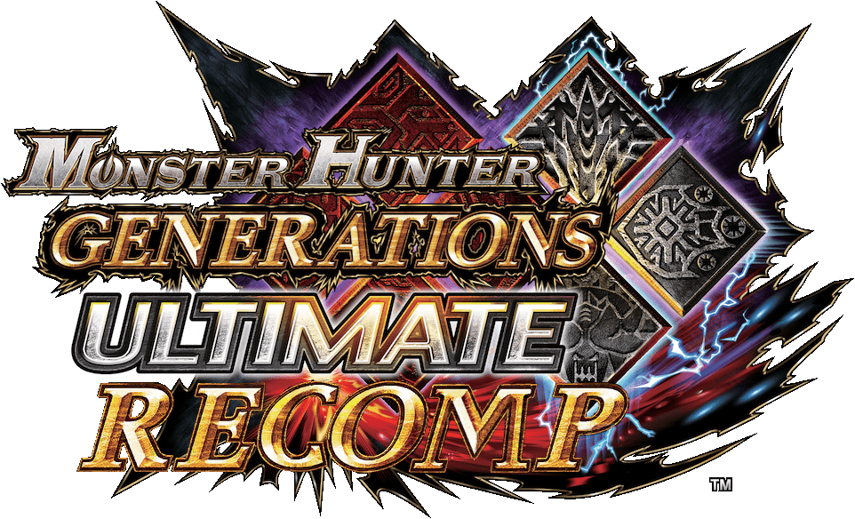

<p align="center"></p>

<p align="center"><a href="README.md">English</a> · <a href="README.es.md">Español</a> · <a href="README.zh-CN.md">简体中文</a> · <b>한국어</b></p>

<p align="center">
  <a href="https://github.com/morerokk/MHGURecomp/releases/latest"></a>
  <a href="https://github.com/morerokk/MHGURecomp/releases"></a>
  <a href="#요구-사항"></a>
  <a href="LICENSE"></a>
  <a href="https://github.com/morerokk/MHGURecomp/stargazers"></a>
</p>

<p align="center">
  <a href="https://discord.gg/mdNPWfKBXf"></a>
  <a href="https://github.com/Oddity-git/MHGURecomp-mods"></a>
</p>

<p align="center">
  <a href="https://github.com/morerokk/MHGURecomp/releases/latest"><b>다운로드</b></a> ·
  <a href="#설치">설치</a> ·
  <a href="#android">Android</a> ·
  <a href="#조작">조작</a> ·
  <a href="#설정">설정</a> ·
  <a href="#모드">모드</a> ·
  <a href="#소스에서-빌드하기">소스에서 빌드</a>
</p>

# MHGU Recomp

**Monster Hunter Generations Ultimate**(Nintendo Switch, 버전 1.4.0)의 네이티브 PC 포트입니다. 게임의 32비트 ARM 코드를
C로 정적 리컴파일하고, 이를 호스트 런타임 위에서 실행합니다. Switch 시스템 서비스와 NVN 그래픽 API를 Windows, Linux,
Android에서 다시 구현했으며, 렌더링에는 Vulkan을 사용합니다.

> **게임 파일은 포함되어 있지 않습니다.** 본인의 Switch에서 직접 덤프한 게임 사본이 필요합니다. 이 프로젝트는 덤프
> 방법을 설명하지 않으며, 게임 파일이나 키, 또는 그 링크를 제공하지 않습니다.

**상태: 완전히 플레이 가능**하며, 싱글플레이와 멀티플레이 모두 됩니다. 여기저기 버그가 있을 수 있으니, 버그를 발견하면 `log.txt`를 첨부해 [이슈를 등록](https://github.com/morerokk/MHGURecomp/issues/new/choose)해 주세요.

> 이 문서는 [영어 README](README.md)의 번역본입니다. 내용이 서로 다르면 영어 원문이 우선합니다.

## Switch 버전 대비 추가된 기능

| 분야 | 추가된 내용 |
| --- | --- |
| **그래픽** | 해상도, 렌더 해상도(슈퍼샘플링), MSAA, FXAA, FSR 3.1 업스케일링, HDR 출력, VSync, 더 먼 렌더 거리 |
| **화면** | 모든 와이드스크린 화면 비율(16:10, 16:9 또는 그보다 넓은 비율) 지원, 울트라와이드용 HUD 조정 옵션 |
| **프레임 레이트** | 30~240fps 사이의 원하는 프레임 레이트. 에뮬레이터에서 높은 프레임 레이트로 GU를 실행할 때 흔히 생기는 버그도 수정했습니다 |
| **조작** | 거의 모든 컨트롤러 지원(SDL), 네이티브 키보드+마우스 지원 |
| **멀티플레이** | "Local Wireless"(로컬 통신) 기능을 통한 온라인 플레이. 온라인 서버가 미리 설정되어 있지만, 직접 서버를 호스팅하거나 39500 포트를 포워딩해 친구와 직접 연결할 수도 있습니다. |
| **멀티플레이 옵션** | 플레이어 간 소형 몬스터 동기화, 플레이어 수에 따른 몬스터 체력 배율(선택), 멀티플레이 집회소에서 마을 퀘스트 플레이, 긴급 퀘스트 클리어를 모두에게 인정 |
| **편의 기능** | 건너뛸 수 없는 컷신을 A로 빨리 감기, 게임 내 PC 설정 메뉴(F1 또는 `Plus`+`Minus`), Discord Rich Presence |
| **랙 보정** | 최신 세대 몬스터 헌터 게임과 비슷한 네트워크 수정 및 개선된 넷코드 |
| **모드** | 에뮬레이터에서 작동하는 거의 모든 모드가 여기서도 작동합니다. Forge 플러그인도 네이티브로 지원합니다([모드](#모드))! |
| **치트 코드** | 에뮬레이터용 치트 코드도 거의 모두 작동합니다. ([치트](#치트)) 참고. |

**AMD FSR 4를 지원하려면 이 모듈을 사용하세요: https://github.com/Huss3A/mhgurecomp-fsr4-module**

## 요구 사항

- OS: Windows 10/11 64비트, 또는 glibc 2.39 이상의 64비트 Linux. 다음 Linux 배포판에서 작동이 확인되었습니다(Vulkan 지원 필요):
    - Ubuntu 24.04
    - Linux Mint 22
    - Debian 13
    - SteamOS 3.7
    - Arch
    - Fedora 40
- CPU: 2014년 이후 출시된 CPU(AVX2 지원 필요)
- GPU: 2016년 이후 출시된 GPU(Vulkan 1.2 지원 필요), VRAM 1GB 이상
- RAM: 4GB
- Android(실험적): Android 10 이상, Vulkan 1.1을 지원하는 64비트 ARM 기기와 컨트롤러. [Android](#android) 참고.
- Monster Hunter Generations Ultimate 버전 1.4.0의 게임 파일. Switch나 Ryujinx에서 패치가 적용된 상태로 추출할 수 있습니다.
    - (타이틀 ID `0100770008DD8000`, `main` 실행 파일의 빌드 ID가 `FB08F1D20FD1204F`로 시작)
 
**Mac OSX 지원은 mhvuze의 포크를 확인하세요! https://github.com/mhvuze/MHGURecomp/releases**

## 설치

[Releases 페이지에서 미리 빌드된 최신 릴리스를 다운로드하세요. 사용할 플랫폼에 맞는 ZIP 파일을 받았는지 꼭 확인하세요.](https://github.com/morerokk/MHGURecomp/releases)

Monster Hunter Generations Ultimate 1.4.0의 `exefs`와 `romfs` 폴더가 필요합니다. Ryujinx를 쓰고 있었다면 게임을 우클릭해(1.4.0 타이틀 업데이트가 적용되어 있는지 확인하세요) 패치가 적용된 상태로 게임 파일을 추출(Extract)할 수 있습니다. Yuzu에도 비슷한 기능이 있으며, 다른 도구로 게임 파일을 추출해도 됩니다.

다른 도구로 파일을 추출할 수도 있지만, 기본 게임 파일과 1.4.0 타이틀 업데이트를 모두 추출해야 합니다. 타이틀 업데이트의 `exefs`와 `romfs` 파일은 기본 게임 파일 위에 덮어써야 합니다.

1. 릴리스 zip을 원하는 곳에 압축 해제하세요. 예: `C:\Games\MHGURecomp\`.
2. 게임의 `exefs`와 `romfs` 폴더를 `data` 하위 폴더에 넣으세요. 다음과 같은 구조가 되어야 합니다:

   ```
   MHGURecomp\
     mhgurecomp.exe
     mhgugame.dll
     (기타 .dll 파일)
     data\
       exefs\
         main
         main.npdm
         rtld
         sdk
         subsdk0
       romfs\
         nativeNX\
         (나머지 게임 romfs)
   ```

   `exefs`는 1.4.0 업데이트의 것이어야 하고, `romfs`는 기본 게임의 romfs 위에 업데이트 파일을 합친 것이어야
   합니다. 파일은 약 35,500개, 12.3GB 정도입니다.
3. `mhgurecomp.exe`를 실행하세요.

### 최신 버전 유지

릴리스는 꽤 자주 나올 수 있습니다. 자동으로 업데이트하려면 `mhgurecomp-updater.exe`(Linux에서는 `mhgurecomp-updater`)를 실행하세요. 업데이터는 컨트롤러를 지원하므로 기본 바로 가기로 쓰거나 비 Steam 게임으로 추가해도 괜찮습니다.

- 업데이터는 항상 GitHub의 최신 릴리스를 확인합니다. 가끔 프리릴리스가 올라오기도 하지만, 문제가 있을 수 있으므로 자동 업데이터는 이를 제공하지 않습니다.
- 업데이트할 때는 리컴프 파일만 교체되며, 다른 모든 폴더(`data`, `mods` 등 포함)는 그대로 유지됩니다.
- 자동 업데이터의 동작은 설정에서 바꿀 수 있습니다.
- 문제가 생기면 `updater.log`에서 자세한 정보를 확인할 수 있습니다.

### 파일 위치

| 항목 | 위치 |
| --- | --- |
| 설정 | `mhgurecomp.ini` (설정을 초기화해야 할 때는 삭제해도 됩니다) |
| 세이브 데이터 | `%APPDATA%\MHGURecomp\save\` (Linux: `~/.local/share/MHGURecomp/save/`), 또는 설정 메뉴에서 세이브 폴더(Save folder)로 지정한 폴더(메뉴 옵션 탭, `mhgurecomp.ini`의 `SaveLocation`) |
| 로그 | `log.txt`. 이슈를 등록할 때 이 파일을 첨부해 주세요 |
| 스크린샷 | `shots\` (F12 키) |
| 모드 | `mods\` 모드마다 폴더 하나(아래 참고) |
| 엔진 모듈 | `engine_modules\` (아래 참고) |
| 치트 | `cheats\` 치트 코드가 담긴 `.txt` 파일(아래 참고) |
| 셰이더 캐시 | `cache\` |

Switch의 기존 세이브를 가져오려면 `system`과 `system_backup` 파일을 `%APPDATA%\MHGURecomp\save\save_0\`(Linux: `~/.local/share/MHGURecomp/save/save_0/`)에 넣으세요.

### Android

**Android 버전은 실험적입니다!** 다음이 필요합니다:

- 64비트 ARM 프로세서, Android 10 이상, Vulkan 1.1을 지원하는 GPU 드라이버(FSR은 Vulkan 1.2 필요)를 갖춘 휴대폰,
  태블릿 또는 Android TV 기기. 최근 출시된 중급 이상 기기(Snapdragon 865 이상)와 6GB 이상의 RAM을 기준으로 생각하세요.
  NVIDIA Shield TV Pro 2019(3GB)에서도 실행되며, 수렵 중 41~45fps가 나옵니다.
- 컨트롤러(블루투스 또는 USB). 터치 조작은 없습니다.
- 게임 파일을 위한 약 13GB의 여유 공간(앱이 다른 폴더에서 파일을 복사해 오는 동안에는 26GB).

1. [Releases 페이지](https://github.com/morerokk/MHGURecomp/releases)에서 `Android-MHGURecomp.<버전>.apk`를
   다운로드해 기기에서 여세요. 처음에는 Android가 브라우저나 파일 관리자에서 앱을 설치하도록 허용할지
   묻습니다.
2. 게임의 `exefs`와 `romfs` 폴더를 기기의 아무 곳(예: `Download` 폴더나 SD 카드)에 한 폴더 안에 함께 넣으세요.
   **MHGU Recomp**를 실행하면 게임 파일을 찾을 수 없다는 메시지와 함께 **Import game files**(게임 파일 가져오기)를 제안합니다.
   `exefs`와 `romfs`가 들어 있는 폴더를 선택하면 앱이 자체 폴더로 복사합니다(몇 분 걸립니다). 복사가 끝나면
   원본은 삭제해도 됩니다.

   공간이 부족하거나 파일이 USB 드라이브나 SD 카드에 있나요? 그럴 때는 대신 **Use where they are**(있는 위치에서 사용)를
   선택하세요. 아무것도 복사하지 않고 게임이 그 폴더에서 파일을 읽으므로, 플레이하는 동안 드라이브가 연결되어 있어야
   합니다. Android가 앱에 "모든 파일 액세스"를 허용할지 묻습니다. 용량이 큰 USB 드라이브라면 첫 실행에 몇 분 걸릴 수 있습니다.
3. 또는 PC에서 복사할 수도 있습니다. 앱을 한 번 실행하고(앱 폴더가 만들어집니다), 기기를 USB로 PC에 연결한 뒤
   기기에서 **파일 전송**을 선택하세요. PC에서 기기 저장소를 열고 `Android\data\io.github.morerokk.mhgurecomp\files\`로 이동해 게임의 `exefs`와 `romfs` 폴더를
   그 안의 `data` 폴더에 복사하세요:

   ```
   Android/data/io.github.morerokk.mhgurecomp/files/
     data/
       exefs/
         main
         (main.npdm, rtld, sdk, subsdk0)
       romfs/
         nativeNX/
         (나머지 게임 romfs)
   ```

   PC에 `files`나 `data` 폴더가 보이지 않으면 기기를 재시작한 뒤 다시 연결하세요(또는 `data` 폴더를 직접
   만드세요). Android 11 이상에서는 기기 자체 파일 관리자로 `Android/data`를 열 수 없으므로 PC를 사용하세요.
   [adb](https://developer.android.com/tools/adb)가 있다면 터미널에서 푸시할 수도 있습니다:
   `adb push exefs romfs /sdcard/Android/data/io.github.morerokk.mhgurecomp/files/data/`
4. 컨트롤러를 연결하고 게임을 시작하세요.

모든 파일은 이 `files` 폴더에 있습니다. 구성은 PC 버전의 게임 폴더와 같습니다:

| 항목 | 위치(`Android/data/io.github.morerokk.mhgurecomp/files/` 안) |
| --- | --- |
| 게임 파일 | `data/exefs/`, `data/romfs/` |
| 세이브 데이터 | `save/save_0/` |
| 설정 | `mhgurecomp.ini` (또는 게임 내 설정 메뉴: `Plus`+`Minus`) |
| 로그 | `log.txt` |
| 모드, 치트 | `mods/`, `cheats/` |
| 셰이더 캐시 | `cache/` |

설정 메뉴에는 기기의 파일 관리자가 `Android/data`에서 할 수 없는 일을 위한 **Android** 탭(마지막 탭)이
있습니다:

- **파일 폴더**(Files folder): 앱의 파일(설정, 세이브, 모드, 치트, 스크린샷, `log.txt`, `env.txt`)을 `Android/data` 대신
  직접 고른 폴더에 보관해, 기기 자체 파일 관리자로 열 수 있게 합니다. 앱이 파일을 그곳으로 복사하고
  (그곳에 없는 파일은 복사합니다. 예를 들어 다른 곳에서 플레이한 뒤의 세이브처럼 그곳의 파일이 앱의 파일보다 오래되었다면 바꿀지 묻고,
  바뀐 파일은 `.bak`으로 남겨 둡니다. 게임 파일은 복사하지 않고 있는 위치 그대로 사용하며, 셰이더 캐시도 복사하지 않고 새로
  만듭니다) 종료됩니다. 다시 실행하세요. Android가 "모든 파일 액세스"를 허용할지 묻습니다. **앱 폴더 사용**(Use the app's folder)은
  파일을 다시 앱 폴더로 복사해 오며, 어느 쪽이든 진행 상황 대화 상자가 표시됩니다. 첫 실행 때도 앱이 한 번 묻습니다(재설치한 뒤에도
  묻습니다. 재설치하면 폴더 설정을 잊으므로, 다시 선택하면 그 안에 있는 내용을 사용합니다. 앱 자체 폴더에 남아 있던 게임 파일은 제거할 때
  삭제되므로 다시 가져와야 합니다). 실행할 때 선택한 폴더를 쓸 수 없으면("모든 파일 액세스"가 꺼졌거나,
  폴더가 이동·삭제되었거나, 드라이브가 없어진 경우) 앱이 이를 알리고, 폴더를 다시 선택하거나 이번에만 앱 자체 폴더를 사용하도록
  제안합니다. 그 뒤 **앱 폴더 사용**을 누르면 그 폴더 설정을 완전히 잊습니다.
- **세이브 가져오기**: 기기 어디에서든 `system`과 `system_backup` 파일을 선택하세요. 앱이 파일을 복사해 오면서
  현재 세이브는 `save/save_0.before-import-<날짜>`에 보관하고 종료됩니다. 다시 실행해 플레이하세요. (USB로 연결했다면
  두 파일을 직접 `save/save_0/`에 넣어도 됩니다.)
- **세이브 내보내기**: 세이브의 두 파일을 선택한 폴더로 복사합니다. 백업하거나 다른 곳으로 옮길 때 쓰세요.
- **세이브 폴더**: 세이브를 선택한 폴더(`save_0`이 들어 있는 폴더)에 보관해, 파일 동기화 소프트웨어로
  여러 기기의 세이브를 똑같이 맞출 수 있게 합니다. 각 기기에서 같은 폴더를 선택하세요. 앱이 그 폴더를 직접 읽고 쓰므로
  Android가 "모든 파일 액세스"를 허용할지 묻습니다. 저장을 누르고 앱을 다시 실행하세요. 현재 세이브는 옮겨지지 않으니,
  먼저 **세이브 내보내기**로 그 폴더에 넣으세요. **앱 폴더 사용**을 누르면 기본값으로 돌아갑니다.
- **게임 파일 폴더**: 게임 파일을 있는 위치 그대로 사용합니다(첫 실행 때의 **Use where they are**와 같습니다). 예를 들어
  USB 드라이브나 SD 카드에 있는 파일을 쓸 수 있습니다. Android가 "모든 파일 액세스"를 허용할지 묻습니다. 저장을 누르고 앱을 다시 실행하세요.
  **앱 폴더 사용**을 누르면 기본값으로 돌아갑니다.
- **게임 파일 가져오기**: 첫 실행 때와 같은 가져오기(위 참고)로, 게임 파일을 교체할 때 씁니다. 가져온 파일은
  설정된 게임 파일 폴더도 대신합니다.
- **모드 가져오기 (zip)** 및 **모드 가져오기 (폴더)**: 기기 어디에서든 모드의 `.zip`이나 폴더를 선택하면
  앱이 `mods/`에 넣습니다. 먼저 구조를 확인합니다. 게임은 모드 폴더 안에서 최대 세 단계 아래에 있는 `romfs`, `exefs`, `nativeNX`
  폴더에서 모드 파일을 찾습니다. 파일이 그보다 깊이 묻혀 있거나(모드를 여러 폴더로 감싼 zip), 패치 파일(`.pchtxt`, `.ips`)이
  `exefs` 폴더에 없으면 이를 알리고 가져오면서 고쳐 주겠다고 제안합니다(파일은 옮기기만 하고 내용은 절대 바꾸지 않습니다). 이런 폴더가
  하나도 없는 zip은 모드가 아닌 것 같다고 표시되지만, 그래도 가져올 수 있습니다. 모드를 불러오려면 앱을 닫았다가 다시 여세요.

FPS 표시 옆에는 **배터리 표시**(그래픽 및 오디오 탭)가 있습니다. 끄거나, FPS 표시 상자 안에 넣거나, 별도의 상자에
표시할 수 있습니다.

Android에서는 메뉴에 재시작이 없습니다(앱이 스스로 다시 시작할 수 없습니다). 게임 종료를 누른 뒤 다시 여세요. PC 버전에서 옮겨 올 때는
`%APPDATA%\MHGURecomp\save\save_0\`(Linux: `~/.local/share/MHGURecomp/save/save_0/`)의 내용을 복사하세요. Switch에서 옮겨 올 때는
PC와 같은 파일을 사용하면 됩니다. 백업을 위해 가끔 `save/save_0/`을 PC로 복사해 두세요.

Android의 공개 인터넷 집회소는 다른 Android 플레이어끼리만 공유됩니다. PC의 친구와 함께 플레이하려면 모두
같은 매치메이킹 키를 입력하세요(설정 메뉴의 네트워크 탭).

업데이트하려면 새 APK를 기존 앱 위에 설치하세요. 게임 파일, 세이브, 설정은 그대로 유지됩니다. **먼저 제거하지
마세요.** 제거하면 게임 파일과 세이브를 포함한 `files` 폴더 전체가 삭제됩니다. Android가 앱 데이터를 남겨 둘지 물어볼 수
있는데, 다시 설치할 생각이라면 예를 선택하세요.

## 조작

SDL을 지원하기만 하면 세상의 거의 모든 컨트롤러가 작동할 겁니다. 두 대 이상 연결되어 있다면(예: 컨트롤러를 꽂은 Steam Deck) 사용하려는 컨트롤러의 버튼을 누르세요. Nintendo가 아닌 컨트롤러에서 페이스 버튼을 꼭 바꾸고 싶다면 .ini 파일을 열어 `FaceButtons = Label`로 설정하세요. 다만 그보다는 버튼 안내를 컨트롤러에 맞춰 주는 모드를 설치하는 것을 추천합니다.

키보드와 마우스도 지원하며, 지금도 의외로 꽤 쓸 만합니다. 기본 키 설정:

| 키 | Switch 버튼 |
| --- | --- |
| W A S D | 왼쪽 스틱(왼쪽 Shift를 누르고 있으면 걷기) |
| 마우스 | 카메라 |
| 왼쪽 클릭 / 오른쪽 클릭 | X / A |
| Space / R 또는 가운데 클릭 | B / Y |
| 마우스 휠 | 아이템 바: 위 = 왼쪽 아이템, 아래 = 오른쪽 아이템(수렵 중에는 L을 누를 필요 없음) |
| Q / E | L / R |
| Tab / T | ZL / ZR |
| Enter / Backspace | Plus / Minus |
| 방향키 | 방향 버튼 |
| Ctrl / Alt | 왼쪽 / 오른쪽 스틱 누르기 |

설정 메뉴(F1)의 조작 > 키 설정에서 바꿀 수 있습니다. 한 동작에 키를 최대 2개까지 지정할 수 있습니다.

Escape, Insert, F1, F7~F12는 리컴프가 사용하므로 지정할 수 없습니다.

헌터 이름을 정하거나 아이템 세트 이름을 바꿀 때처럼 게임이 키보드 입력을 요구할 때가 있습니다. 키보드로 텍스트를 입력하고, `ENTER`로 확인하거나 `ESC`로 취소하세요. 멀티플레이 로비에서는 `/` 키로 자유 채팅을 할 수 있습니다.

그 밖의 유용한 키:

- F1: 설정 메뉴
- Alt+Enter 또는 F11: 창 모드와 전체 화면 전환
- F7: MSAA 모드 순환
- F12: 스크린샷

## 설정

키보드에서는 F1, 컨트롤러에서는 `Plus`+`Minus`(`Start`+`Select`)로 설정 메뉴를 열 수 있습니다.

모든 설정은 `mhgurecomp.ini`에도 있으며, 각 설정 위에 설명 주석이 달려 있습니다. 자세한 내용:
[docs/SETTINGS_UI.md](docs/SETTINGS_UI.md).

<details>
<summary><b><code>mhgurecomp.ini</code> 섹션별 전체 설정</b></summary>


- `[Display]`: `Mode` (Borderless / Fullscreen / Windowed), `Resolution`, `RenderResolution`(3D 해상도),
  `AspectRatio`(Auto는 창을 따릅니다. 16:10 이상으로 넓으면 창을 채우고, 그보다 좁으면 16:10에 검은 띠가 생깁니다), `FOV`
  (1.0 = 게임 기본값), `UIAnchor`(Center는 울트라와이드 화면에서 HUD를 가운데 16:9 영역에 두고, Edges는 양옆
  가장자리로 펼칩니다). 창은 게임을 마지막으로 닫았을 때의 위치와 크기(`Resolution`을 바꾸기 전까지)로 같은 모니터에서 열리며(전체 화면도 마찬가지), F11 / Alt+Enter로 바꿔 둔 창 모드나 전체 화면도 그대로입니다(`Mode`를 바꾸기 전까지).
  이 위치는 `mhgurecomp.ini` 옆의 `window.txt`에 저장됩니다(프로그램이 창 위치를 정할 수 없는 Wayland 제외)
- `[Anti-aliasing]`: `MSAA` (Off / 2x / 4x / 8x), `FXAA` (On / Off), `FXAAMode` (Original / 3_11: GU의 FXAA 대신
  FXAA 3.11을 사용해 텍스처가 더 선명합니다. 기본값 Original)
- `[Upscaler]`: `FSR` (Off / On, 기본값 Off), `FSRQuality` (NativeAA / Quality / Balanced / Performance /
  UltraPerformance), `Sharpness`. FSR을 켜면 MSAA와 FXAA를 대신합니다. 자세한 내용: `docs/FSR-PORT.md`
- `[Graphics]`: `DrawDistance` (마을과 집회소의 사람들을 얼마나 멀리까지 그리는지: 1 = 게임 기본값,
  2 = 두 배, 0.5 = 절반, 0 = 제한 없음. 최대 10)
- `[HDR]`: `HDR` (Off / On, 기본값 Off: HDR 디스플레이에서 네이티브 HDR10 또는 scRGB 출력. 이 게임용 RenoDX HDR 모드를
  이식한 것입니다. 먼저 시스템 디스플레이 설정에서 HDR을 켜세요), `PeakBrightness`, `GameBrightness`,
  `UIBrightness`(니트), `ToneMapper` (Vanilla / None / RenoDRT), `GammaCorrection` (Off / 2.2 / BT.1886),
  `Exposure`, `Highlights`, `Shadows`, `Contrast`, `Saturation`, `HighlightSaturation`, `Flare`, `Bloom`,
  `UnclampedScene`, `HDRFormat`(ini 전용). FSR을 끈 상태로 사용하세요. 자세한 내용: [docs/HDR.md](docs/HDR.md)
- `[Performance]`: `FPS` (30~240), `VSync` (On / Off. 모니터 주사율보다 높게 설정할 때는 VSync를 끄세요), `ShaderPrewarm`
  (On / Off: 시작할 때 게임의 모든 셰이더를 백그라운드에서 변환해, 처음 나타날 때 검게 그려지는 것을 줄입니다.
  이 때문에 첫 실행 때 로고가 나오는 동안 약 20초가 걸리며, cache 폴더에 약 340MB가 필요합니다). exe 옆의 `pipelines.list`에는
  자주 가는 지역에서 쓰이는 셰이더 조합이 들어 있습니다. 사전 컴파일을 켜면 이것들도 백그라운드에서 준비되므로, 그 지역에 처음
  들어갈 때 표면이 잠깐 검게 보이지 않습니다. MSAA Off 기준으로만 만들어져 있으며, 나머지는 여전히 처음 필요할 때 준비됩니다.
  더 많이 기록하는 방법: [docs/PIPELINE_LIST.md](docs/PIPELINE_LIST.md). `LoadingIndicator` (On / Off: 게임이
  시작되고 셰이더를 준비하는 동안 오른쪽 아래에 표시되는 "Loading" 상자. ini 전용이며 설정 메뉴에는 없습니다)
- `[Controls]`: `FaceButtons` (Position / Label), `MenuConfirm`(설정 메뉴의 확인 버튼),
  `BackgroundInput` (On / Off: 위키를 앞에 띄워 놓은 경우처럼 게임 창이 백그라운드에 있어도 컨트롤러가 계속
  작동합니다. 기본값 On), `ComboInputWindow` (Lenient / Strict: 수렵피리의 X+A 같은 입력에서 게임이 두 번째 버튼을
  얼마나 기다리는지. 기본값인 Lenient는 프레임 레이트와 상관없이 30fps일 때만큼 기다리고, Strict는 고정된 프레임 수만큼
  기다리므로 프레임 레이트가 높을수록 짧아집니다)
- `[Mouse]`: `MouseSensitivity` (1 = 기본값, 0.1~10)
- `[Multiplayer]`: `Port`, `Join`(LAN 밖에 있는 호스트의 주소), `Server`(인터넷 집회소용 집회소 서버:
  비워 두면 기본 서버, `Off` = 사용 안 함, 또는 `host[:port]`), `Key`(매치메이킹 키: 같은 키를 쓰는 플레이어끼리만
  서로의 집회소를 볼 수 있습니다. 비워 두면 공개이며, Android에서는 Android 플레이어끼리만 공개), `SyncSmallMonsters`,
  `ShareUrgentCredit`(기본값 On: 다른 사람이 수주한 긴급 퀘스트를 클리어하면 나도 클리어한 것으로 인정됩니다. 단, 그 퀘스트가
  나에게도 해금되어 있어야 합니다)
- `[Monster HP]`: 집회소 퀘스트에서 헌터 1~4명일 때의 몬스터 체력과 부위 내구도(경직, 부위 파괴, 절단) 배율, 그리고 퀘스트별 예외(기본값: 모두 1,
  원래 게임과 동일)
- `[Village Quests]`: `VillageQuestsInHub` (기본값 On), `HubHP` (기본값 1.6: 집회소에서 수주한 마을 퀘스트는
  몬스터 체력과 부위 내구도에 먼저 이 값을 곱한 뒤 `[Monster HP]` 배율을 곱합니다)
- `[Quest Rewards]`: `HoldASend` (기본값 On: 퀘스트가 끝날 때 보상 상자의 '아이템 박스로 보내기' 화면에서 A를 길게
  누르면 아이템을 하나씩 연달아 박스로 보냅니다)
- `[Discord]`: `RichPresence` (기본값 On: Discord 프로필에 현재 위치, 수렵 중인 몬스터와 맵, 집회소나 퀘스트의
  인원수가 표시됩니다. 같은 컴퓨터에서 Discord가 실행 중이어야 합니다), `ShowHunter`
  (기본값 On: 헌터 이름, HR, 무기 종류도 표시)
- `[Bonus Content]`: `BonusContent` (기본값 On), 아래 참고
- `[Audio]`: `Volume` (0~100: 게임 전체), `MuteInBackground` (On / Off, 기본값 Off: 게임 창이 백그라운드에 있을 때
  소리를 끔), `Output` (Stereo(기본값) / 5.1: 게임은 Switch의 서라운드 출력처럼 소리를 5.1로 믹스합니다.
  5.1은 서라운드 시스템으로 재생하고, Stereo는 2채널로 다운믹스합니다. 저장하면 적용), `Device` (Default(기본값):
  시스템의 기본 장치, 게임 중에 바뀌어도 따라감 / 설정 메뉴에 나오는 장치 이름: 항상 그 장치, 분리되어 있는 동안에는
  소리 없음. 저장하면 적용)
- `[Application]`: `ConfirmExit`(창을 닫기 전에 확인), 설정 메뉴의 `Language` (English /
  Spanish / 中文(중국어 간체) / 한국어. 처음 실행하는 플레이어는 시스템 언어가 이 중 하나면 그 언어로,
  아니면 English로 설정되며, 저장된 Language는 항상 유지됩니다. 중국어와 한국어 글리프는 프로그램 옆의 `mhgurecomp-cjk.otf`에서, 없으면 시스템 글꼴(Android: Noto Sans CJK)에서 가져옵니다. 모드가 romfs
  `nativeNX/forge/fonts/MHGU-CJK.ttf`로 자체 글꼴을 넣을 수도 있습니다), `ButtonIcons` (Xbox / Switch /
  PlayStation), `Theme` (Hunter(기본값) / Gold / Blue: 설정 메뉴의 색상),
  `MenuScale` (50~200%), `Updates` (Ask / Auto / Off: `mhgurecomp-updater`의 동작. "최신 버전
  유지" 참고). 마우스로 설정 메뉴 위쪽(탭 부분)을 드래그하면 옮길 수 있고, 오른쪽 아래 모서리의 손잡이를 드래그하면
  크기를 조절할 수 있습니다. 메뉴 옵션 > 메뉴 고정(Attach menu)을 누르면 원래 자리로 돌아갑니다.

</details>

## 멀티플레이

LAN이나 VLAN에서는 별도 설정 없이 바로 작동합니다. 같은 네트워크에 있는 다른 집회소가 자동으로 보입니다.

게임에는 제가 운영하는 LDN 서버도 미리 설정되어 있습니다(직접 호스팅할 수 있는 서버 소프트웨어도 이 저장소에 포함되어 있습니다). 기본적으로 게임 내 "Local Wireless" 옵션을 사용하면 다른 온라인 플레이어와 집회소를 볼 수 있습니다.

친구나 미리 모인 그룹과만 플레이하고 싶다면 F1 메뉴에서 매치메이킹 키를 설정하세요. 매치메이킹 키를 설정한 사람들은 같은 키를 쓰는 사람끼리만 서로 볼 수 있습니다.

직접 LDN 서버를 호스팅하려면 [server/README.md](server/README.md)를 참고하세요. 집회소 서버에 연결할 수 없으면 화면 위쪽에 알림이 표시됩니다. LDN 서버는 가능한 한 24시간 내내 켜 두려고 합니다.

친구와 함께 플레이할 때는 LDN 서버 없이도 멀티플레이를 할 수 있습니다. 호스트는 해당 포트(기본값 39500 TCP/UDP)를 포워딩해야 하고, 모든 클라이언트는 .ini 파일에 호스트의 IP 주소를 설정해야 합니다. (`Join = xxx.xxx.xxx.xxx`)

멀티플레이는 "Local Wireless" 옵션을 선택하세요. 이 포트는 근처에 있는 Switch가 무선으로 연결된 것처럼 동작하기 때문입니다. 온라인 옵션은 사용할 수 없으며, 필요하지도 않습니다.

### 에뮬레이터와 크로스플레이 (실험적)

Ryujinx / Ryubing 사용자, 그리고 suyu, yuzu, Eden, Citron 등 멀티플레이 룸 기능을 유지한 포크 사용자와도 함께 플레이할 수 있습니다. 아직 실험적인 기능입니다. 에뮬레이터의 서버 소프트웨어로는 테스트했지만, 실제 에뮬레이터 플레이어와 실제로 수렵하며 테스트하지는 않았습니다. 문제가 생기면 `log.txt`를 첨부해 [이슈를 등록](https://github.com/morerokk/MHGURecomp/issues/new/choose)해 주세요.

먼저 알아 둘 점:
- 크로스플레이는 F1 메뉴의 네트워크 페이지에 있는 에뮬레이터 크로스플레이 항목이나, `mhgurecomp.ini`의 `[Multiplayer]` 아래(아래 설정)에서 설정합니다. 변경 사항은 재시작 후 적용됩니다.
- 에뮬레이터 플레이어를 포함해 모두 게임 버전 1.4.0이어야 합니다.
- 에뮬레이터 플레이어가 있는 집회소에서는 이 포트의 추가 기능(소형 몬스터 동기화, 체력 배율)이 꺼집니다. 이 포트를 쓰는 플레이어만 이해할 수 있는 기능이기 때문입니다.

**가장 쉬운 방법: 이 포트를 쓰는 플레이어 한 명이 모든 것을 호스팅합니다.** 호스트는 게임에 내장된 서버를 켭니다:

```ini
RyuServe = On        ; Ryujinx / Ryubing 플레이어용 (TCP 포트 30456)
RoomServe = On       ; suyu, yuzu, Eden, Citron... 플레이어용 (UDP 포트 24872)
RoomPassword =       ; 선택 사항: 룸 비밀번호
```

이 서버들은 Local Wireless 플레이가 열려 있는 동안에만 실행되므로, 호스트는 평소처럼 집회소를 만드세요. 인터넷으로 플레이하려면 호스트가 해당 포트를 포워딩하거나, 모두 Radmin 같은 VPN을 사용하세요. 그다음:
- **Ryujinx 플레이어**는 LDN 서버를 호스트의 주소(포트 30456)로 설정하고 Local Play에서 집회소를 검색합니다.
- **suyu / Eden / Citron 플레이어**는 호스트 IP의 포트 24872에 있는 멀티플레이 룸에 접속합니다(룸 비밀번호가 있다면 함께 입력합니다).
- **이 포트를 쓰는 다른 플레이어**는 `RyuServers = <호스트 주소>`를 설정하면 집회소 검색(Search Hubs)에 그 집회소가 표시됩니다.

두 서버를 모두 켜면 Ryujinx 플레이어와 룸 플레이어가 모두 같은 집회소에서 플레이합니다.

**이미 있는 서버 사용하기:**
- `RyuServers = host[:port], ...`: 로비가 집회소 검색에 표시될 Ryujinx LDN 서버(기본 포트 30456).
- `RyuHost = host`: 내가 만든 집회소가 그 서버에 만들어지므로, 그 서버의 Ryujinx 플레이어가 참가할 수 있습니다.
- `RoomServer = host[:port]`와 `RoomHost = On`: suyu 방식의 멀티플레이 룸에 대해 같은 역할을 합니다(기본 포트 24872). `RoomName`은 룸에서의 내 이름, `RoomPassword`는 룸 비밀번호입니다.
- `RyuHost`와 `RoomHost`를 함께 쓰면 Ryujinx 플레이어와 룸 플레이어가 모두 참가할 수 있는 집회소 하나가 만들어집니다.
- 이 용도로 Ryujinx 자체의 공개 LDN 서버는 사용하지 마세요. 그 서버는 Ryujinx 사용자를 위한 것입니다. 직접 Ryujinx LdnServer를 운영하거나, 그냥 `RyuServe`를 사용하세요.

**알아 두면 좋은 점:**
- Ryujinx 플레이어와 비공개 그룹으로 플레이하려면 `RyuPassphrase`를 `Ryujinx-` 뒤에 정확히 16진수 8자리를 붙인 값(예: `Ryujinx-1a2b3c4d`)으로 설정하고, Ryujinx 플레이어도 같은 값을 입력하게 하세요. 그 밖의 값은(오타도 포함) 패스프레이즈가 없는 것으로 처리되어 로비가 **공개**됩니다. Ryujinx도 같은 방식으로 동작합니다.
- Ryujinx 플레이어와 룸 플레이어가 함께 있는 집회소는 테스트가 가장 덜 되어 있습니다. 그런 집회소에서 이상한 일이 생기면(예: 퀘스트에서 플레이어끼리 서로 보이지 않음) Ryujinx 플레이어만 있거나 룸 플레이어만 있는 집회소를 사용해 보세요.
- 누군가 크로스플레이 집회소를 나갔다가 다시 들어온 뒤 상황이 이상해지면 새 집회소를 만드세요.

## 보너스 콘텐츠

기본적으로 릴리스의 `bonus` 하위 폴더에는 모든 무료 온라인 콘텐츠(이벤트 퀘스트, 아이템 팩, 오토모 아이루)가 들어 있는 세이브 데이터가 포함되어 있으며, 게임을 두 번째로 실행할 때 내 세이브 데이터로 복사됩니다.

원하지 않는다면 `BonusContent = Off`로 설정하거나 `bonus` 하위 폴더에 세이브 데이터를 넣지 마세요. 원한다면 대신 자신의 세이브 데이터를 넣어도 됩니다. 이 포트는 해당 보너스 콘텐츠가 이미 있으면 복사하지 않습니다.

## 모드

모드를 설치하려면 모드 폴더를 `mods\`에 넣으세요. 제거하려면 그 폴더를 삭제하면 됩니다. 모드는 시작할 때 게임 위에 덧씌워집니다.
- romfs 모드(게임 데이터를 교체하거나 추가하는 파일)는 모드 폴더 안에서 찾으며,
  `atmosphere\contents\0100770008DD8000\romfs` 구조도 인식합니다.
- 여러 모드가 같은 게임 아카이브(예: `resident_eng.arc`)를 포함하면 각 모드가 게임 원본에서 바꾼 항목만
  적용되므로, 같은 아카이브 안의 서로 다른 파일을 바꾸는 모드끼리는 함께 작동합니다. 두 모드가 같은 항목을 바꾸면
  로드 순서상 뒤에 오는 모드가 우선하며, 로그에 그 사실이 기록됩니다("changes ..., which an earlier mod changed too"). 모드는
  알파벳 순서로 로드됩니다. 순서를 직접 정하려면 한 줄에 모드 폴더 이름 하나씩 적은 `mods\load_order.txt`를 만드세요. 그러면
  목록에 있는 모드만 그 순서대로 로드됩니다. 병합된 아카이브는 `cache\arcmerge\`에 보관됩니다.
- 부분 `.arc` 파일도 지원합니다(교체할 항목 하나만 들어 있는 `.arc` 파일도 작동합니다). 항목은 내부 이름과 형식으로 게임의 항목과 대응되며,
  아카이브 버전은 게임과 같아야 합니다(17). 게임의 항목을 하나도 포함하지 않는 아카이브는 여전히 원본 전체를
  대체합니다.
- 설정 메뉴의 **모드** 탭에서는 파일을 편집하지 않고도 이 작업을 할 수 있습니다. 모드 폴더 목록을 보여 주고, 각 모드를 켜거나
  끄고, 위아래로 옮기며, 저장을 누르면 `mods\load_order.txt`를 작성합니다(재시작하면 적용됩니다. 나중에 추가한 모드도
  끄기 전까지는 목록에 있는 모드 뒤에 로드됩니다. 끈 모드도 순서상 자리는 유지됩니다). 또한 모드를 비교해 같은 게임 파일을 바꾸는 모드들(그리고
  둘 중 어느 쪽이 사용되는지)을 보여 주고, 가장 많은 파일을 바꾸는 모드를 앞에 두는 추천 순서를 적용할 수 있습니다.
- exefs 패치(`.pchtxt`, `.ips` / IPS32)는 데이터와 코드 모두에 적용됩니다. 게임 코드는 미리 컴파일되어 있으므로,
  패치가 바꾼 함수는 대신 인터프리터에서 실행됩니다(조금 느려지지만 그 함수만 해당됩니다). 모드 자체의 코드
  모듈(`exefs\subsdk1` 등,
  [MH4U Port](https://github.com/Scrimas/MH4U-port-to-MHGU)처럼)도 로드되어 인터프리터에서 실행됩니다. 무엇이 패치되고
  로드되었는지는 로그(`[mods]` 줄)에 기록됩니다.
- Forge 플러그인(`romfs\nativeNX\plugins\`의 `.nro`)을 로드합니다. Forge 자체 로더(Forge와 Forge 플러그인이 들어 있는
  모드에 포함된 `exefs\subsdk9`)는 필요 없으며 건너뜁니다. 이 포트가 플러그인을 직접 실행하기 때문입니다. 플러그인 설정이 있는 Forge 메뉴는
  Insert 키(모드에 Forge 파일이 포함되어 있다면 Forge 자체 `config.ini`에 지정된 키. 이 파일로 `[log] level`도 설정할 수 있습니다)로 열거나,
  컨트롤러만 있을 때는 설정의 모드 탭 맨 아래에 있는 **Forge 메뉴 열기**로 엽니다.
  메뉴 안에서는 마우스, 키보드, 컨트롤러를 사용할 수 있습니다. 컨트롤러에서는 게임 메뉴에서 취소에 쓰는 버튼(Forge 창에서
  더 취소할 것이 없을 때) 또는 Start + Back으로 닫습니다. 열려 있는 동안 게임은 컨트롤러 입력을 받지 않습니다. 창 위치는
  `forge_imgui.ini`에 저장됩니다.
- 모드 제작자를 위해: 이 포트는 Forge API 외에도 모드에 마우스 기능을 제공합니다. `forge_input_getMouse`(1280x720
  화면 기준 포인터와 버튼), `forge_input_getMouseMove`(이동량. 수렵 카메라가 마우스를 쓰고 있을 때도 사용 가능),
  `forge_input_setMouseFree`(모드 자체 메뉴가 열려 있는 동안 마우스 캡처 해제), 그리고 키 설정 기능으로 `forge_input_setKeybind`(플레이어 설정을
  바꾸지 않고 한동안 `[Keybinds]` 항목에 다른 키를 지정), `forge_input_getKeybind`,
  `forge_input_getModKeybind`(모드가 어떤 항목에 지정한 키가 있다면 그 키), `forge_input_getKeyPressed`(방금 누른 키의 이름.
  모드 자체 키 설정 메뉴용)를 제공합니다. 설정 메뉴에는 모드가 어떤 항목을 가지고 있는지 표시됩니다. `runtime/forge.c`를 참고하세요.
- 해상도, FPS 제한 해제, 연결 수정 모드는 필요 없습니다. 이 기능들은 이 포트에 포함되어 있습니다.

**모드를 구할 수 있는 곳:**

- [MHGURecomp-Mods 저장소](https://github.com/Oddity-git/MHGURecomp-mods)
- [MHGU GameBanana](https://gamebanana.com/mods/games/17088)

**모딩 자료:**
- [MHGU-Modding 위키](https://github.com/RTHKKona/MHGU-Modding/wiki)
- [Fexty's Forge](https://github.com/Fexty12573/forge)

## 엔진 모듈

엔진 모듈은 게임이 아니라 포트 자체를 확장하는 네이티브 프로그램입니다(예: 다른 업스케일러). 모드나 Forge 플러그인과는
다르며, **게임과 같은 권한으로 실행되므로 신뢰할 수 있는 것만 설치하세요**. 직접 요청하지 않으면 아무것도 로드되지
않습니다. 모듈 폴더를 `engine_modules\`에 넣고, `engine_modules\enabled.txt`에 그 폴더 이름을 한 줄에 하나씩
추가하세요. 로드된 항목은 `log.txt`에 기록됩니다. 모듈 제작자를 위한 자세한 내용: [docs/ENGINE-MODULES.md](docs/ENGINE-MODULES.md).

## 치트

치트는 F1 메뉴에서 설정할 수 있습니다. `cheats/` 하위 폴더에 .txt 파일을 넣어 직접 설정할 수도 있습니다.

모든 치트는 기본적으로 켜진 상태로 시작하지만 F1 메뉴에서 끌 수 있습니다. GU용 치트 코드라면 에뮬레이터에서와 같은 방식으로 작동할 겁니다. 파일 하나에 치트를 몇 개든 넣을 수 있으며,
각 치트는 대괄호 안의 이름으로 시작합니다:

```
[Skill points x2]
04000000 000DFAB4 E1A00080
```

- 설정 메뉴(F1)의 치트 탭에서 치트를 하나씩 켜고 끌 수 있습니다. 저장을 누르면 바로 적용됩니다. 치트 파일을 추가, 수정, 삭제한 내용은 다음에 설정 메뉴를 열 때 반영됩니다.
- 파일을 삭제하지 않고 끄려면 파일 이름 앞에 `_`를 붙이세요.
- 게임 코드를 바꾸는 치트도 작동하지만, 그런 치트를 하나 쓸 때마다 *아주* 약간의 성능 저하가 있을 수 있습니다. 대부분의 치트 코드에서는 신경 쓸 정도가 아닙니다.
- `log.txt`에는 불러온 치트와 읽지 못한 치트가 기록됩니다.
- `extras\cheats\`에 예시 치트가 몇 가지 있습니다. [더 많은 치트는 MHGU Modding 위키의 Cheat Codes 페이지를 확인하세요.](https://github.com/RTHKKona/MHGU-Modding/wiki/Cheat-Codes)
    - 이 저장소의 브레이브 납도(Valor Sheathe) 치트는 MHGU Rebalanced가 설치되어 있지 않으면 아무 효과가 없습니다.
- 멀티플레이에서 치트 코드를 사용한다면 다른 플레이어에게 **꼭** 알리고, 어떤 코드를 쓰는지도 알려 주세요. 매너를 지켜 주세요.

## 소스에서 빌드하기

빌드할 때 본인의 게임 사본에서 게임 코드를 리컴파일합니다. 이 저장소에는 게임 코드나 데이터가 전혀 들어 있지 않으므로, 먼저 추출한 게임 파일이 필요합니다(위 참고).

### 1. 도구 (Windows)

1. [MSYS2](https://www.msys2.org/)를 `C:\msys64`에 설치하세요.
2. **MSYS2 UCRT64** 셸에서 컴파일러와 라이브러리를 설치하세요:

   ```bash
   pacman -S --needed make git diffutils \
     mingw-w64-ucrt-x86_64-clang mingw-w64-ucrt-x86_64-lld mingw-w64-ucrt-x86_64-pkgconf \
     mingw-w64-ucrt-x86_64-sdl3 mingw-w64-ucrt-x86_64-shaderc mingw-w64-ucrt-x86_64-nasm \
     mingw-w64-ucrt-x86_64-vulkan-headers mingw-w64-ucrt-x86_64-vulkan-loader \
     mingw-w64-ucrt-x86_64-vulkan-memory-allocator
   ```

   FFmpeg(게임 동영상용)는 설치하지 않습니다. 첫 빌드 때 소스를 다운로드해 동영상에 필요한 작은 부분만
   실행 파일에 넣어 빌드합니다(아래 "FFmpeg" 참고).

3. Windows용 [Python](https://www.python.org/) 3.10 이상을 설치하세요. 그런 다음 저장소 폴더에서 명령 프롬프트를 열고
   도구용 가상 환경을 만드세요(Makefile은 `tools\venv`가 있으면 그것을 사용합니다):

   ```bat
   py -3 -m venv tools\venv
   tools\venv\Scripts\pip install -r tools\requirements.txt
   ```

### 2. 리컴파일 및 빌드

UCRT64 셸의 저장소 폴더에서, `exefs\`와 `romfs\`가 들어 있는 폴더에 게임 파일을 둔 상태로([설치](#설치)
참고):

```bash
make gen GAME=/c/path/to/game      # 게임 코드를 C로 변환해 generated/에 저장 (~300 MB)
make -j4 GAME=/c/path/to/game      # 모두 컴파일해 build/에 저장
```

첫 전체 빌드는 시간이 좀 걸립니다(4코어 Haswell에서 `-j4`로 약 8분. 코어가 더 많으면 `-j`를 더 높게). 이후
빌드는 바뀐 부분만 다시 컴파일합니다.

`make`는 `build\`를 바로 실행할 수 있는 게임 폴더로 만들며, 그 밖의 것은 넣지 않습니다(컴파일러 자체 파일은
`obj\`로 갑니다):
- `mhgurecomp.exe`: 런타임
- `mhgugame.dll`: 리컴파일된 게임 코드
- 이들이 필요로 하는 MSYS2 DLL
- `data\exefs`와 `data\romfs`: 게임 파일에 대한 하드 링크이므로 디스크 공간을 추가로 차지하지 않습니다.

다른 폴더에서 플레이하려면 `build\`의 내용을 그곳에 복사하세요. 그 폴더를 업데이트할 때는 위에 덮어쓰면 됩니다(`data\`가
이미 있다면 건너뛰어도 됩니다). 빌드에는 설정, 캐시, 모드, 로그가 절대 들어가지 않으므로
`mhgurecomp.ini` 등은 그대로 유지됩니다. 또는 `run-game.bat`을 실행하세요. 설정, 캐시, `mods\`, `log.txt`를
`run\`(`MHGU_HOME`)에 두고 `build\mhgurecomp.exe`를 실행하므로 `build\`가 깨끗하게 유지됩니다.
`build\mhgurecomp.exe`를 직접 실행해도 되지만, 그러면 이 파일들이 `build\`에 기록됩니다.

유용한 타깃과 옵션:

- `make test-lift`: 게임 명령어 수천 개로 리컴파일러를 Unicorn CPU 에뮬레이터와 비교해 검증합니다.
- `make clean`: 컴파일된 파일(`obj\`와 `build\`의 프로그램 파일)을 삭제합니다. `build\data`는 유지합니다.
- `GENARCH=-march=x86-64-v2`: 구형 CPU를 위해 AVX2 없이 게임 코드를 컴파일합니다. 테스트되지 않았습니다.
- `FFMPEG=system`: FFmpeg 라이브러리를 빌드하는 대신 시스템의 것을 링크합니다(아래 참고).
- Linux: `SDL3=system`, `SHADERC=system`: SDL3 / shaderc를 빌드하는 대신 시스템의 것을 링크합니다(Linux 참고).

### FFmpeg

게임 동영상은 H.264 비디오와 AAC 오디오로 된 MP4 파일입니다. 첫 빌드 때 FFmpeg 소스
(`third_party/ffmpeg/`, SHA-256으로 검증하는 고정 릴리스)를 다운로드해 MP4 리더와 두 디코더만
`obj/`에 빌드하고 실행 파일에 링크합니다. FFmpeg를 따로 설치하거나 함께 배포할 필요가 없으며,
Linux 빌드는 FFmpeg 버전에 상관없이(설치되어 있지 않아도) 어떤 배포판에서든 실행됩니다. 이를 위해 `curl`이 필요하고, FFmpeg의
빠른 x86 코드를 쓰려면 `nasm`이 필요합니다(없으면 FFmpeg가 일반 C 코드를 사용하며, 이 동영상들에는 충분히 빠릅니다). 처음 한 번만
몇 분 걸립니다. FFmpeg는 LGPL 2.1이며, 라이선스는 `build/licenses/`에 들어갑니다.

`make FFMPEG=system`은 배포판 패키지처럼 시스템의 avformat / avcodec / avutil(FFmpeg 5.1 이상)을 대신
링크합니다. 이렇게 만든 빌드는 그 FFmpeg 버전에서만 실행됩니다.

### 릴리스 만들기

<details>
<summary>관리자용: 릴리스 빌드 및 게시</summary>

`make dist VERSION=<릴리스 태그>`는 해당 버전으로 모든 것을 빌드하고 GitHub용으로 패키징합니다:

```bash
git fetch --tags                          # (릴리스 사이의 빌드가 마지막 릴리스를 알 수 있도록)
make dist VERSION=0.10.4 BONUS=<보너스 세이브의 system 파일 경로>
```

Windows에서는 `dist\Windows-MHGURecomp.0.10.4.zip`이, Linux(또는 WSL에서 `B=build-linux O=obj-linux`로)에서는
프로그램의 실행 권한이 유지되는 `dist/Linux-MHGURecomp.0.10.4.tar.gz`가 만들어집니다. 각 파일에는 폴더 하나가 들어 있으며,
그 안에 `mhgurecomp(.exe)`, `mhgugame.dll` / `.so`, `mhgurecomp-updater(.exe)`, 함께 배포하는 DLL, `licenses\`,
`bonus\system`(`BONUS`에서 가져오며, 없으면 비워 둠), 빈 `data\`, `mods\`, `cheats\` 폴더가 있습니다. 게임의 파일이나
빌드 폴더의 설정, 캐시, 모드는 절대 들어가지 않습니다. `make dist`는 각 아카이브의 SHA-256을 출력합니다. 마지막 `make gen` 이후
`tools/gen.py`나 다른 변환기 소스가 바뀌었다면 중단되니, 먼저 `make gen`을 실행하세요.

Windows에서 Android SDK가 설치되어 있으면([docs/research/android.md](docs/research/android.md) 참고) `make dist`는
이어서 `dist\Android-MHGURecomp.0.10.4.apk`도 만듭니다. arm64 전용이며, `pipelines.list`, `licenses`, 보너스
세이브가 들어 있고 릴리스 키로 서명됩니다. `ANDROID_DIST=`를 지정하면 APK를 만들지 않습니다. Android는 설치된 앱과 같은 키로 서명된
업데이트만 설치하므로, 모든 릴리스에 그 키가 필요합니다: `%USERPROFILE%\.android\mhgurecomp-release.keystore`와
그 옆의 `mhgurecomp-release.keystore.pass`에 든 비밀번호. 둘 다 백업해 두고 릴리스를 만드는 모든 PC에
복사하세요. 키가 없으면 `make dist`가 중단되며, 스스로 새 키를 만들지는 않습니다. 새 키를 쓰면
플레이어가 먼저 앱을 제거해야 하고, 제거하면 게임 파일과 세이브가 삭제됩니다. (`make PLATFORM=android
release-key`로 한 번 만들었습니다.)

아카이브(와 APK)를 태그가 정확히 그 버전(`0.10.4`, `v` 없이)인 GitHub 릴리스에 프리릴리스가 아닌
일반 릴리스로 업로드하세요. 업데이터는 GitHub의 "latest" 릴리스만 확인하고, 그 태그를 자신의 버전과
숫자로 비교하며(0.10.10이 0.10.9보다 최신), `Windows-`(`.zip`) 또는 `Linux-`
(`.tar.gz`, 없으면 `.zip`. 0.11.4까지 쓰던 이름인 `ArchLinux-`도 포함)로 시작하는 에셋을 고릅니다. GitHub는 업로드마다 SHA-256을 기록하며, 업데이터가 이를 검증합니다. 문제가 있는 릴리스를
보류하려면 초안이나 프리릴리스로 바꾸세요. 그러면 업데이터는 이전 릴리스를 최신으로 봅니다.

버전은 `git describe --tags`에서 가져옵니다. 정확히 태그와 일치하지 않는 빌드(`0.10.3-4-gabc1234`)는 스스로
업데이트하지 않으므로, 개발 빌드가 릴리스로 교체되는 일은 없습니다(`--update-force`로 무시할 수 있습니다). 업데이터 테스트용
옵션: `--update-no-launch`(업데이트 후 게임을 실행하지 않음), `MHGU_UPDATE_API=<url>`(다른 "latest
release" 주소).

`make`는 배포본에 반드시 포함해야 하는 모든 것으로 `licenses\`를 채웁니다: 이 프로젝트의 `LICENSE.txt`, `THIRD_PARTY_NOTICES.txt`
(함께 컴파일된 코드), FFmpeg 라이선스, 그리고 Windows에서는 함께 배포하는 DLL과 링크된 라이브러리의 바탕이 되는
MSYS2 패키지들의 라이선스. `licenses\README.txt`에는 이것들의 버전과 정확한 소스가 있는 위치가 적혀 있으며,
그중 LGPL DLL(SDL3가 사용하는 libiconv)의 소스에 대한 서면 제공 약속도 들어 있습니다. 이 약속은 릴리스를
게시하는 사람이 하는 것이므로, 해당 소스를 3년간 보관하세요(거기 적힌 MSYS2 주소가 사본 하나입니다).

exe는 첫 실행 때 `mods`와 `cheats` 폴더, ini를 만듭니다. 그다음 플레이어가 위에서 설명한 대로 자신의 `data\`를
추가합니다.

</details>

### Linux

릴리스에는 네이티브 Linux 빌드가 포함되어 있습니다(Windows 빌드도 Proton / Wine에서 실행됩니다). Makefile은 `uname -s`가
Windows가 아니면 `runtime/platform/linux.c`를 선택하며, 나머지는 모두 공통입니다. `make`, `git`, `clang`, `lld`, Python 3.10 이상 외에
다음이 필요합니다:

- Vulkan 로더와 헤더, 그리고 FFmpeg 빌드를 위한 `curl`과 (선택) `nasm`(위 "FFmpeg" 참고. FFmpeg 패키지는
  필요 없습니다)
- `cmake`와 SDL이 데스크톱에서 사용하는 것들의 개발 파일: X11(Xcursor, Xext, Xfixes, Xi, Xrandr,
  Xss, Xtst 포함), Wayland(wayland-protocols, libxkbcommon, libdecor), PipeWire, PulseAudio, ALSA, libudev, D-Bus.
  FFmpeg처럼 첫 빌드 때 SDL3와 shaderc(glslang, SPIRV-Tools 포함)의 고정 릴리스를 `third_party/`에 다운로드해
  SHA-256으로 검증하고 정적으로 링크하므로, 둘 다 없는 배포판(Ubuntu 24.04에는 SDL3가 없습니다)에서도 게임이 실행되며,
  릴리스에는 glibc, libstdc++, Vulkan 로더 외에 아무것도 필요 없습니다. SDL은 실행할 때 여전히 시스템에서 X11 / Wayland와
  오디오 서버를 불러오며, 시스템에 같은 버전 이상의 SDL3가 있으면(새 컨트롤러 지원, 수정 사항) 게임은 그쪽을 사용합니다.
  어느 쪽을 쓰는지는 `log.txt`에 기록되며(`[ui] SDL ...`), `MHGU_SDL=bundled`로 내장된 것을 쓰게 할 수 있습니다. 이 과정은 처음 한 번만
  몇 분 걸리며, SDL이 위 항목 중 하나를 찾지 못하면 빌드가 중단됩니다(`SDL3_NEED`). `make SDL3=system SHADERC=system`은
  배포판 패키지처럼 시스템의 `libSDL3.so.0` / `libshaderc_shared.so.1`을 대신 링크합니다.
- `third_party/vk_mem_alloc/`의 `vk_mem_alloc.h`(3.4.0). Makefile이 이 경로를 include 경로에 넣습니다(컴파일러가
  기본으로 찾는 위치에 헤더를 설치하는 배포판 패키지도 똑같이 작동합니다).
- 치명적 오류 대화 상자용 `zenity` 또는 `kdialog`. 둘 다 없으면 메시지는 평소처럼 터미널과
  `log.txt`에 출력됩니다.
- 업데이터용: 빌드할 때는 zlib 헤더, 실행할 때는 `libcurl.so.4`(curl)가 필요합니다. SteamOS와 일반적인
  데스크톱 배포판에는 들어 있습니다. 업데이터는 libcurl을 직접 불러오므로, 없으면 그냥 게임을 실행합니다.

```bash
python3 -m venv tools/venv && tools/venv/bin/pip install -r tools/requirements.txt
make gen GAME=../mhgu/game       # 위와 같이: exefs/와 romfs/가 들어 있는 폴더
make -j8 GAME=../mhgu/game
cd build && ./mhgurecomp
```

`build/`는 Windows와 똑같이 게임 폴더가 됩니다: `mhgurecomp`, 리컴파일된 게임 코드인 `mhgugame.so`,
게임 파일에 대한 하드 링크인 `data/`만 있고 그 밖에는 없습니다. ini, 캐시, `mods/`는 실행할 때 그 옆에
기록됩니다(`MHGU_HOME=<폴더>`로 지정하면 대신 그곳에 기록됩니다). 세이브는
`$XDG_DATA_HOME/MHGURecomp/save`(기본값 `~/.local/share/MHGURecomp/save`)에 저장됩니다. Windows 빌드가 `%APPDATA%` 아래에
두는 폴더와 같은 구조이므로, 세이브를 옮기려면 `save_0`을 복사하면 됩니다.

Windows에서는 WSL의 Arch Linux(`wsl --install -d archlinux`)로 Windows 체크아웃에서 바로 Linux 빌드를 만들 수 있으며,
별도의 폴더에 빌드하므로 Windows 빌드에는 영향이 없습니다:

```bash
pacman -Syu --needed make git clang lld python cmake vulkan-headers vulkan-icd-loader nasm vulkan-swrast \
    libx11 libxcursor libxext libxfixes libxi libxrandr libxss libxtst wayland wayland-protocols libxkbcommon \
    libdecor pipewire libpulse alsa-lib systemd-libs dbus
mkdir -p /usr/local/include/vma && cp /mnt/c/msys64/ucrt64/include/vma/vk_mem_alloc.h /usr/local/include/vma/
make -j16 B=build-linux O=obj-linux     # 저장소에서, /mnt/c/... 아래
```

Arch에는 `vk_mem_alloc.h` 패키지가 없습니다. MSYS2의 것(3.4.0)이 Windows 빌드가 사용하는 헤더입니다. `build-linux/data`에는
사본을 하나 더 두는 대신 게임 파일에 대한 링크를 둘 수 있습니다(`ln -s /mnt/c/.../exefs build-linux/data/exefs`, `romfs`도 마찬가지로 한 뒤
`touch build-linux/data/.complete`). WSLg 창에서 실행할 수도 있지만 느립니다. WSL 자체 Vulkan 드라이버(dzn, Direct3D 12 위의
Vulkan)는 렌더러의 파이프라인 레이아웃을 만들지 못하므로, `VK_DRIVER_FILES=/usr/share/vulkan/icd.d/lvp_icd.json`으로
Mesa의 소프트웨어 드라이버를 사용하세요. WSLg에서는 마우스를 캡처할 수 없고(클릭은 버튼으로 작동합니다), 스크린샷이
검게 나옵니다.

## 저장소 구조

| 폴더 | 내용 |
| --- | --- |
| `tools/` | 리컴파일러: `lifter.py`(ARM → C), `neon.py`(NEON / VFP), `gen.py`(모듈 전체), `nso.py`, 테스트 및 분석 도구 |
| `runtime/` | 호스트 측: CPU 상태, 커널과 스레드, Switch 서비스(`services/`, `hle/`), 네트워킹(`net/`), Vulkan 기반 NVN 그래픽 API(`nvn/`), 설정, 입력, 모드 |
| `updater/` | `mhgurecomp-updater`: GitHub의 최신 릴리스를 게임 폴더에 설치한 뒤 게임을 실행 |
| `docs/` | `STATUS.md`: 진행 상황, 설계 메모, 리버스 엔지니어링 결과, 디버그 옵션 |
| `android/` | Android 앱: 매니페스트, Java 액티비티, APK 빌드(`apk.mk`) |
| `server/` | 온라인 멀티플레이용 집회소(LDN) 서버. [server/README.md](server/README.md) 참고 |
| `tests/` | 게임 파일이 필요 없는 호스트 전용 테스트(설정, 설정 메뉴, 번역) |
| `third_party/` | 함께 빌드되는 라이브러리의 고정 소스(SDL3, shaderc, FFmpeg, ImGui, FSR) |
| `extras/` | `cheats/`: 플레이어가 자신의 `cheats` 폴더에 복사할 수 있는 치트 파일, `pipelines.list` |

## 라이선스

MHGU Recomp 자체 코드는 MIT 라이선스(`LICENSE`)를 따릅니다. LAS Recomp와 Forge의 코드를 기반으로 하며,
cimgui와 Dear ImGui, AMD의 FidelityFX SDK(FSR 3.1), FSR-Vulkan을 함께 포함하고 있고, 이들도 모두 MIT 라이선스입니다.
`THIRD_PARTY_NOTICES`를 참고하세요. 이 라이선스는 게임이나 게임 코드에는 적용되지 않으며,
빌드로 만들어지는 리컴파일된 게임 코드(`mhgugame.dll` / `mhgugame.so`)에도 적용되지 않습니다.

## 법적 고지

이 프로젝트는 Capcom 또는 Nintendo와 제휴 관계가 없으며, 이들의 승인을 받지 않았습니다. Monster Hunter는 Capcom의 상표입니다.
이 저장소에는 게임 코드, 데이터, 키가 들어 있지 않으며, 빌드는 사용자가 제공한 사본에서 이를 읽습니다. 게임을 구매해
개발사를 응원해 주세요.
