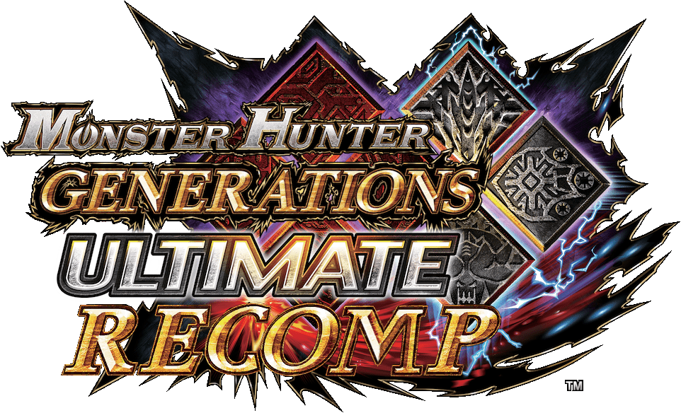

<p align="center"></p>

<p align="center"><b>English</b> · <a href="README.es.md">Español</a></p>

<p align="center">
  <a href="https://github.com/morerokk/MHGURecomp/releases/latest"></a>
  <a href="https://github.com/morerokk/MHGURecomp/releases"></a>
  <a href="#requirements"></a>
  <a href="LICENSE"></a>
  <a href="https://github.com/morerokk/MHGURecomp/stargazers"></a>
</p>

<p align="center">
  <a href="https://discord.gg/mdNPWfKBXf"></a>
  <a href="https://github.com/Oddity-git/MHGURecomp-mods"></a>
</p>

<p align="center">
  <a href="https://github.com/morerokk/MHGURecomp/releases/latest"><b>Download</b></a> ·
  <a href="#installation">Install</a> ·
  <a href="#android">Android</a> ·
  <a href="#controls">Controls</a> ·
  <a href="#settings">Settings</a> ·
  <a href="#mods">Mods</a> ·
  <a href="#building-from-source">Build from source</a>
</p>

# MHGU Recomp

A native PC port of **Monster Hunter Generations Ultimate** (Nintendo Switch, version 1.4.0), made by statically
recompiling the game's 32-bit ARM code to C and running it on a host runtime. Switch system services and the NVN
graphics API are reimplemented on Windows, Linux and Android, with Vulkan for rendering.

> **No game files are included.** You need your own copy of the game, dumped from your own Switch. This project does
> not explain how to dump it and does not provide game files, keys or links to them.

**Status: fully playable**, singleplayer and multiplayer. There will probably be some bugs here and there, please [open an issue](https://github.com/morerokk/MHGURecomp/issues/new/choose) with your `log.txt` if you run into one.

## What it adds over the Switch version

| Area | What you get |
| --- | --- |
| **Graphics** | Resolution, render resolution (supersampling), MSAA, FXAA, FSR 3.1 upscaling, HDR output, VSync, longer draw distance |
| **Screens** | Any widescreen aspect ratio (16:10, 16:9 or anything wider), with HUD adjustment options for ultrawide |
| **Frame rate** | Framerates anywhere between 30-240 fps, with fixes for bugs that GU normally has on emulators at high frame rates |
| **Controls** | Almost any controller is supported (SDL), as well as keyboard+mouse |
| **Multiplayer** | Online play through the "Local Wireless" feature. Comes preloaded with an online server, but you can also host your own or directly connect to friends by forwarding port 39500. |
| **Multiplayer options** | Small monsters are synced between players, monster HP optionally scaled by player count, Village quests playable in Multiplayer Hubs, Urgent Quest credit for everyone |
| **Quality of life** | Fast-forward unskippable cutscenes with A, an in-game PC settings menu (F1 or `Plus`+`Minus`), Discord Rich Presence |
| **Mods and cheats** | Drop-in `mods` folder with load order and conflict checks. Natively supports Forge plugins ([Mods](#mods)), and Ryujinx / Atmosphère cheat files ([Cheats](#cheats)) |

**For AMD FSR 4 support, use this module: https://github.com/Huss3A/mhgurecomp-fsr4-module**

## Requirements

- OS: Windows 10/11 64-bit, or Linux 64-bit with glibc 2.39 or newer. The following Linux distros are known to work (Vulkan support required):
    - Ubuntu 24.04
    - Linux Mint 22
    - Debian 13
    - SteamOS 3.7
    - Arch
    - Fedora 40
- CPU: Any CPU from 2014 or newer (needs AVX2 support)
- GPU: Any GPU from 2016 or newer (needs Vulkan 1.2 support), and at least 1GB of VRAM
- RAM: 4GB
- Android (experimental): a 64-bit ARM device with Android 10+, Vulkan 1.1 and a controller. See [Android](#android).
- The game files for Monster Hunter Generations Ultimate, version 1.4.0. You can extract these from your Switch or Ryujinx with patches pre-applied.
    - (Title ID `0100770008DD8000`, the `main` executable's build ID starts with `FB08F1D20FD1204F`)
 
**For Mac OSX support, please check out mhvuze's fork! https://github.com/mhvuze/MHGURecomp/releases**

## Installation

[Download the latest prebuilt release from the Releases page. Make sure you download the right ZIP file for your desired platform.](https://github.com/morerokk/MHGURecomp/releases)

You need the `exefs` and `romfs` folders from Monster Hunter Generations Ultimate 1.4.0. If you are coming from Ryujinx, you can right-click the game (make sure the 1.4.0 title update is applied), and Extract the game files with the patches pre-applied. Similar functionality also exists in Yuzu, or you can use other tools to extract the game files.

You may be able to extract the files with another tool, just make sure that you extract both the base game files and the 1.4.0 title update. The title update's `exefs` and `romfs` files should be copied on top of the base game's.

1. Extract the release zip anywhere, for example `C:\Games\MHGURecomp\`.
2. Put the game's `exefs` and `romfs` folders in the `data` subfolder. It should look like this:

   ```
   MHGURecomp\
     mhgurecomp.exe
     mhgugame.dll
     (other .dll files)
     data\
       exefs\
         main
         main.npdm
         rtld
         sdk
         subsdk0
       romfs\
         nativeNX\
         (the rest of the game's romfs)
   ```

   `exefs` must come from the 1.4.0 update, and `romfs` must be the base game's romfs with the update's files
   merged over it. You should have about 35,500 files, 12.3 GB.
3. Start `mhgurecomp.exe`.

### Staying up to date

Releases may come out pretty often. To update automatically, start `mhgurecomp-updater.exe` (`mhgurecomp-updater` on Linux). The updater has controller support, so you can safely use it as your main shortcut or add it as a non-Steam game.

- The updater always checks against the latest release on GitHub. Sometimes pre-releases might be available, these won't be offered by the auto-updater since they might be broken.
- Only the recomp files are replaced on update, all other folders (including `data` and `mods` and such) are kept.
- You can change the auto-updater behavior in the settings.
- If you run into any issues, `updater.log` has more information.

### Where things are

| What | Where |
| --- | --- |
| Settings | `mhgurecomp.ini` (safe to delete if you need to reset your settings) |
| Save data | `%APPDATA%\MHGURecomp\save\` (Linux: `~/.local/share/MHGURecomp/save/`), or the folder set as Save folder in the settings menu (Menu Options tab, `SaveLocation` in `mhgurecomp.ini`) |
| Log | `log.txt`, please attach this file when opening an issue |
| Screenshots | `shots\` (press F12) |
| Mods | `mods\` one folder per mod (see below) |
| Engine modules | `engine_modules\` (see below) |
| Cheats | `cheats\` `.txt` files with cheat codes (see below) |
| Shader cache | `cache\` |

To import your existing saves from the Switch, put the `system` and `system_backup` files in `%APPDATA%\MHGURecomp\save\save_0\` (Linux: `~/.local/share/MHGURecomp/save/save_0/`).

### Android

**The Android version is experimental!** You need:

- A phone, tablet or Android TV device with a 64-bit ARM processor, Android 10 or newer, and a GPU driver with Vulkan
  1.1 (FSR needs Vulkan 1.2). Expect a recent mid-range or high-end device (Snapdragon 865 or better) with 6 GB of RAM or
  more; an NVIDIA Shield TV Pro 2019 (3 GB) runs it too, at 41-45 fps in a hunt.
- A controller (Bluetooth or USB). There are no touch controls.
- About 13 GB of free storage for the game files (26 GB while the app copies them in from another folder).

1. Download `Android-MHGURecomp.<version>.apk` from the
   [Releases page](https://github.com/morerokk/MHGURecomp/releases) and open it on the device. Android asks you to
   allow installing apps from your browser or file manager the first time.
2. Put the game's `exefs` and `romfs` folders anywhere on the device (for example in `Download`, or on an SD card),
   both in one folder. Start **MHGU Recomp**: it says the game files were not found and offers **Import game files**.
   Pick the folder that holds `exefs` and `romfs`, and the app copies them into its own folder (a few minutes). You
   can delete your copy afterwards.

   Not enough room, or the files are on a USB drive or SD card? Choose **Use where they are** instead: nothing is
   copied, and the game reads them from that folder, so the drive has to stay connected while you play. Android asks you
   to allow "All files access" for the app. With a large USB drive, the first start can take a couple of minutes.
3. Or copy them from a PC instead: start the app once (it makes its folder), connect the device to your PC with USB
   and choose **File transfer** on the device. On the PC, open the device's storage, go to `Android\data\io.github.morerokk.mhgurecomp\files\` and copy the game's `exefs` and `romfs` folders
   into the `data` folder there:

   ```
   Android/data/io.github.morerokk.mhgurecomp/files/
     data/
       exefs/
         main
         (main.npdm, rtld, sdk, subsdk0)
       romfs/
         nativeNX/
         (the rest of the game's romfs)
   ```

   If the PC doesn't show the `files` or `data` folder, restart the device and connect it again (or create `data`
   yourself). The device's own file manager can't open `Android/data` on Android 11 and newer, so use a PC.
   With [adb](https://developer.android.com/tools/adb) you can push them from a terminal instead:
   `adb push exefs romfs /sdcard/Android/data/io.github.morerokk.mhgurecomp/files/data/`
4. Connect your controller and start the game.

Everything lives in that `files` folder. Its contents match the PC version's game folder:

| What | Where (in `Android/data/io.github.morerokk.mhgurecomp/files/`) |
| --- | --- |
| Game files | `data/exefs/`, `data/romfs/` |
| Save data | `save/save_0/` |
| Settings | `mhgurecomp.ini` (or the in-game settings menu: `Plus`+`Minus`) |
| Log | `log.txt` |
| Mods, cheats | `mods/`, `cheats/` |
| Shader cache | `cache/` |

The settings menu has an **Android** tab (the last one) for what the device's file managers can't do in
`Android/data`:

- **Files folder:** keeps the app's files (settings, save, mods, cheats, screenshots, `log.txt`, `env.txt`) in a folder
  you pick instead of `Android/data`, so the device's own file managers can open them. The app copies its files there
  (files missing there are copied; if files there are older than the app's, the save after playing elsewhere for
  example, it asks whether to replace them, keeping the replaced ones as `.bak`; not the game files, which are then used where they are, nor the shader cache, which is
  made again) and closes; start it again. Android asks you to allow "All files access". **Use the app's folder** copies
  them back, with a progress dialog either way. The app asks once at the first start too (and after a reinstall, which
  forgets the folder: choose it again and what's in it is used; game files left in the app's own folder are deleted by
  the uninstall and need importing again). If the chosen folder can't be used at a start ("All files access" turned
  off, the folder moved or deleted, its drive gone), the app says so and offers to choose it again or use its own folder
  for that time; **Use the app's folder** then forgets it for good.
- **Import save:** pick the `system` and `system_backup` files from anywhere on the device. The app copies them in,
  keeping your current save in `save/save_0.before-import-<date>`, and closes; start it again to play. (Over USB you
  can also put the two files in `save/save_0/` yourself.)
- **Export save:** copies the save's two files out to a folder you pick, as a backup or to move it elsewhere.
- **Save folder:** keeps the save in a folder you pick (the one that holds `save_0`), so file syncing software
  can keep it in step between devices: pick the same folder on each. Android asks you to allow "All files access" for it, since
  the app reads and writes that folder itself. Press Save and start the app again. Your current save isn't moved: use
  **Export save** first to put it in the folder. **Use the app's folder** goes back to the default.
- **Game files folder:** uses the game files where they are (the **Use where they are** of the first start), for
  example on a USB drive or SD card. Android asks you to allow "All files access". Press Save and start the app again.
  **Use the app's folder** goes back to the default.
- **Import game files:** the same import as at the first start (see above), for replacing the game files. They then
  replace any Game files folder as well.
- **Import mod (zip)** and **Import mod (folder):** pick a mod's `.zip` or folder from anywhere on the device, and the
  app puts it in `mods/`. It checks the layout first: the game finds a mod's files in a `romfs`, `exefs` or `nativeNX`
  folder at most three folders down in the mod's folder. If the files are buried deeper (a zip with folders wrapped
  around the mod), or the patch files (`.pchtxt`, `.ips`) aren't in an `exefs` folder, it says so and offers to fix it
  while importing (the files are only moved, never changed). A zip with none of those folders is flagged as not
  looking like a mod, and you can still import it. Close and reopen the app to load the mod.

The FPS counter has a **Battery indicator** next to it (Graphics & Audio): off, in the FPS counter's box, or in a box of
its own.

There is no Restart in the menu on Android (the app can't start itself again): use Exit game and open it again. From the PC version, copy the
contents of `%APPDATA%\MHGURecomp\save\save_0\` (Linux: `~/.local/share/MHGURecomp/save/save_0/`). From a Switch,
use the same files you'd use on PC. Copy `save/save_0/` back to your PC now and then as a backup.

Public internet hubs on Android are shared with other Android players only. To play with friends on PC, all enter the
same matchmaking key (settings menu, Multiplayer).

To update, install the newer APK over the old one: your game files, saves and settings stay. **Don't uninstall it
first.** Uninstalling deletes the whole `files` folder, game files and saves included. Android may offer to keep the
app's data; say yes if you mean to reinstall.

## Controls

Almost every controller under the sun should work, as long as it has SDL support. With more than one connected (a Steam Deck with a controller plugged in, say), press a button on the one you want to use. If you really want to swap the face buttons on non-Nintendo controllers, open the .ini file and set `FaceButtons = Label`, but I recommend installing a mod to match the button prompts instead.

Keyboard and mouse support is also implemented, and currently surprisingly viable. Default keybinds:

| Key | Switch button |
| --- | --- |
| W A S D | left stick (hold Left Shift to walk) |
| Mouse | camera |
| Left click / Right click | X / A |
| Space / R or middle click | B / Y |
| Mouse wheel | item bar: up = the item to the left, down = to the right (in a hunt, no need to hold L) |
| Q / E | L / R |
| Tab / T | ZL / ZR |
| Enter / Backspace | Plus / Minus |
| Arrow keys | d-pad |
| Ctrl / Alt | left / right stick click |

You can change them in the Settings menu (F1), Controls, Keybinds. You can bind up to 2 keys at a time for a single action.

Escape, Insert, F1 and F7 to F12 cannot be bound, as they are reserved by the recomp.

Sometimes the game might ask for keyboard input, such as naming your hunter or renaming item sets. Use the keyboard to enter text, `ENTER` to confirm, or `ESC` to cancel. You can use the `/` key to free-chat in multiplayer lobbies.

Other useful keybinds:

- F1: settings menu
- Alt+Enter or F11: switches between windowed and full screen
- F7: Cycle MSAA
- F12: screenshot

## Settings

You can open the settings menu with F1 on keyboard, or `Plus`+`Minus` (`Start`+`Select`) on controller.

Every setting is also in `mhgurecomp.ini`, with a comment above each one that explains it. Details:
[docs/SETTINGS_UI.md](docs/SETTINGS_UI.md).

<details>
<summary><b>All settings, by section of <code>mhgurecomp.ini</code></b></summary>


- `[Display]`: `Mode` (Borderless / Fullscreen / Windowed), `Resolution`, `RenderResolution` (the 3D resolution),
  `AspectRatio` (Auto follows the window: 16:10 and anything wider fill it, narrower gets 16:10 with bars), `FOV`
  (1.0 = the game's), `UIAnchor` (Center keeps the HUD in the middle 16:9 on an ultrawide screen, Edges spreads it
  to the sides)
- `[Anti-aliasing]`: `MSAA` (Off / 2x / 4x / 8x), `FXAA` (On / Off), `FXAAMode` (Original / 3_11: FXAA 3.11 in
  place of GU's FXAA, sharper textures; default Original)
- `[Upscaler]`: `FSR` (Off / On, default Off), `FSRQuality` (NativeAA / Quality / Balanced / Performance /
  UltraPerformance), `Sharpness`. FSR replaces MSAA and FXAA while it is on. Details: `docs/FSR-PORT.md`
- `[Graphics]`: `DrawDistance` (how far away people in the villages and the Hubs are still drawn: 1 = the game's,
  2 = twice as far, 0.5 = half, 0 = no limit; up to 10)
- `[HDR]`: `HDR` (Off / On, default Off: native HDR10 or scRGB output on an HDR display, a port of the RenoDX HDR mod
  for this game; turn HDR on in the system's display settings first), `PeakBrightness`, `GameBrightness`,
  `UIBrightness` (nits), `ToneMapper` (Vanilla / None / RenoDRT), `GammaCorrection` (Off / 2.2 / BT.1886),
  `Exposure`, `Highlights`, `Shadows`, `Contrast`, `Saturation`, `HighlightSaturation`, `Flare`, `Bloom`,
  `UnclampedScene`, `HDRFormat` (ini only). Use it with FSR off. Details: [docs/HDR.md](docs/HDR.md)
- `[Performance]`: `FPS` (30 to 240), `VSync` (On / Off; above your monitor's refresh rate, turn VSync off), `ShaderPrewarm`
  (On / Off: translate all of the game's shaders in the background at startup, so fewer things are drawn black the
  first time they appear; the first start takes about 20 s for it, during the logos, and the cache folder needs about
  340 MB). `pipelines.list` next to the exe lists the shader combinations the common areas use; with the prewarm on,
  they are prepared in the background as well, so entering those areas for the first time no longer shows surfaces
  briefly black. Only made with MSAA Off; the rest is still prepared the first time it is needed. Recording more of
  it: [docs/PIPELINE_LIST.md](docs/PIPELINE_LIST.md). `LoadingIndicator` (On / Off: the "Loading" box in the bottom
  right corner while the game starts up and prepares its shaders; only in the ini, not in the settings menu)
- `[Controls]`: `FaceButtons` (Position / Label), `MenuConfirm` (the settings menu's confirm button),
  `BackgroundInput` (On / Off: the controller keeps working while the game's window is in the background, such as
  with a wiki in front of it; default On), `ComboInputWindow` (Lenient / Strict: how long the game waits for a
  second button for inputs like the Hunting Horn's X+A; Lenient, the default, as long as at 30 fps at any frame
  rate, Strict a fixed number of frames, shorter the higher the frame rate)
- `[Mouse]`: `MouseSensitivity` (1 = default, 0.1 to 10)
- `[Multiplayer]`: `Port`, `Join` (addresses of hosts outside your LAN), `Server` (hub server for internet hubs:
  empty = the default, `Off` = none, or `host[:port]`), `Key` (matchmaking key: only players with the same key see
  each other's hubs; empty = public, on Android public among Android players only), `SyncSmallMonsters`,
  `ShareUrgentCredit` (default On: an Urgent quest someone else posted counts for you too when you clear it, if you
  have unlocked it yourself)
- `[Monster HP]`: HP factors for 1 to 4 hunters in Hub quests, and per-quest exceptions (default: all 1, the
  original game)
- `[Village Quests]`: `VillageQuestsInHub` (default On), `HubHP` (default 2.0: Village quests posted in the Hub
  multiply their monsters' HP by this first, then by the `[Monster HP]` factor)
- `[Discord]`: `RichPresence` (default On: your Discord profile shows where you are, the monsters you're hunting
  and the map, how many are in your hub or quest; Discord must be running on the same computer), `ShowHunter`
  (default On: your hunter's name, HR and weapon type too)
- `[Bonus Content]`: `BonusContent` (default On), see below
- `[Audio]`: `Volume` (0 to 100: the whole game), `MuteInBackground` (On / Off, default Off: no sound while the
  game's window is in the background)
- `[Application]`: `ConfirmExit` (ask before the window closes), and the settings menu's `Language` (English /
  Spanish), `ButtonIcons` (Xbox / Switch / PlayStation), `Theme` (Hunter, the default / Gold / Blue: the settings menu's colours) and
  `MenuScale` (50 to 200 percent), and `Updates` (Ask / Auto / Off: what `mhgurecomp-updater` does, see "Staying up
  to date"). With the mouse, drag the top of the settings menu (its tabs) to move it, and the grip at its bottom right
  corner to size it; Menu Options > Attach menu puts it back in place.

</details>

## Multiplayer

Over LAN or a VLAN, this should work out of the box. You can automatically see other hubs that are on the same network as you.

The game also comes with my own LDN server preloaded (server software for hosting your own is included in this repo). By default, this lets you see other online players and hubs by using the ingame "Local Wireless" option.

If you only want to play with friends or premade groups, set a matchmaking key in the F1 menu. Everyone who has a matchmaking key set, can only see each other.

See [server/README.md](server/README.md) if you want to host your own LDN server. If the hub server can't be reached, a notice at the top of the screen will tell you. I try to keep the LDN server up 24/7.

You can also play multiplayer without an LDN server if you want to play with your friends. The host needs to forward the right port (39500 TCP/UDP by default), and all clients need to configure the host's IP address in their .ini file. (`Join = xxx.xxx.xxx.xxx`)

Choose the "Local Wireless" multiplayer options, as this port pretends to be a local nearby Switch with a wireless connection. The online options are unavailable and are unnecessary.

### Crossplay with emulators (experimental)

You can also play with people on Ryujinx / Ryubing, and on suyu, yuzu, Eden, Citron and the other forks that kept their multiplayer rooms. This is still experimental: it has been tested against the emulators' server software, but not yet in real hunts with real emulator players. Please [open an issue](https://github.com/morerokk/MHGURecomp/issues/new/choose) with your `log.txt` if something goes wrong.

Some things to know first:
- Crossplay is set up in `mhgurecomp.ini`, under `[Multiplayer]`, not in the F1 menu. If your .ini is from an older version and doesn't have the settings below yet, just add them.
- Everyone needs game version 1.4.0, the emulator players too.
- This port's extras (small monster sync, HP scaling) are off in a hub with emulator players: only players on this port understand them.

**The easy way: one player on this port hosts everything.** The host turns on the servers that are built into the game:

```ini
RyuServe = On        ; for Ryujinx / Ryubing players (TCP port 30456)
RoomServe = On       ; for suyu, yuzu, Eden, Citron... players (UDP port 24872)
RoomPassword =       ; optional: a password for the room
```

These only run while Local Wireless play is open, so the host creates a hub as usual. To play over the internet, the host forwards those ports, or everyone uses a VPN such as Radmin. Then:
- **Ryujinx players** set their LDN server to the host's address (port 30456) and search for hubs in Local Play.
- **suyu / Eden / Citron players** connect to a multiplayer room at the host's IP, port 24872 (with the room password, if there is one).
- **Other players on this port** set `RyuServers = <the host's address>`, so the hub shows up in their Search Hubs.

With both servers on, Ryujinx players and room players all play in the same hub.

**Using a server that already exists:**
- `RyuServers = host[:port], ...`: Ryujinx LDN servers whose lobbies show up in Search Hubs (default port 30456).
- `RyuHost = host`: hubs you create are made on that server, so Ryujinx players on it can join them.
- `RoomServer = host[:port]` and `RoomHost = On`: the same for a suyu-style multiplayer room (default port 24872). `RoomName` is your name in the room, `RoomPassword` its password.
- `RyuHost` and `RoomHost` together make one hub that both Ryujinx and room players can join.
- Please don't use Ryujinx's own public LDN server for this, it's meant for Ryujinx users. Run your own Ryujinx LdnServer, or just use `RyuServe`.

**Good to know:**
- For a private group with Ryujinx players, set `RyuPassphrase` to `Ryujinx-` followed by exactly 8 hex digits (for example `Ryujinx-1a2b3c4d`), and have the Ryujinx players enter the same one. Anything else (a typo too) counts as no passphrase, which means your lobby is **public**. Ryujinx does the same.
- Hubs with both Ryujinx and room players are the least tested. If something odd happens there (players not seeing each other in a quest, for example), try a hub with only Ryujinx players or only room players.
- If things get strange after someone left and rejoined a crossplay hub, make a new hub.

## Bonus content

By default, the `bonus` subfolder in releases contains a savegame with all the free online content (event quests, item packs, palicoes), which will be copied into your savegame when the game starts the 2nd time.

If you don't want this, set `BonusContent = Off` or don't provide a savegame in the `bonus` subfolder. You can also provide your own savegame instead if you want. Note that this port will not attempt to copy bonus content if such bonus content already exists.

## Mods

To install a mod, put the mod folder in `mods\`. Remove the folder to uninstall said mod. Mods are layered over the game at startup.
- romfs mods (files that replace or add game data) are found inside the mod's folder, including the
  `atmosphere\contents\0100770008DD8000\romfs` layout.
- When several mods ship the same game archive (such as `resident_eng.arc`), only the entries each mod changed from the
  game's are applied, so mods that change different files in it work together. If two mods change the same entry,
  the one later in load order wins, and the log says so ("changes ..., which an earlier mod changed too"). Mods load in
  alphabetical order. To choose the order, make `mods\load_order.txt` with one mod folder name per line: then only
  the mods listed load, in that order. The merged archives are kept in `cache\arcmerge\`.
- Partial `.arc` files supported (so `.arc` files that only contain a single entry to replace also work). Entries match the game's by their internal name and type, and
  the archive's version must be the game's (17). An archive that holds none of the game's entries still replaces it
  entirely.
- The **Mods** tab of the settings menu does this without editing files: it lists the mod folders, turns each on or
  off, moves them up or down, and writes `mods\load_order.txt` when Save is pressed (restart to apply; mods you add
  later load too, after the listed ones, until you turn them off; a mod turned off keeps its place in the order). It also compares the mods and lists the ones that change the same game files (and which of
  the two is used), and can apply a suggested order, with the mods that change the most files first.
- exefs patches (`.pchtxt`, `.ips` / IPS32) are applied, to data and to code. The game's code is precompiled, so a
  function a patch changes runs in an interpreter instead (a little slower, only that function). A mod's own code
  modules (`exefs\subsdk1` and so on, as in the
  [MH4U Port](https://github.com/Scrimas/MH4U-port-to-MHGU)) are loaded and run in the interpreter too. The log says
  what was patched and loaded (`[mods]` lines).
- Forge plugins (`.nro` in `romfs\nativeNX\plugins\`) are loaded. Forge's own loader (the `exefs\subsdk9` that
  Forge and mods with Forge plugins include) is not needed and is passed over: the port runs the plugins itself. Forge's menu with the plugins' settings opens with
  Insert (or the key in Forge's own `config.ini`, if a mod includes Forge's files, which can also set `[log] level`),
  or, with a controller alone, with **Open the Forge menu** at the bottom of the settings' Mods tab;
  use the mouse, keyboard or controller in it. On a controller, the button that cancels in the game's menus (when
  nothing in the Forge window is left to cancel) or Start + Back closes it. While it is open the game gets no controller input. Window positions
  are kept in `forge_imgui.ini`.
- For mod makers: besides Forge's API, the port gives mods the mouse: `forge_input_getMouse` (the pointer on the
  1280x720 screen and the buttons), `forge_input_getMouseMove` (the movement, also while the hunt camera has it) and
  `forge_input_setMouseFree` (no capture while a mod's own menu is open). See `runtime/forge.c`.
- You do not need any resolution, FPS cap or connection fix mods. These features are included with this port.

**Places to get mods:**

- [The MHGURecomp-Mods Repo](https://github.com/Oddity-git/MHGURecomp-mods)
- [MHGU GameBanana](https://gamebanana.com/mods/games/17088)

**Modding resources:**
- [MHGU-Modding Wiki](https://github.com/RTHKKona/MHGU-Modding/wiki)
- [Fexty's Forge](https://github.com/Fexty12573/forge)

## Engine modules

Engine modules are native programs that extend the port itself, not the game (for example a different upscaler). They aren't
mods or Forge plugins, and **they run with the same rights as the game, so only install ones you trust**. Nothing loads unless
you ask for it: put the module's folder in `engine_modules\` and add its folder name on a line of its own in
`engine_modules\enabled.txt`. `log.txt` lists what was loaded. Details for module authors: [docs/ENGINE-MODULES.md](docs/ENGINE-MODULES.md).

## Cheats

You can configure cheats in the F1 menu. You can also manually configure them by putting .txt files in the `cheats/` subfolder.

Every cheat starts enabled by default, but can be disabled in the F1 menu. Any cheat code for GU should work, the same way as on an emulator. A file can hold any number of cheats, each
starting with its name in square brackets:

```
[Skill points x2]
04000000 000DFAB4 E1A00080
```

- Turn single cheats on and off in the settings menu (F1), on the Cheats tab. It takes effect immediately when you press Save. Cheat files added, edited or removed count the next time the settings menu opens.
- To turn off a file without deleting it, start its name with `_`.
- Cheats that change the game's code also work, but for each one used, you may experience *very* slight performance loss. For the vast majority of cheat codes, this won't matter.
- `log.txt` lists the cheats it loaded, and any it couldn't read.
- There are some example cheats listed in `extras\cheats\`. [For more, check out the Cheat Codes page on the MHGU Modding Wiki.](https://github.com/RTHKKona/MHGU-Modding/wiki/Cheat-Codes)
    - The Valor Sheathe cheat in this repo does nothing unless you have MHGU Rebalanced installed.
- **Please** notify other players in multiplayer if you're using cheat codes, and what codes you're using. Be nice.

## Building from source

The build recompiles the game code from your own copy of the game. Nothing in this repository contains game code or data, so you will need the extracted game files first (see above).

### 1. Tools (Windows)

1. Install [MSYS2](https://www.msys2.org/) to `C:\msys64`.
2. In the **MSYS2 UCRT64** shell, install the compiler and libraries:

   ```bash
   pacman -S --needed make git diffutils \
     mingw-w64-ucrt-x86_64-clang mingw-w64-ucrt-x86_64-lld mingw-w64-ucrt-x86_64-pkgconf \
     mingw-w64-ucrt-x86_64-sdl3 mingw-w64-ucrt-x86_64-shaderc mingw-w64-ucrt-x86_64-nasm \
     mingw-w64-ucrt-x86_64-vulkan-headers mingw-w64-ucrt-x86_64-vulkan-loader \
     mingw-w64-ucrt-x86_64-vulkan-memory-allocator
   ```

   FFmpeg (for the game's movies) isn't installed: the first build downloads its source and builds the small part the
   movies need into the executable (see "FFmpeg" below).

3. Install [Python](https://www.python.org/) 3.10 or newer for Windows. Then, in a Command Prompt in the repository
   folder, make the tools' virtual environment (the Makefile uses `tools\venv` when it exists):

   ```bat
   py -3 -m venv tools\venv
   tools\venv\Scripts\pip install -r tools\requirements.txt
   ```

### 2. Recompile and build

From the UCRT64 shell, in the repository folder, with your game files in a folder holding `exefs\` and `romfs\` (as
under [Installation](#installation)):

```bash
make gen GAME=/c/path/to/game      # translate the game code to C in generated/ (~300 MB)
make -j4 GAME=/c/path/to/game      # compile everything into build/
```

The first full build takes a while (about 8 minutes on a 4-core Haswell with `-j4`; more cores: higher `-j`). Later
builds only recompile what changed.

`make` turns `build\` into a ready-to-run game folder, and puts nothing else there (the compiler's own files go
to `obj\`):
- `mhgurecomp.exe`, the runtime;
- `mhgugame.dll`, the recompiled game code;
- the MSYS2 DLLs they need;
- `data\exefs` and `data\romfs`, hard links to your game files, so they take no extra disk space.

To play from another folder, copy the contents of `build\` there; to update that folder, copy them over it (`data\`
can be skipped when it is already there). The build never contains settings, caches, mods or logs, so your
`mhgurecomp.ini` and the rest stay as they are. Or start `run-game.bat`: it runs `build\mhgurecomp.exe` with the
settings, caches, `mods\` and `log.txt` in `run\` (`MHGU_HOME`), keeping `build\` clean. Starting
`build\mhgurecomp.exe` directly also works, but then it writes those into `build\`.

Useful targets and options:

- `make test-lift`: checks the recompiler against the Unicorn CPU emulator on thousands of the game's instructions.
- `make clean`: removes the compiled files (`obj\` and the program files in `build\`). It keeps `build\data`.
- `GENARCH=-march=x86-64-v2`: compiles the game code without AVX2, for older CPUs. Untested.
- `FFMPEG=system`: links the system's FFmpeg libraries instead of building them (see below).
- Linux: `SDL3=system`, `SHADERC=system`: link the system's SDL3 / shaderc instead of building them (see Linux).

### FFmpeg

The game's movies are MP4 files with H.264 video and AAC audio. The first build downloads FFmpeg's source
(`third_party/ffmpeg/`, a pinned release checked against its SHA-256), builds only the MP4 reader and those two
decoders into `obj/`, and links them into the executable. Nothing of FFmpeg needs to be installed or shipped, and the
Linux build runs on any distribution whatever FFmpeg version it has (or none). This needs `curl` and, for FFmpeg's
fast x86 code, `nasm` (without it FFmpeg uses plain C, which is fast enough for these movies). It takes a few minutes,
once. FFmpeg is LGPL 2.1; its license goes into `build/licenses/`.

`make FFMPEG=system` links the system's avformat / avcodec / avutil instead (FFmpeg 5.1 or newer), as a
distribution package would; that build then only runs with that FFmpeg version.

### Making a release

<details>
<summary>For maintainers: building and publishing a release</summary>

`make dist VERSION=<the release's tag>` builds everything with that version and packs it for GitHub:

```bash
git fetch --tags                          # (so builds between releases know the last one)
make dist VERSION=0.10.4 BONUS=<path to the bonus savegame's system file>
```

On Windows that writes `dist\Windows-MHGURecomp.0.10.4.zip`; on Linux (or in WSL, with `B=build-linux
O=obj-linux`) `dist/Linux-MHGURecomp.0.10.4.tar.gz`, which keeps the programs executable. Each holds one folder
with `mhgurecomp(.exe)`, `mhgugame.dll` / `.so`, `mhgurecomp-updater(.exe)`, the bundled DLLs, `licenses\`,
`bonus\system` (from `BONUS`, else left empty), and empty `data\`, `mods\` and `cheats\` folders; never anything of
the game's, or the build folder's settings, caches or mods. `make dist` prints each archive's SHA-256. It stops if
`tools/gen.py` or the other translator sources changed since the last `make gen`: run that first.

On Windows, when the Android SDK is installed (see [docs/research/android.md](docs/research/android.md)), `make dist`
then also writes `dist\Android-MHGURecomp.0.10.4.apk`: arm64 only, with `pipelines.list`, `licenses` and the bonus
save inside, signed with the release key. `ANDROID_DIST=` leaves it out. Android only installs an update signed with
the same key as the installed app, so every release needs that key: `%USERPROFILE%\.android\mhgurecomp-release.keystore`
and its password in `mhgurecomp-release.keystore.pass` beside it. Keep both backed up and copy them to every PC that
makes releases. `make dist` stops when the key isn't there; it never makes a new one by itself. A new key means
players have to uninstall first, and uninstalling deletes their game files and saves. (`make PLATFORM=android
release-key` made it once.)

Upload the archives (and the APK) to a GitHub release whose tag is exactly that version (`0.10.4`, no `v`), as a normal release,
not a pre-release. The updater only looks at GitHub's "latest" release, compares its tag with its own version as
numbers (0.10.10 is newer than 0.10.9), and picks the asset starting with `Windows-` (`.zip`) or `Linux-`
(`.tar.gz`, else `.zip`; `ArchLinux-`, the name up to 0.11.4, as well). GitHub records each upload's SHA-256, which the updater checks. To hold a broken release
back, make it a draft or pre-release: the updater then sees the previous one as the latest.

The version comes from `git describe --tags`. A build that isn't exactly a tag (`0.10.3-4-gabc1234`) never updates
itself, so a development build is never replaced by a release (`--update-force` overrides that). Options for testing
the updater: `--update-no-launch` (don't start the game afterwards) and `MHGU_UPDATE_API=<url>` (another "latest
release" address).

`make` fills `licenses\` with everything a copy has to carry: this project's `LICENSE.txt`, `THIRD_PARTY_NOTICES.txt`
(code compiled in), FFmpeg's license, and on Windows the licenses of the MSYS2 packages behind the bundled DLLs and
the libraries linked in. `licenses\README.txt` lists those with their versions and where their exact source is, and
holds a written offer for the source of the LGPL DLL among them (libiconv, which SDL3 uses): whoever publishes the
release makes that offer, so keep those sources at hand for three years (the MSYS2 address it gives is one copy).

The exe creates the `mods` and `cheats` folders and the ini on first start. Players then add their own `data\` as
described above.

</details>

### Linux

Releases include a native Linux build (the Windows build also runs under Proton / Wine). The Makefile picks
`runtime/platform/linux.c` when `uname -s` isn't Windows and everything else is shared. Besides `make`, `git`, `clang`, `lld` and Python 3.10 or newer it
needs:

- the Vulkan loader and headers, plus `curl` and optionally `nasm` for building FFmpeg (see "FFmpeg" above; no
  FFmpeg package needed);
- `cmake` and the development files of what SDL uses on a desktop: X11 (with Xcursor, Xext, Xfixes, Xi, Xrandr,
  Xss, Xtst), Wayland (wayland-protocols, libxkbcommon, libdecor), PipeWire, PulseAudio, ALSA, libudev and D-Bus.
  Like FFmpeg, the first build downloads pinned releases of SDL3 and shaderc (with glslang and SPIRV-Tools) to
  `third_party/`, checked against their SHA-256, and links them in statically, so the game runs on distributions
  that have neither (Ubuntu 24.04 has no SDL3) and the release needs nothing besides glibc, libstdc++ and the
  Vulkan loader. SDL still loads X11 / Wayland and the audio server from the system when it runs, and when the system
  has an SDL3 of the same version or newer (new controllers, fixes), the game uses that one instead: `log.txt` says
  which (`[ui] SDL ...`), and `MHGU_SDL=bundled` keeps the built-in one. That takes a few
  minutes, once; the build stops if SDL didn't find one of those (`SDL3_NEED`). `make SDL3=system SHADERC=system`
  links the system's `libSDL3.so.0` / `libshaderc_shared.so.1` instead, as a distribution package would;
- `vk_mem_alloc.h` (3.4.0) in `third_party/vk_mem_alloc/`, which the Makefile has on the include path (a
  distro package that installs the header where the compiler looks by default works just as well);
- `zenity` or `kdialog` for the dialog on a fatal error. Without either, the message goes to the terminal and
  to `log.txt` as usual;
- for the updater: zlib's headers to build it, and `libcurl.so.4` (curl) when it runs, which SteamOS and the
  usual desktop distributions have. It loads libcurl itself, so without it the updater just starts the game.

```bash
python3 -m venv tools/venv && tools/venv/bin/pip install -r tools/requirements.txt
make gen GAME=../mhgu/game       # as above: the folder holding exefs/ and romfs/
make -j8 GAME=../mhgu/game
cd build && ./mhgurecomp
```

`build/` becomes the game folder exactly as on Windows: `mhgurecomp`, `mhgugame.so` with the recompiled game
code and `data/` as hard links to your game files, nothing else; the ini, caches and `mods/` are written beside
them when it runs (`MHGU_HOME=<folder>` puts those there instead). Saves go to
`$XDG_DATA_HOME/MHGURecomp/save`, default `~/.local/share/MHGURecomp/save` — the folder the Windows build
keeps them in under `%APPDATA%`, same layout, so moving a save across is copying `save_0`.

From Windows, the Linux build can be made in WSL with Arch Linux (`wsl --install -d archlinux`), straight from the
Windows checkout, into its own folders so the Windows build is left alone:

```bash
pacman -Syu --needed make git clang lld python cmake vulkan-headers vulkan-icd-loader nasm vulkan-swrast \
    libx11 libxcursor libxext libxfixes libxi libxrandr libxss libxtst wayland wayland-protocols libxkbcommon \
    libdecor pipewire libpulse alsa-lib systemd-libs dbus
mkdir -p /usr/local/include/vma && cp /mnt/c/msys64/ucrt64/include/vma/vk_mem_alloc.h /usr/local/include/vma/
make -j16 B=build-linux O=obj-linux     # in the repository, under /mnt/c/...
```

Arch has no package for `vk_mem_alloc.h`; MSYS2's (3.4.0) is the one the Windows build uses. `build-linux/data` can
hold links to the game files (`ln -s /mnt/c/.../exefs build-linux/data/exefs`, same for `romfs`, then
`touch build-linux/data/.complete`) instead of a second copy. It also runs there, in a WSLg window, slowly: WSL's
own Vulkan driver (dzn, Vulkan on Direct3D 12) can't create the renderer's pipeline layouts, so use Mesa's software
one with `VK_DRIVER_FILES=/usr/share/vulkan/icd.d/lvp_icd.json`. WSLg can't capture the mouse (clicks still work as
buttons), and screenshots come out black there.

## Repository layout

| Folder | What's in it |
| --- | --- |
| `tools/` | the recompiler: `lifter.py` (ARM to C), `neon.py` (NEON / VFP), `gen.py` (whole modules), `nso.py`, test and research tools |
| `runtime/` | the host side: CPU state, kernel and threads, Switch services (`services/`, `hle/`), networking (`net/`), the NVN graphics API on Vulkan (`nvn/`), settings, input, mods |
| `updater/` | `mhgurecomp-updater`: installs the latest GitHub release over the game folder, then starts the game |
| `docs/` | `STATUS.md`: progress, design notes, reverse-engineering findings, debug options |
| `android/` | the Android app: manifest, Java activities and the APK build (`apk.mk`) |
| `server/` | the hub (LDN) server for online multiplayer, see [server/README.md](server/README.md) |
| `tests/` | host-only tests (settings, settings menu, translations) that need no game files |
| `third_party/` | pinned sources of the libraries built in (SDL3, shaderc, FFmpeg, ImGui, FSR) |
| `extras/` | `cheats/`: cheat files players can copy into their `cheats` folder; `pipelines.list` |

## License

MHGU Recomp's own code is under the MIT License (`LICENSE`). It builds on code from LAS Recomp and Forge, and
bundles cimgui and Dear ImGui, AMD's FidelityFX SDK (FSR 3.1) and FSR-Vulkan, all under the MIT License too: see
`THIRD_PARTY_NOTICES`. The license does not cover
the game or its code, including the recompiled game code a build produces (`mhgugame.dll` / `mhgugame.so`).

## Legal

This project is not affiliated with or endorsed by Capcom or Nintendo. Monster Hunter is a trademark of Capcom. The
repository contains no game code, data or keys; the build reads them from a copy you provide. Please support the
developers by owning the game.
