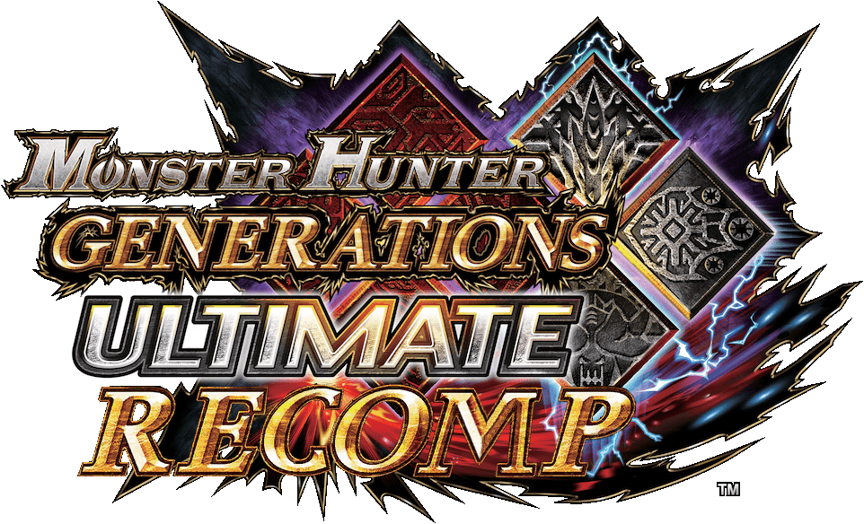

<p align="center"></p>

<p align="center"><a href="README.md">English</a> · <a href="README.es.md">Español</a> · <b>简体中文</b> · <a href="README.ko.md">한국어</a></p>

<p align="center">
  <a href="https://github.com/morerokk/MHGURecomp/releases/latest"></a>
  <a href="https://github.com/morerokk/MHGURecomp/releases"></a>
  <a href="#系统要求"></a>
  <a href="LICENSE"></a>
  <a href="https://github.com/morerokk/MHGURecomp/stargazers"></a>
</p>

<p align="center">
  <a href="https://discord.gg/mdNPWfKBXf"></a>
  <a href="https://github.com/Oddity-git/MHGURecomp-mods"></a>
</p>

<p align="center">
  <a href="https://github.com/morerokk/MHGURecomp/releases/latest"><b>下载</b></a> ·
  <a href="#安装">安装</a> ·
  <a href="#android">Android</a> ·
  <a href="#操作">操作</a> ·
  <a href="#设置">设置</a> ·
  <a href="#模组">模组</a> ·
  <a href="#从源码构建">从源码构建</a>
</p>

# MHGU Recomp

**怪物猎人 XX 超究极版**（Monster Hunter Generations Ultimate，Nintendo Switch，1.4.0 版）的原生 PC 移植版。它把游戏的 32 位 ARM 代码静态重编译为 C 代码，并运行在宿主运行时之上。Switch 的系统服务和 NVN 图形 API 在 Windows、Linux 和 Android 上重新实现，渲染使用 Vulkan。

> **本项目不包含任何游戏文件**。你需要自己的游戏副本，从你自己的 Switch 中导出。本项目不讲解如何导出，也不提供游戏文件、密钥或指向它们的链接。

**状态：完全可玩**，单人和多人均可。难免还会有一些 bug，如果遇到了，请附上你的 `log.txt` [提交 issue](https://github.com/morerokk/MHGURecomp/issues/new/choose)。

> 本文是[英文 README](README.md) 的翻译。如果两者内容不一致，以英文版为准。

## 相比 Switch 版新增的内容

| 方面 | 你能得到什么 |
| --- | --- |
| **画面** | 分辨率、渲染分辨率（超采样）、MSAA、FXAA、FSR 3.1 超分辨率、HDR 输出、垂直同步、更远的绘制距离 |
| **屏幕** | 支持任意宽屏宽高比（16:10、16:9 或更宽），并为超宽屏提供 HUD 调整选项 |
| **帧率** | 帧率可设在 30 到 240 fps 之间，并修复了 GU 在模拟器上高帧率运行时通常会出现的 bug |
| **操作** | 几乎支持所有手柄（SDL），同时原生支持键盘鼠标。 |
| **多人游戏** | 通过「本地联机」（Local Wireless）功能进行在线游戏。预置了一台在线服务器，你也可以自己架设服务器，或者转发 39500 端口直接与好友连接。 |
| **多人游戏选项** | 小型怪物在玩家之间同步，怪物体力可按玩家人数缩放，村任务可在多人集会所中进行，紧急任务对所有人计入 |
| **便利性改进** | 可按 A 快进无法跳过的过场动画，游戏内的 PC 设置菜单（F1 或 `Plus`+`Minus`），Discord 状态显示（Rich Presence） |
| **延迟补偿** | 网络修复和改进的联机代码，与新世代的怪物猎人作品类似。 |
| **模组** | 几乎所有能在模拟器上使用的模组在这里也能用。还原生支持 Forge 插件（[模组](#模组)）！ |
| **金手指** | 几乎所有模拟器金手指在这里也能用。参见（[金手指](#金手指)）。 |

**如需 AMD FSR 4 支持，请使用这个模块：https://github.com/Huss3A/mhgurecomp-fsr4-module**

## 系统要求

- 操作系统：64 位 Windows 10/11，或 glibc 2.39 及以上的 64 位 Linux。以下 Linux 发行版已知可以运行（需要 Vulkan 支持）：
    - Ubuntu 24.04
    - Linux Mint 22
    - Debian 13
    - SteamOS 3.7
    - Arch
    - Fedora 40
- CPU：2014 年及以后的任意 CPU（需要支持 AVX2）
- GPU：2016 年及以后的任意 GPU（需要支持 Vulkan 1.2），且至少 1GB 显存
- 内存：4GB
- Android（实验性）：Android 10 及以上、支持 Vulkan 1.1 的 64 位 ARM 设备，以及一个手柄。参见 [Android](#android)。
- 怪物猎人 XX 超究极版 1.4.0 版的游戏文件。你可以从你的 Switch 或 Ryujinx 中提取已预先打好更新补丁的文件。
    - （Title ID `0100770008DD8000`，`main` 可执行文件的 build ID 以 `FB08F1D20FD1204F` 开头）
 
**如需 Mac OSX 支持，请查看 mhvuze 的分支！https://github.com/mhvuze/MHGURecomp/releases**

## 安装

[从 Releases 页面下载最新的预编译版本。请确认下载的是对应你所用平台的 ZIP 文件。](https://github.com/morerokk/MHGURecomp/releases)

你需要怪物猎人 XX 超究极版 1.4.0 的 `exefs` 和 `romfs` 文件夹。如果你用的是 Ryujinx，可以右键点击游戏（确保已安装 1.4.0 更新），然后选择提取游戏文件并预先打好补丁。Yuzu 也有类似功能，你也可以用其他工具提取游戏文件。

你也可以用别的工具提取文件，只要确保同时提取了本体游戏文件和 1.4.0 更新即可。更新的 `exefs` 和 `romfs` 文件应覆盖复制到本体文件之上。

1. 把发布版的 zip 解压到任意位置，例如 `C:\Games\MHGURecomp\`。
2. 把游戏的 `exefs` 和 `romfs` 文件夹放进 `data` 子文件夹。结构应如下所示：

   ```
   MHGURecomp\
     mhgurecomp.exe
     mhgugame.dll
     (other .dll files)
     data\
       exefs\
         main
         main.npdm
         rtld
         sdk
         subsdk0
       romfs\
         nativeNX\
         (the rest of the game's romfs)
   ```

   `exefs` 必须来自 1.4.0 更新，`romfs` 必须是本体的 romfs 再合并上更新中的文件。合并后大约有 35,500 个文件，共 12.3 GB。
3. 运行 `mhgurecomp.exe`。

### 保持最新

新版本可能发布得相当频繁。如需自动更新，请运行 `mhgurecomp-updater.exe`（Linux 上为 `mhgurecomp-updater`）。更新器支持手柄操作，所以你可以放心地把它当作主快捷方式，或者添加为非 Steam 游戏。

- 更新器始终以 GitHub 上的最新正式版本为准。有时会有预发布版本，但它们可能存在问题，所以自动更新器不会提供它们。
- 更新时只替换重编译程序本身的文件，其他所有文件夹（包括 `data`、`mods` 等）都会保留。
- 你可以在设置中更改自动更新器的行为。
- 如果遇到任何问题，`updater.log` 中有更多信息。

### 文件位置

| 内容 | 位置 |
| --- | --- |
| 设置 | `mhgurecomp.ini`（如需重置设置，可以放心删除） |
| 存档数据 | `%APPDATA%\MHGURecomp\save\`（Linux：`~/.local/share/MHGURecomp/save/`），或设置菜单中「存档文件夹」（Save folder）所指定的文件夹（「菜单选项」标签页，即 `mhgurecomp.ini` 中的 `SaveLocation`） |
| 日志 | `log.txt`，提交 issue 时请附上此文件 |
| 截图 | `shots\`（按 F12） |
| 模组 | `mods\`，每个模组一个文件夹（见下文） |
| 引擎模块 | `engine_modules\`（见下文） |
| 金手指 | `cheats\`，存放金手指代码的 `.txt` 文件（见下文） |
| 着色器缓存 | `cache\` |

如需导入你在 Switch 上已有的存档，请把 `system` 和 `system_backup` 文件放到 `%APPDATA%\MHGURecomp\save\save_0\`（Linux：`~/.local/share/MHGURecomp/save/save_0/`）。

### Android

**Android 版仍处于实验阶段**！你需要：

- 一台搭载 64 位 ARM 处理器、Android 10 及以上、GPU 驱动支持 Vulkan 1.1（FSR 需要 Vulkan 1.2）的手机、平板或 Android TV 设备。建议使用较新的中高端设备（骁龙 865 或更好），内存 6 GB 及以上；NVIDIA Shield TV Pro 2019（3 GB）也能运行，狩猎中约 41-45 fps。
- 一个手柄（蓝牙或 USB）。没有触屏操作。
- 约 13 GB 的可用存储空间存放游戏文件（应用从其他文件夹复制文件期间需要 26 GB）。

1. 从 [Releases 页面](https://github.com/morerokk/MHGURecomp/releases)下载 `Android-MHGURecomp.<version>.apk`，并在设备上打开它。第一次安装时，Android 会要求你允许浏览器或文件管理器安装应用。
2. 把游戏的 `exefs` 和 `romfs` 文件夹放在设备上的任意位置（例如 `Download` 中，或 SD 卡上），两者放在同一个文件夹里。启动 **MHGU Recomp**：它会提示找不到游戏文件，并提供 **Import game files**（导入游戏文件）选项。选择包含 `exefs` 和 `romfs` 的文件夹，应用会把它们复制到自己的文件夹中（需要几分钟）。之后你可以删除自己那份副本。

   空间不够，或者文件在 U 盘或 SD 卡上？那就改选 **Use where they are**（在原位置使用）：不会复制任何文件，游戏直接从那个文件夹读取，所以游玩期间该驱动器必须保持连接。Android 会要求你为应用开启“所有文件访问权限”。如果是大容量 U 盘，第一次启动可能需要几分钟。
3. 也可以改为从 PC 复制：先启动一次应用（它会创建自己的文件夹），用 USB 把设备连接到 PC，并在设备上选择 **文件传输**（File transfer）。在 PC 上打开设备的存储，进入 `Android\data\io.github.morerokk.mhgurecomp\files\`，把游戏的 `exefs` 和 `romfs` 文件夹复制到其中的 `data` 文件夹里：

   ```
   Android/data/io.github.morerokk.mhgurecomp/files/
     data/
       exefs/
         main
         (main.npdm, rtld, sdk, subsdk0)
       romfs/
         nativeNX/
         (the rest of the game's romfs)
   ```

   如果 PC 上看不到 `files` 或 `data` 文件夹，请重启设备后重新连接（或自己创建 `data`）。在 Android 11 及更高版本上，设备自带的文件管理器无法打开 `Android/data`，所以请使用 PC。有 [adb](https://developer.android.com/tools/adb) 的话，也可以在终端里推送：
   `adb push exefs romfs /sdcard/Android/data/io.github.morerokk.mhgurecomp/files/data/`
4. 连接手柄，开始游戏。

所有东西都在那个 `files` 文件夹里。其内容与 PC 版的游戏文件夹一致：

| 内容 | 位置（在 `Android/data/io.github.morerokk.mhgurecomp/files/` 中） |
| --- | --- |
| 游戏文件 | `data/exefs/`、`data/romfs/` |
| 存档数据 | `save/save_0/` |
| 设置 | `mhgurecomp.ini`（或游戏内的设置菜单：`Plus`+`Minus`） |
| 日志 | `log.txt` |
| 模组、金手指 | `mods/`、`cheats/` |
| 着色器缓存 | `cache/` |

设置菜单中有一个 **Android** 标签页（最后一个），用来完成设备上的文件管理器在 `Android/data` 里做不到的事：

- **文件文件夹**（Files folder）：把应用的文件（设置、存档、模组、金手指、截图、`log.txt`、`env.txt`）保存在你选择的文件夹中，而不是 `Android/data`，这样设备自带的文件管理器就能打开它们。应用会把文件复制过去（那里缺少的文件会被复制；如果那里的文件比应用里的旧，例如你在别处玩过之后的存档，会询问是否替换，被替换的文件保留为 `.bak`；游戏文件不复制，之后直接在原处使用，着色器缓存也不复制，会重新生成），然后自动关闭；请重新启动。Android 会要求你开启“所有文件访问权限”。**使用应用文件夹**（Use the app's folder）会把它们复制回来，两种方向都会显示进度对话框。首次启动时应用也会询问一次（重新安装之后也会，因为重装会忘记这个文件夹：再次选择它，里面的内容就会被使用；留在应用自己文件夹中的游戏文件会在卸载时被删除，需要重新导入）。如果某次启动时所选文件夹无法使用（“所有文件访问权限”被关闭、文件夹被移动或删除、所在驱动器不见了），应用会提示，并让你重新选择，或者这一次先使用它自己的文件夹；之后点 **使用应用文件夹** 会永久忘记那个文件夹。
- **导入存档**（Import save）：从设备上任意位置选择 `system` 和 `system_backup` 文件。应用会把它们复制进来，并把你当前的存档保留在 `save/save_0.before-import-<date>` 中，然后自动关闭；重新启动即可游玩。（通过 USB 时，你也可以自己把这两个文件放进 `save/save_0/`。）
- **导出存档**（Export save）：把存档的两个文件复制到你选择的文件夹，用于备份或转移到别处。
- **存档文件夹**（Save folder）：把存档保存在你选择的文件夹中（存放 `save_0` 的那个文件夹），这样文件同步软件就能让它在多台设备之间保持一致：在每台设备上选择同一个文件夹。由于应用要自己读写这个文件夹，Android 会要求你为它开启“所有文件访问权限”。按「保存」后重新启动应用。你当前的存档不会被移动：请先用 **导出存档** 把它放进那个文件夹。**使用应用文件夹** 可恢复默认设置。
- **游戏文件文件夹**（Game files folder）：在原位置使用游戏文件（即首次启动时的 **Use where they are**），例如在 U 盘或 SD 卡上。Android 会要求你开启“所有文件访问权限”。按「保存」后重新启动应用。**使用应用文件夹** 可恢复默认设置。
- **导入游戏文件**（Import game files）：与首次启动时相同的导入（见上文），用于替换游戏文件。导入后它们也会取代已设置的游戏文件文件夹。
- **导入模组（zip）** 和 **导入模组（文件夹）**（Import mod (zip) / Import mod (folder)）：从设备上任意位置选择一个模组的 `.zip` 或文件夹，应用会把它放进 `mods/`。它会先检查目录结构：游戏会在模组文件夹中最多往下三层的 `romfs`、`exefs` 或 `nativeNX` 文件夹里查找模组文件。如果文件埋得更深（zip 中模组外面还包了几层文件夹），或者补丁文件（`.pchtxt`、`.ips`）不在 `exefs` 文件夹中，应用会提示，并可在导入时帮你修正（文件只会被移动，绝不会被修改）。如果 zip 中这些文件夹一个都没有，会被标记为看起来不像模组，但你仍然可以导入。关闭并重新打开应用即可加载该模组。

帧率显示旁边有一个 **电量指示**（Battery indicator，在「画面与音频」中）：可设为关闭、显示在帧率框内，或单独显示在一个框里。

Android 上的菜单中没有「重启」（应用无法自行重新启动）：请使用「退出游戏」后再重新打开。从 PC 版迁移存档时，复制 `%APPDATA%\MHGURecomp\save\save_0\`（Linux：`~/.local/share/MHGURecomp/save/save_0/`）中的内容即可。从 Switch 迁移时，使用与 PC 版相同的文件。请时不时把 `save/save_0/` 复制回 PC 作为备份。

Android 上的公开互联网集会所只与其他 Android 玩家共享。如果要和 PC 上的好友一起玩，所有人都要填写同一个匹配密钥（设置菜单的「网络」标签页）。

更新时，直接把新版 APK 覆盖安装在旧版之上即可：你的游戏文件、存档和设置都会保留。**不要先卸载**。卸载会删除整个 `files` 文件夹，包括游戏文件和存档。Android 可能会询问是否保留应用数据；如果你打算重新安装，请选择保留。

## 操作

只要支持 SDL，几乎所有手柄都能用。如果连接了不止一个（比如插了手柄的 Steam Deck），在你想用的那个上按一下按键即可。如果你确实想在非任天堂手柄上交换面板按键，可以打开 .ini 文件设置 `FaceButtons = Label`，不过我更推荐安装一个模组来让按键提示与手柄对应。

键盘鼠标支持也已实现，而且目前出乎意料地好用。默认按键：

| 按键 | Switch 按键 |
| --- | --- |
| W A S D | 左摇杆（按住左 Shift 慢走） |
| 鼠标 | 视角 |
| 左键 / 右键 | X / A |
| 空格 / R 或中键 | B / Y |
| 鼠标滚轮 | 道具栏：向上 = 左边的道具，向下 = 右边的道具（狩猎中无需按住 L） |
| Q / E | L / R |
| Tab / T | ZL / ZR |
| Enter / Backspace | Plus / Minus |
| 方向键 | 十字键 |
| Ctrl / Alt | 左 / 右摇杆按下 |

你可以在设置菜单（F1）的「控制」>「按键绑定」中修改它们。同一个动作最多可以绑定 2 个按键。

Escape、Insert、F1 以及 F7 到 F12 被重编译层保留，无法绑定。

有时游戏会要求你用键盘输入文字，比如给猎人起名或重命名道具组合。用键盘输入文字，`ENTER` 确认，`ESC` 取消。在多人游戏大厅中可以按 `/` 键自由聊天。在线的集会所或酒馆里，右下角的按键提示会把这个键显示为**聊天**（即使用手柄游玩也显示键盘按键），而游戏本身打开快捷短语和聊天记录的 ZR 提示会改名为**聊天记录**（使用游戏语言的原文）。

其他实用按键：

- F1：设置菜单
- Alt+Enter 或 F11：在窗口和全屏之间切换
- F7：切换 MSAA
- F12：截图
- Pause：暂停游戏，画面变暗并显示 **已暂停**；按 Pause、`ESC` 或 `ENTER` 继续。只能在离线时使用：在大厅中、开启猎人搜索时或
  游戏保存时不起作用。按键在 控制 > 按键绑定 的 **暂停/挂起** 中修改（`[Controls] PauseKey`）

## 设置

在键盘上按 F1，或在手柄上按 `Plus`+`Minus`（`Start`+`Select`），即可打开设置菜单。

所有设置也都在 `mhgurecomp.ini` 中，每一项上方都有一行注释加以说明。详情：[docs/SETTINGS_UI.md](docs/SETTINGS_UI.md)。

<details>
<summary><b>全部设置，按 <code>mhgurecomp.ini</code> 的分节列出</b></summary>


- `[Display]`：`Mode`（Borderless / Fullscreen / Windowed），`Resolution`，`RenderResolution`（3D 渲染分辨率），`AspectRatio`（Auto 跟随窗口：16:10 及更宽的比例会填满窗口，更窄的则显示为带黑边的 16:10），`FOV`（1.0 = 游戏原始值），`UIAnchor`（Center 在超宽屏上把 HUD 保持在中间的 16:9 区域内，Edges 则把它铺到两侧）。窗口会以上次关闭游戏时的位置和大小（直到更改 `Resolution`）在同一台显示器上打开（全屏也是如此），并保持用 F11 / Alt+Enter 切换后的窗口或全屏状态（直到更改 `Mode`），位置保存在 `mhgurecomp.ini` 旁边的 `window.txt` 中（Wayland 除外，那里程序无法自行放置窗口）
- `[Anti-aliasing]`：`MSAA`（Off / 2x / 4x / 8x），`FXAA`（On / Off），`FXAAMode`（Original / 3_11：用 FXAA 3.11 代替 GU 自带的 FXAA，纹理更锐利；默认 Original）
- `[Upscaler]`：`FSR`（Off / On，默认 Off），`FSRQuality`（NativeAA / Quality / Balanced / Performance / UltraPerformance），`Sharpness`。FSR 开启时会取代 MSAA 和 FXAA。详情：`docs/FSR-PORT.md`
- `[Graphics]`：`DrawDistance`（村庄和集会所中的人物在多远距离内仍会被绘制：1 = 游戏原始值，2 = 两倍距离，0.5 = 一半，0 = 无限制；最大 10）
- `[HDR]`：`HDR`（Off / On，默认 Off：在 HDR 显示器上输出原生 HDR10 或 scRGB，移植自本游戏的 RenoDX HDR 模组；请先在系统的显示设置中开启 HDR），`PeakBrightness`、`GameBrightness`、`UIBrightness`（尼特），`ToneMapper`（Vanilla / None / RenoDRT），`GammaCorrection`（Off / 2.2 / BT.1886），`Exposure`、`Highlights`、`Shadows`、`Contrast`、`Saturation`、`HighlightSaturation`、`Flare`、`Bloom`、`UnclampedScene`，`HDRFormat`（仅限 ini）。请在关闭 FSR 时使用。详情：[docs/HDR.md](docs/HDR.md)
- `[Performance]`：`FPS`（30 到 240），`VSync`（On / Off；帧率高于显示器刷新率时请关闭 VSync），`ShaderPrewarm`（On / Off：启动时在后台转换游戏的全部着色器，这样首次出现时显示为黑色的东西会更少；首次启动时这需要约 20 秒，在 Logo 画面期间进行，缓存文件夹需要约 340 MB）。exe 旁边的 `pipelines.list` 列出了常见区域所用的着色器组合；开启预编译后，它们也会在后台准备好，因此首次进入这些区域时不会再短暂出现黑色表面。该列表只在 MSAA 为 Off 时录制；其余部分仍会在首次需要时准备。录制更多组合：[docs/PIPELINE_LIST.md](docs/PIPELINE_LIST.md)。`LoadingIndicator`（On / Off：游戏启动并准备着色器期间，右下角显示的“Loading”框；仅限 ini，设置菜单中没有）
- `[Controls]`：`FaceButtons`（Position / Label），`MenuConfirm`（设置菜单的确认键），`BackgroundInput`（On / Off：游戏窗口位于后台时手柄仍然有效，例如前面开着 wiki 的时候；默认 On），`ComboInputWindow`（Lenient / Strict：对于像狩猎笛 X+A 这样的输入，游戏等待第二个按键的时长；默认的 Lenient 在任何帧率下都与 30 fps 时一样长，Strict 为固定帧数，帧率越高越短）
- `[Mouse]`：`MouseSensitivity`（1 = 默认，0.1 到 10）
- `[Multiplayer]`：`Port`，`Join`（局域网之外的主机地址），`Server`（用于互联网集会所的大厅服务器：留空 = 默认服务器，`Off` = 不使用，或 `host[:port]`），`Key`（匹配密钥：只有密钥相同的玩家才能看到彼此的集会所；留空 = 公开，在 Android 上则只对 Android 玩家公开），`SyncSmallMonsters`，`ShareUrgentCredit`（默认 On：别人发布的紧急任务，只要你自己也已解锁，完成后对你同样计入）
- `[Monster HP]`：集会所任务中 1 到 4 名猎人时怪物体力和部位耐久（硬直、破坏、切断）的倍率，以及针对单个任务的例外设置（默认：全部为 1，即原版游戏）
- `[Village Quests]`：`VillageQuestsInHub`（默认 On），`HubHP`（默认 1.6：在集会所发布的村任务会先把怪物体力和部位耐久乘以这个值，再乘以 `[Monster HP]` 的倍率）
- `[Quest Rewards]`：`HoldASend`（默认 On：任务结束时，在奖励箱的“送入道具箱”画面长按 A，可把道具一个接一个地送入道具箱）
- `[Discord]`：`RichPresence`（默认 On：你的 Discord 个人资料会显示你所在的位置、正在狩猎的怪物和地图，以及你的集会所或任务中有几个人；Discord 必须在同一台电脑上运行），`ShowHunter`（默认 On：同时显示你的猎人名称、HR 和武器种类）
- `[Bonus Content]`：`BonusContent`（默认 On），见下文
- `[Audio]`：`Volume`（0 到 100：整个游戏的音量），`MuteInBackground`（On / Off，默认 Off：游戏窗口位于后台时不发声），`Output`（Stereo，默认 / 5.1：游戏本身以 5.1 混音，与 Switch 的环绕声输出相同；5.1 在环绕声系统上播放，Stereo 则合并为两个声道；按「保存」后生效），`Device`（Default，默认：系统的默认设备，游戏运行中更改也会跟随 / 设置菜单中列出的设备名称：始终使用该设备，断开期间没有声音；按「保存」后生效）
- `[Application]`：`ConfirmExit`（关闭窗口前先询问），以及设置菜单的 `Language`（English / Spanish / 中文，即简体中文 / 한국어，即韩语；新玩家会使用系统语言（如果是其中之一），否则为英语，已保存的 Language 始终保持不变。中文和韩文字形来自程序旁边的 `mhgurecomp-cjk.otf`，否则来自系统字体（Android：Noto Sans CJK）；模组可以以 romfs `nativeNX/forge/fonts/MHGU-CJK.ttf` 的形式自带字体），`ButtonIcons`（Xbox / Switch / PlayStation），`Theme`（Hunter，默认 / Gold / Blue：设置菜单的配色）和 `MenuScale`（50 到 200 百分比），以及 `Updates`（Ask / Auto / Off：`mhgurecomp-updater` 的行为，见“保持最新”）。使用鼠标时，拖动设置菜单顶部（标签页）可移动它，拖动右下角的手柄可调整大小；「菜单选项」>「固定菜单」（Menu Options > Attach menu）可把它放回原位。

</details>

## 多人游戏

在局域网或虚拟局域网中，开箱即可使用。你可以自动看到同一网络中的其他集会所。

游戏还预置了我自己的 LDN 服务器（用来自行架设服务器的软件也包含在本仓库中）。默认情况下，通过游戏内的「本地联机」（Local Wireless）选项，你就能看到其他在线玩家和集会所。

如果你只想和好友或固定队伍一起玩，请在 F1 菜单中设置匹配密钥。设置了匹配密钥的玩家只能看到密钥相同的人。

如果你想自己架设 LDN 服务器，请参阅 [server/README.md](server/README.md)。如果无法连接大厅服务器，屏幕顶部会出现提示。我会尽量让 LDN 服务器 24/7 在线。

如果想和好友一起玩，也可以不用 LDN 服务器进行多人游戏。主机需要转发相应端口（默认 39500 TCP/UDP），所有客户端都要在 .ini 文件中填写主机的 IP 地址。（`Join = xxx.xxx.xxx.xxx`）

请选择「本地联机」（Local Wireless）多人游戏选项，因为本移植版会伪装成一台附近通过无线连接的 Switch。在线选项不可用，也没有必要。

### 与模拟器跨平台联机（实验性）

你也可以与使用 Ryujinx / Ryubing 的玩家一起玩，还有 suyu、yuzu、Eden、Citron 以及其他保留了多人房间功能的分支。这仍处于实验阶段：已经针对这些模拟器的服务器软件进行过测试，但尚未与真实的模拟器玩家在实际狩猎中测试过。如果出了问题，请附上你的 `log.txt` [提交 issue](https://github.com/morerokk/MHGURecomp/issues/new/choose)。

先了解几点：
- 跨平台联机可以在 F1 菜单“网络”页的“模拟器跨平台联机”下设置，也可以在 `mhgurecomp.ini` 的 `[Multiplayer]` 下设置（即下面这些设置）。更改在重启后生效。
- 所有人都需要 1.4.0 版游戏，模拟器玩家也一样。
- 在有模拟器玩家的集会所中，本移植版的额外功能（小型怪物同步、体力缩放）会关闭：只有使用本移植版的玩家才能识别它们。

**简单的方法：由一名使用本移植版的玩家担任所有主机**。主机开启游戏内置的服务器：

```ini
RyuServe = On        ; for Ryujinx / Ryubing players (TCP port 30456)
RoomServe = On       ; for suyu, yuzu, Eden, Citron... players (UDP port 24872)
RoomPassword =       ; optional: a password for the room
```

这些服务器只在本地联机开启时运行，所以主机照常创建集会所即可。如需通过互联网游玩，主机要转发这些端口，或者所有人使用 Radmin 之类的 VPN。然后：
- **Ryujinx 玩家**把 LDN 服务器设为主机的地址（端口 30456），并在本地联机（Local Play）中搜索集会所。
- **suyu / Eden / Citron 玩家**连接到主机 IP、端口 24872 上的多人房间（如果设置了房间密码，需要输入）。
- **使用本移植版的其他玩家**设置 `RyuServers = <the host's address>`，这样该集会所就会出现在他们的「搜索集会所」（Search Hubs）中。

两个服务器都开启时，Ryujinx 玩家和房间玩家都在同一个集会所中游玩。

**使用已有的服务器：**
- `RyuServers = host[:port], ...`：这些 Ryujinx LDN 服务器上的大厅会出现在「搜索集会所」中（默认端口 30456）。
- `RyuHost = host`：你创建的集会所会建在该服务器上，这样其上的 Ryujinx 玩家就能加入。
- `RoomServer = host[:port]` 和 `RoomHost = On`：对 suyu 式多人房间的同样设置（默认端口 24872）。`RoomName` 是你在房间中的名字，`RoomPassword` 是房间密码。
- 同时设置 `RyuHost` 和 `RoomHost`，会创建一个 Ryujinx 玩家和房间玩家都能加入的集会所。
- 请不要为此使用 Ryujinx 官方的公共 LDN 服务器，它是给 Ryujinx 用户用的。请运行你自己的 Ryujinx LdnServer，或者直接使用 `RyuServe`。

**值得注意：**
- 如需与 Ryujinx 玩家组成私人队伍，请把 `RyuPassphrase` 设为 `Ryujinx-` 后接恰好 8 位十六进制数字（例如 `Ryujinx-1a2b3c4d`），并让 Ryujinx 玩家输入同一个口令。其他任何内容（包括打错字）都视为没有口令，也就是说你的大厅是**公开**的。Ryujinx 也是这样处理的。
- 同时有 Ryujinx 玩家和房间玩家的集会所测试得最少。如果在那里遇到奇怪的情况（例如任务中玩家看不到彼此），请试试只有 Ryujinx 玩家或只有房间玩家的集会所。
- 如果有人离开并重新加入跨平台集会所之后情况变得奇怪，请新建一个集会所。

## 赠送内容

默认情况下，发布版中的 `bonus` 子文件夹里有一个包含所有免费在线内容（活动任务、道具包、随从猫）的存档，游戏第 2 次启动时会把这些内容复制到你的存档中。

如果你不想要这些，请设置 `BonusContent = Off`，或者不在 `bonus` 子文件夹中放存档。你也可以改为提供自己的存档。注意：如果你的存档中已经有这些赠送内容，本移植版不会尝试复制。

## 模组

安装模组：把模组文件夹放进 `mods\`。删除该文件夹即可卸载这个模组。模组会在启动时叠加到游戏之上。
- romfs 模组（替换或新增游戏数据的文件）会在模组文件夹中查找，包括 `atmosphere\contents\0100770008DD8000\romfs` 这种结构。
- 当多个模组带有同一个游戏档案（例如 `resident_eng.arc`）时，只应用每个模组相对于游戏原版改动过的条目，因此修改其中不同文件的模组可以共存。如果两个模组修改了同一个条目，加载顺序靠后的那个生效，日志中会注明（“changes ..., which an earlier mod changed too”）。模组按字母顺序加载。如需自定义顺序，请创建 `mods\load_order.txt`，每行写一个模组文件夹名：此时只加载列出的模组，并按该顺序加载。合并后的档案保存在 `cache\arcmerge\` 中。
- 支持不完整的 `.arc` 文件（因此只含一个待替换条目的 `.arc` 文件也能用）。条目按内部名称和类型与游戏中的条目匹配，档案版本必须与游戏一致（17）。如果档案中不含任何游戏原有条目，则仍会整个替换原档案。
- 设置菜单的 **模组** 标签页可以免去手动编辑文件：它会列出模组文件夹，可逐个启用或停用、上移或下移，并在按下「保存」时写入 `mods\load_order.txt`（重启后生效；之后新增的模组也会加载，排在列出的模组之后，直到你停用它们；停用的模组会保留它在顺序中的位置）。它还会比较各个模组，列出修改了相同游戏文件的模组（以及两者中实际使用的是哪个），并可应用建议的顺序，把修改文件最多的模组排在最前面。
- 会应用 exefs 补丁（`.pchtxt`、`.ips` / IPS32），对数据和代码都有效。游戏代码是预编译的，所以被补丁修改的函数会改为在解释器中运行（稍慢一些，且仅限该函数）。模组自带的代码模块（`exefs\subsdk1` 等，如 [MH4U Port](https://github.com/Scrimas/MH4U-port-to-MHGU) 中那样）也会被加载并在解释器中运行。日志中会写明打了哪些补丁、加载了什么（`[mods]` 行）。
- 会加载 Forge 插件（`romfs\nativeNX\plugins\` 中的 `.nro`）。Forge 自己的加载器（Forge 及带 Forge 插件的模组所附带的 `exefs\subsdk9`）不需要，会被跳过：本移植版会自己运行这些插件。包含各插件设置的 Forge 菜单可用 Insert 打开（如果某个模组带有 Forge 的文件，则用 Forge 自己的 `config.ini` 中指定的键，该文件还可以设置 `[log] level`），只用手柄时，则通过设置菜单「模组」标签页底部的 **打开 Forge 菜单** 打开；在其中可以使用鼠标、键盘或手柄操作。使用手柄时，按游戏菜单中的取消键（当 Forge 窗口中已没有可取消的内容时）或 Start + Back 可关闭它。它打开期间，游戏不会接收手柄输入。窗口位置保存在 `forge_imgui.ini` 中。
- 致模组作者：除了 Forge 的 API 之外，本移植版还向模组提供鼠标功能：`forge_input_getMouse`（1280x720 画面上的指针位置和按键），`forge_input_getMouseMove`（移动量，狩猎视角占用鼠标时同样可用）和 `forge_input_setMouseFree`（模组自己的菜单打开时不捕获鼠标）；以及按键绑定功能：`forge_input_setKeybind`（暂时为某个 `[Keybinds]` 行指定其他按键，而不改变玩家的设置），`forge_input_getKeybind`，`forge_input_getModKeybind`（模组为某行设置的按键，如果有的话）和 `forge_input_getKeyPressed`（刚按下的按键名称，供模组自己的按键绑定菜单使用）。设置菜单会显示哪些行被模组设置了。参见 `runtime/forge.c`。
- 你不需要任何分辨率、帧率上限或连接修复类模组。这些功能本移植版都已内置。

**获取模组的地方：**

- [MHGURecomp-Mods 仓库](https://github.com/Oddity-git/MHGURecomp-mods)
- [MHGU GameBanana](https://gamebanana.com/mods/games/17088)

**模组制作资源：**
- [MHGU-Modding Wiki](https://github.com/RTHKKona/MHGU-Modding/wiki)
- [Fexty's Forge](https://github.com/Fexty12573/forge)

## 引擎模块

引擎模块是扩展本移植版本身（而不是游戏）的原生程序（例如另一种超分辨率方案）。它们不是模组，也不是 Forge 插件，而且**它们以与游戏相同的权限运行，所以只安装你信任的模块**。除非你主动要求，否则不会加载任何模块：把模块的文件夹放进 `engine_modules\`，并在 `engine_modules\enabled.txt` 中单独一行写上它的文件夹名。`log.txt` 会列出加载了哪些模块。面向模块作者的详细说明：[docs/ENGINE-MODULES.md](docs/ENGINE-MODULES.md)。

## 金手指

你可以在 F1 菜单中配置金手指。也可以手动配置：把 .txt 文件放进 `cheats/` 子文件夹。

每个金手指默认都是启用的，但可以在 F1 菜单中停用。任何适用于 GU 的金手指代码都应该能用，用法与模拟器相同。一个文件可以包含任意数量的金手指，每个都以方括号中的名称开头：

```
[Skill points x2]
04000000 000DFAB4 E1A00080
```

- 在设置菜单（F1）的「金手指」标签页中可以单独启用或关闭每个金手指。按「保存」后立即生效。新增、编辑或删除的金手指文件会在下次打开设置菜单时生效。
- 想停用某个文件而不删除它，可以在文件名前加上 `_`。
- 修改游戏代码的金手指也能用，但每使用一个，你可能会感受到*非常*轻微的性能损失。对于绝大多数金手指代码来说，这无关紧要。
- `log.txt` 会列出已加载的金手指，以及无法读取的金手指。
- `extras\cheats\` 中列出了一些示例金手指。[更多金手指请查看 MHGU Modding Wiki 上的 Cheat Codes 页面。](https://github.com/RTHKKona/MHGU-Modding/wiki/Cheat-Codes)
    - 本仓库中的 Valor Sheathe（勇气风格纳刀）金手指只有在安装了 MHGU Rebalanced 时才有作用。
- 多人游戏中如果使用金手指，**请**告知其他玩家，以及你用了哪些代码。友善一点。

## 从源码构建

构建过程会从你自己的游戏副本重编译游戏代码。本仓库中不包含任何游戏代码或数据，所以你需要先准备好提取出的游戏文件（见上文）。

### 1. 工具（Windows）

1. 把 [MSYS2](https://www.msys2.org/) 安装到 `C:\msys64`。
2. 在 **MSYS2 UCRT64** shell 中安装编译器和库：

   ```bash
   pacman -S --needed make git diffutils \
     mingw-w64-ucrt-x86_64-clang mingw-w64-ucrt-x86_64-lld mingw-w64-ucrt-x86_64-pkgconf \
     mingw-w64-ucrt-x86_64-sdl3 mingw-w64-ucrt-x86_64-shaderc mingw-w64-ucrt-x86_64-nasm \
     mingw-w64-ucrt-x86_64-vulkan-headers mingw-w64-ucrt-x86_64-vulkan-loader \
     mingw-w64-ucrt-x86_64-vulkan-memory-allocator
   ```

   不需要安装 FFmpeg（用于游戏中的影片）：首次构建时会下载它的源码，只把影片所需的一小部分编译进可执行文件（见下文“FFmpeg”）。

3. 安装 Windows 版 [Python](https://www.python.org/) 3.10 或更高版本。然后在仓库文件夹中打开命令提示符，创建工具所用的虚拟环境（`tools\venv` 存在时 Makefile 会使用它）：

   ```bat
   py -3 -m venv tools\venv
   tools\venv\Scripts\pip install -r tools\requirements.txt
   ```

### 2. 重编译与构建

在 UCRT64 shell 中，于仓库文件夹下执行以下命令，游戏文件需放在一个包含 `exefs\` 和 `romfs\` 的文件夹中（与[安装](#安装)中相同）：

```bash
make gen GAME=/c/path/to/game      # translate the game code to C in generated/ (~300 MB)
make -j4 GAME=/c/path/to/game      # compile everything into build/
```

首次完整构建需要一段时间（在 4 核 Haswell 上使用 `-j4` 约 8 分钟；核心更多就用更大的 `-j`）。之后的构建只会重新编译改动过的部分。

`make` 会把 `build\` 变成一个可直接运行的游戏文件夹，其中不放任何其他东西（编译器自己的文件放在 `obj\`）：
- `mhgurecomp.exe`，运行时；
- `mhgugame.dll`，重编译后的游戏代码；
- 它们所需的 MSYS2 DLL；
- `data\exefs` 和 `data\romfs`，指向你游戏文件的硬链接，因此不占用额外的磁盘空间。

如果要在其他文件夹中游玩，把 `build\` 的内容复制过去即可；要更新那个文件夹，就把它们覆盖复制过去（如果 `data\` 已经存在，可以跳过）。构建结果中从不包含设置、缓存、模组或日志，所以你的 `mhgurecomp.ini` 等文件都会保持原样。或者运行 `run-game.bat`：它会运行 `build\mhgurecomp.exe`，并把设置、缓存、`mods\` 和 `log.txt` 放在 `run\` 中（`MHGU_HOME`），让 `build\` 保持干净。直接运行 `build\mhgurecomp.exe` 也可以，但这些文件就会写进 `build\`。

实用的目标和选项：

- `make test-lift`：在游戏的数千条指令上，用 Unicorn CPU 模拟器检验重编译器。
- `make clean`：删除编译生成的文件（`obj\` 以及 `build\` 中的程序文件）。会保留 `build\data`。
- `GENARCH=-march=x86-64-v2`：不使用 AVX2 编译游戏代码，用于较旧的 CPU。未经测试。
- `FFMPEG=system`：链接系统的 FFmpeg 库，而不是自行构建（见下文）。
- Linux：`SDL3=system`、`SHADERC=system`：链接系统的 SDL3 / shaderc，而不是自行构建（见 Linux 一节）。

### FFmpeg

游戏中的影片是采用 H.264 视频和 AAC 音频的 MP4 文件。首次构建时会下载 FFmpeg 的源码（`third_party/ffmpeg/`，固定版本并校验 SHA-256），只把 MP4 读取器和这两个解码器编译到 `obj/` 中，并链接进可执行文件。无需安装或随附任何 FFmpeg 组件，Linux 版也能在任何发行版上运行，不论其 FFmpeg 版本如何（甚至没有也行）。这需要 `curl`，以及用于 FFmpeg 快速 x86 代码的 `nasm`（没有它的话 FFmpeg 会使用纯 C 代码，对这些影片来说已经足够快）。这一步只需执行一次，耗时几分钟。FFmpeg 采用 LGPL 2.1 许可证；其许可证文件会放进 `build/licenses/`。

`make FFMPEG=system` 会改为链接系统的 avformat / avcodec / avutil（FFmpeg 5.1 或更高版本），就像发行版的软件包那样；这样构建出的程序只能在那个 FFmpeg 版本下运行。

### 发布版本

<details>
<summary>面向维护者：构建并发布一个版本</summary>

`make dist VERSION=<the release's tag>` 会以该版本号构建所有内容，并打包用于 GitHub：

```bash
git fetch --tags                          # (so builds between releases know the last one)
make dist VERSION=0.10.4 BONUS=<path to the bonus savegame's system file>
```

在 Windows 上会生成 `dist\Windows-MHGURecomp.0.10.4.zip`；在 Linux 上（或在 WSL 中，配合 `B=build-linux O=obj-linux`）会生成 `dist/Linux-MHGURecomp.0.10.4.tar.gz`，它会保留程序的可执行权限。每个包中都有一个文件夹，内含 `mhgurecomp(.exe)`、`mhgugame.dll` / `.so`、`mhgurecomp-updater(.exe)`、附带的 DLL、`licenses\`、`bonus\system`（来自 `BONUS`，否则留空），以及空的 `data\`、`mods\` 和 `cheats\` 文件夹；绝不会包含任何游戏的内容，也不会包含构建文件夹中的设置、缓存或模组。`make dist` 会输出每个压缩包的 SHA-256。如果自上次 `make gen` 以来 `tools/gen.py` 或其他转换器源码有改动，它会停止：请先运行 `make gen`。

在 Windows 上，如果安装了 Android SDK（见 [docs/research/android.md](docs/research/android.md)），`make dist` 还会生成 `dist\Android-MHGURecomp.0.10.4.apk`：仅限 arm64，内含 `pipelines.list`、`licenses` 和赠送存档，并用发布密钥签名。`ANDROID_DIST=` 可跳过它。Android 只会安装与已安装应用使用同一密钥签名的更新，所以每个版本都需要这个密钥：`%USERPROFILE%\.android\mhgurecomp-release.keystore`，以及同目录下 `mhgurecomp-release.keystore.pass` 中的密码。请备份好这两个文件，并把它们复制到每台用于发布版本的 PC 上。密钥不存在时 `make dist` 会停止；它绝不会自行生成新密钥。换用新密钥意味着玩家必须先卸载，而卸载会删除他们的游戏文件和存档。（密钥是用 `make PLATFORM=android release-key` 生成过一次的。）

把这些压缩包（以及 APK）上传到一个标签与版本号完全一致（`0.10.4`，不带 `v`）的 GitHub release，作为正式版本发布，而不是预发布版本。更新器只看 GitHub 的“latest”版本，把它的标签与自身版本按数字比较（0.10.10 比 0.10.9 新），并选择以 `Windows-`（`.zip`）或 `Linux-`（`.tar.gz`，否则 `.zip`；也包括 `ArchLinux-`，这是 0.11.4 及以前使用的名称）开头的文件。GitHub 会记录每个上传文件的 SHA-256，更新器会校验它。如果要撤回一个有问题的版本，把它改为草稿或预发布版本即可：更新器就会把上一个版本当作最新版本。

版本号来自 `git describe --tags`。不是恰好对应某个标签的构建（`0.10.3-4-gabc1234`）永远不会自我更新，因此开发版构建不会被正式版本替换（`--update-force` 可以强制更新）。用于测试更新器的选项：`--update-no-launch`（更新后不启动游戏）和 `MHGU_UPDATE_API=<url>`（另一个“latest release”地址）。

`make` 会在 `licenses\` 中放入每份副本必须附带的全部内容：本项目的 `LICENSE.txt`、`THIRD_PARTY_NOTICES.txt`（编译进程序的代码）、FFmpeg 的许可证，在 Windows 上还有附带 DLL 所对应的 MSYS2 软件包以及链接进程序的库的许可证。`licenses\README.txt` 列出了它们的版本以及对应源码的确切位置，并包含一份针对其中 LGPL DLL（libiconv，SDL3 使用它）源码的书面提供承诺：发布版本的人就是作出这项承诺的人，所以请把这些源码保留三年（其中给出的 MSYS2 地址是一份副本）。

exe 首次启动时会创建 `mods` 和 `cheats` 文件夹以及 ini 文件。之后玩家按上文所述放入自己的 `data\`。

</details>

### Linux

发布版包含原生 Linux 版本（Windows 版也可以在 Proton / Wine 下运行）。当 `uname -s` 不是 Windows 时，Makefile 会选用 `runtime/platform/linux.c`，其余部分全部共用。除了 `make`、`git`、`clang`、`lld` 和 Python 3.10 或更高版本之外，还需要：

- Vulkan 加载器和头文件，以及用于构建 FFmpeg 的 `curl` 和可选的 `nasm`（见上文“FFmpeg”；不需要 FFmpeg 软件包）；
- `cmake`，以及 SDL 在桌面环境下所用组件的开发文件：X11（含 Xcursor、Xext、Xfixes、Xi、Xrandr、Xss、Xtst）、Wayland（wayland-protocols、libxkbcommon、libdecor）、PipeWire、PulseAudio、ALSA、libudev 和 D-Bus。与 FFmpeg 一样，首次构建时会把固定版本的 SDL3 和 shaderc（含 glslang 和 SPIRV-Tools）下载到 `third_party/`，校验 SHA-256 后静态链接，因此游戏可以在两者都没有的发行版上运行（Ubuntu 24.04 没有 SDL3），发布版除了 glibc、libstdc++ 和 Vulkan 加载器之外不需要任何东西。SDL 运行时仍会从系统加载 X11 / Wayland 和音频服务器；如果系统中有版本相同或更新的 SDL3（支持新手柄、包含修复），游戏会改用系统的那个：`log.txt` 会写明用的是哪个（`[ui] SDL ...`），`MHGU_SDL=bundled` 则保持使用内置的版本。这一步只需执行一次，耗时几分钟；如果 SDL 没找到上述某个组件，构建会停止（`SDL3_NEED`）。`make SDL3=system SHADERC=system` 会改为链接系统的 `libSDL3.so.0` / `libshaderc_shared.so.1`，就像发行版的软件包那样；
- `third_party/vk_mem_alloc/` 中的 `vk_mem_alloc.h`（3.4.0），Makefile 已将其加入包含路径（如果发行版软件包把这个头文件安装到编译器默认查找的位置，也同样可用）；
- 用于显示致命错误对话框的 `zenity` 或 `kdialog`。两者都没有的话，消息会照常输出到终端和 `log.txt`；
- 用于更新器：构建它需要 zlib 的头文件，运行时需要 `libcurl.so.4`（curl），SteamOS 和常见的桌面发行版都自带它。更新器会自行加载 libcurl，所以没有它时，更新器只会直接启动游戏。

```bash
python3 -m venv tools/venv && tools/venv/bin/pip install -r tools/requirements.txt
make gen GAME=../mhgu/game       # as above: the folder holding exefs/ and romfs/
make -j8 GAME=../mhgu/game
cd build && ./mhgurecomp
```

`build/` 会和在 Windows 上一样成为游戏文件夹：`mhgurecomp`、包含重编译游戏代码的 `mhgugame.so`，以及作为指向你游戏文件的硬链接的 `data/`，此外别无他物；运行时，ini、缓存和 `mods/` 会写在它们旁边（`MHGU_HOME=<folder>` 可改为写到指定文件夹）。存档保存在 `$XDG_DATA_HOME/MHGURecomp/save`，默认为 `~/.local/share/MHGURecomp/save`，对应 Windows 版保存在 `%APPDATA%` 下的那个文件夹，结构相同，所以迁移存档只需复制 `save_0`。

在 Windows 上，可以在装有 Arch Linux 的 WSL（`wsl --install -d archlinux`）中构建 Linux 版，直接使用 Windows 上的代码仓库，构建到独立的文件夹中，不影响 Windows 版的构建：

```bash
pacman -Syu --needed make git clang lld python cmake vulkan-headers vulkan-icd-loader nasm vulkan-swrast \
    libx11 libxcursor libxext libxfixes libxi libxrandr libxss libxtst wayland wayland-protocols libxkbcommon \
    libdecor pipewire libpulse alsa-lib systemd-libs dbus
mkdir -p /usr/local/include/vma && cp /mnt/c/msys64/ucrt64/include/vma/vk_mem_alloc.h /usr/local/include/vma/
make -j16 B=build-linux O=obj-linux     # in the repository, under /mnt/c/...
```

Arch 没有 `vk_mem_alloc.h` 的软件包；MSYS2 的那个（3.4.0）就是 Windows 版构建所用的。`build-linux/data` 中可以放指向游戏文件的链接（`ln -s /mnt/c/.../exefs build-linux/data/exefs`，`romfs` 同理，然后 `touch build-linux/data/.complete`），而不必再复制一份。游戏也能在那里的 WSLg 窗口中运行，但很慢：WSL 自带的 Vulkan 驱动（dzn，基于 Direct3D 12 的 Vulkan）无法创建渲染器的管线布局，所以请通过 `VK_DRIVER_FILES=/usr/share/vulkan/icd.d/lvp_icd.json` 使用 Mesa 的软件渲染驱动。WSLg 无法捕获鼠标（点击仍可作为按键使用），截图在那里也会是黑的。

## 仓库结构

| 文件夹 | 内容 |
| --- | --- |
| `tools/` | 重编译器：`lifter.py`（ARM 转 C）、`neon.py`（NEON / VFP）、`gen.py`（整个模块）、`nso.py`，以及测试和研究工具 |
| `runtime/` | 宿主端：CPU 状态、内核与线程、Switch 服务（`services/`、`hle/`）、网络（`net/`）、基于 Vulkan 的 NVN 图形 API（`nvn/`）、设置、输入、模组 |
| `updater/` | `mhgurecomp-updater`：把 GitHub 上的最新版本安装到游戏文件夹中，然后启动游戏 |
| `docs/` | `STATUS.md`：进度、设计笔记、逆向工程发现、调试选项 |
| `android/` | Android 应用：清单文件、Java Activity 以及 APK 构建（`apk.mk`） |
| `server/` | 用于在线多人游戏的大厅（LDN）服务器，见 [server/README.md](server/README.md) |
| `tests/` | 仅在宿主端运行、不需要游戏文件的测试（设置、设置菜单、翻译） |
| `third_party/` | 编译进程序的库的固定版本源码（SDL3、shaderc、FFmpeg、ImGui、FSR） |
| `extras/` | `cheats/`：玩家可以复制到自己 `cheats` 文件夹中的金手指文件；`pipelines.list` |

## 许可证

MHGU Recomp 自身的代码采用 MIT 许可证（`LICENSE`）。它基于 LAS Recomp 和 Forge 的代码，并附带 cimgui 和 Dear ImGui、AMD 的 FidelityFX SDK（FSR 3.1）以及 FSR-Vulkan，它们同样采用 MIT 许可证：见 `THIRD_PARTY_NOTICES`。该许可证不涵盖游戏本身或其代码，包括构建时生成的重编译游戏代码（`mhgugame.dll` / `mhgugame.so`）。

## 法律声明

本项目与 Capcom 或任天堂无关，也未获得其认可。Monster Hunter 是 Capcom 的商标。本仓库不包含任何游戏代码、数据或密钥；构建过程会从你提供的副本中读取它们。请购买正版游戏，支持开发者。
